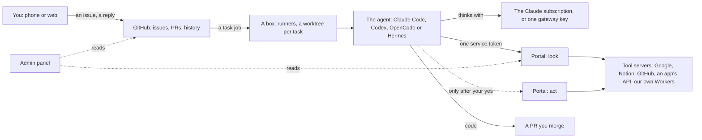
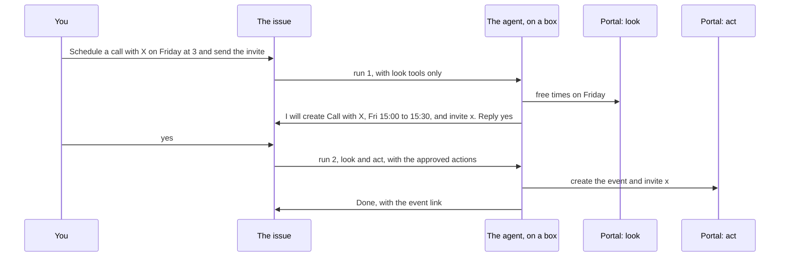

# 0014: Tools and agents: one door for tools, any agent, a yes before acting

## Context
Tasks change code and answer questions from what's on a box and on the web. Next, the owner wants:
- **any tool:** a calendar, docs, email, an app's API ("send me tomorrow's schedule", "schedule
  a call with X on Friday at 3 and send the invite", "write a doc and share it with Y");
- **any agent and model,** Claude first;
- to add a tool without code for each provider, see what's connected, and pay nothing extra;
- to keep what works: asking on GitHub issues, approving by merging, the admin panel to look.

What constrains it (checked on 2026-10-01):
- **A Claude subscription works only in Claude Code itself and claude.ai.** Anthropic: "Using OAuth
  tokens obtained through Claude Free, Pro, or Max accounts in any other product, tool, or service
  — including the Agent SDK — is not permitted". Signing in to "the unmodified Claude Code binary
  with their own Claude subscription" is fine, which is what boxes do. Hermes's Claude sign-in
  only spends a Max plan's extra-usage credits.
- **claude.ai connectors** reach Claude Code only with a claude.ai sign-in. The boxes'
  `claude setup-token` "can only make model requests".
- **MCP is the plug every agent here speaks.** Claude Code (`--mcp-config`), Codex (`url`,
  `env_http_headers`), OpenCode (`remote`, `headers`) and Hermes (`mcp_servers` with `url` and
  `headers`) all reach a remote MCP server and send it headers.
- **Cloudflare's MCP server portals** put many MCP servers behind one URL and Cloudflare Access:
  - Cloudflare keeps each server's sign-in or key, encrypted, and refreshes sign-ins;
  - machines connect with an Access service token;
  - tools switch on and off one by one, or start off;
  - every call is logged;
  - Zero Trust is free up to 50 users, and a portal takes up to 80 servers.

## Options
- **A: Hermes at the centre:** its dashboard, scheduler, chat and memory, with tools by keys in its
  `.env` (+ a big UI and many chat apps / − can't use the subscription; a second platform next to
  issues, with its own scheduler and approvals; a fast-moving Python app, and keys on the Pi).
- **B: claude.ai connectors** (+ tools added with clicks, nothing to host / − Claude only, and each
  box signs in to claude.ai instead of using the setup token).
- **C: tool servers set up per agent on each box** (+ full control / − we handle every provider's
  sign-in, refresh tokens live on boxes, and keys spread over machines).
- **D: a hosted sign-in broker** such as Composio or Pipedream (+ a thousand apps signed in for us /
  − another company sees the data, under its free tier's limits).
- **E: one door.** Every tool is an MCP server behind a Cloudflare portal. Boxes and agents connect
  with one service token. Looking and acting are two portals, and agents are adapters (+ sign-ins
  held and refreshed by Cloudflare, the same tools for every agent, approvals enforced outside the
  model, free, nothing on boxes / − relies on a young Cloudflare feature; tools that need the
  machine itself stay box commands).

## Decision
Chosen **E**:
- **B** stays for the owner's own claude.ai chats.
- **D** may sit behind the portal as one more server, for apps with no MCP server of their own.
- **Hermes** (from A) becomes an optional agent.

### The parts

| Part | What it is | Where it lives | Adding one |
|---|---|---|---|
| Task | an ask: an issue and its status comment | shipify's issues | a form, or plain words |
| Kind | what a task does: change, question, **errand** (new), repeat, operations | the forms and `playbooks/task.md` | a form and a playbook section |
| Box | a machine that runs tasks | runners with labels | `box add` |
| Runner | one job at a time | on the box | `box add --tasks N` |
| Agent | the program that thinks | `executors.json` | one entry |
| Model | what it thinks with | Claude Code: the subscription. Others: one gateway key | a secret and a model name |
| Tool | an MCP server | the portal | the Cloudflare dashboard |
| Skill | how to do a kind of work well | `skills/` | a folder |
| View | where the owner looks | GitHub, the admin panel, Cloudflare | — |

The core names no agent, model or tool. ADR 0010 says this for stacks; it now holds for these too.

### Tools: one door
- **Two portals:**
  - `shipify-look`: reading (search, list, get);
  - `shipify-act`: anything another person sees, or that changes data (send, invite, share,
    create, delete, buy).

  Each tool is switched on in one of them, and a new tool starts off.
- **Sign-ins stay at Cloudflare.** The owner signs in to each server once in the dashboard, or
  pastes its key. Cloudflare keeps it and refreshes it. Shipify never handles a provider.
- **Boxes get one credential:** an Access service token, kept as two GitHub secrets and passed to
  the agent as headers. No tool's sign-in is ever on a box.
- **Every kind of tool joins the same way:**

  | The tool is… | It joins by |
  |---|---|
  | a provider's own MCP server (Google, Notion, GitHub, Linear) | adding its URL to the portal and signing in once |
  | a service with an API key and an MCP server for it | adding that server, with the key as a header |
  | a service with no MCP server (a price API, a home device) | a small MCP Worker built as a Shipify project (a preset `mcp`), its key a Worker secret, behind Access |
  | something only the box can see (its health, its network) | a box command, as today (`ship box health`) |

### Agents: adapters
An `executors.json` entry says how its program takes four things:
- the prompt;
- the tools, as a portal's URL and headers, in that program's own config form;
- the skills;
- the model.

Every run passes the same four, whichever agent it uses:

| Agent | Model | Tools | Skills |
|---|---|---|---|
| Claude Code (default) | the subscription | `--mcp-config`, with `--allowedTools mcp__look__*` | `skills/`, as today |
| Codex | the ChatGPT sign-in, or the gateway | `mcp_servers` with `env_http_headers` | `skills/`, linked where it reads them |
| OpenCode | the gateway: any model | `remote`, with `headers` | `skills/`, linked where it reads them |
| Hermes (optional) | the gateway | `mcp_servers`, with `url` and `headers` | `skills/`, linked where it reads them |

- A task picks its agent with a form field. The default is Claude Code.
- The gateway (OpenRouter or Vercel AI Gateway) is one key with a monthly spending cap, used only
  by agents other than Claude Code.

### Errands: a yes before acting

1. **Look.** The run has `shipify-look` only. The agent gathers what it needs and writes out the
   exact actions ("create 'Call with X', Fri 2 Oct 15:00–15:30, invite x@example.com"), then
   stops with `needs-you`.
2. **You reply yes**, or change it ("make it 4pm"), which plans again.
3. **Act.** The next run also has `shipify-act`, and the approved actions. It does only those, and
   first checks each one isn't already done, so a retry never sends an invite twice. It replies
   with what it did, with links.

Two more rules:
- Actions addressed only to the owner (their own calendar, an email to themself) may be approved
  once, when a repeat is set up ("every weekday at 8, put my day in my inbox").
- A run that breaks halfway says which actions happened, from the tool results; "continue" does
  the rest.

### Boxes and parallel work
- Each runner has its own folder. Each task has its own worktrees, branch and files, and git
  settings of its own for each job (done). One run per task at a time.
- **Labels** say where a task may run: `shipify-box`, the box's name, and what it has (`arm64`,
  `pi`). A task pinned to a box (an `on:homepi` label) runs only there; the Pi health check pins
  to the Pi.
- `box add --tasks N` registers N task runners, and the clock gets its own runner (ADR 0013).
- What matters lives in GitHub and Cloudflare, so a box can be wiped and added again.

### Views
- **GitHub:** asking, approving, history, from the phone app too.
- **The admin panel** (read-only):
  - today: Boxes, Tasks, Keys (adding the service token and the gateway key);
  - new: **Tools** (servers, which tools look or act, recent calls), **Automations** (repeats and
    their next runs), **Usage** (gateway spending).
- **Cloudflare's dashboard:** adding tools, sign-ins, the switches, the call logs.

### When something goes wrong

| What goes wrong | What happens |
|---|---|
| Cloudflare or one tool is down | its calls fail and the agent says which. Code tasks need no tools and carry on; a repeat tries again next time |
| A tool's sign-in expires | Cloudflare refreshes it. If it can't, the Tools view shows it and the agent asks you to sign in again |
| The service token nears expiry | the Keys section warns 30 days ahead |
| Text in an email or page tells the agent to act | the look run can't act; an act run needs your yes on exact actions |
| A box dies during an act run | the task is marked failed; "continue" checks what's done before doing the rest |
| The gateway's cap is reached | runs on other agents fail and say so; Claude Code runs are unaffected |
| Claude's usage limit is reached | the task says when it resets; repeats try again next time |
| We leave Cloudflare | another MCP gateway takes the URL; agents, skills and flows stay |

## Consequences
- **Free:** the Zero Trust free plan, self-hosted runners and the subscription. The gateway is
  paid per use, only for agents other than Claude Code, with a cap.
- **Easier:**
  - a tool reaches every agent at once;
  - no code per provider;
  - every outward action is seen before it happens;
  - no keys on boxes.
- **Harder:**
  - Cloudflare's portal is a dependency, and young;
  - an errand takes two runs with your reply in between;
  - tool calls are logged at Cloudflare, not in GitHub.
- **The roadmap's "no plugins from outside this repo" holds:** tools are services the agent calls,
  switched on by the owner. Code stays in repos.
- **Built in steps,** each one tested with `pnpm verify`, then a real run on the Pi before the next:
  0. **A trial on this PC, with no flow changes.**
     - A look portal with one harmless tool, and a service token.
     - Claude Code (`-p`), OpenCode and Hermes call it with no browser, and the call shows in the
       logs.
     - The open questions below get answered.
  1. **Look tools in tasks:** the adapters in `executors.json`, the service token as secrets, and a
     tools section in the playbook. Questions may use look tools.
  2. **Errands:**
     - the form and the kind, the actions in the result, the yes, and the act run;
     - retries that never do anything twice;
     - Google Calendar and Docs as the first tools.
  3. **Boxes:** labels and pinning, `--tasks N`, the clock's own runner.
  4. **Agents and models:** an agent per task, the gateway key, OpenCode, and Hermes if wanted.
  5. **Views:** Tools, Automations and Usage in the admin panel; the token and the key in Keys.

## Open questions (step 0 answers them)
- **Google:** its official MCP servers are a developer preview, by invitation. The alternatives
  are a community server run as a Worker, or Composio behind the portal.
- **The portal's limits** on the free plan.
- **Keeping an act run to the approved tools** with agents that have no per-tool allowlist.

## Confirmation
- **Step 0:** Claude Code, OpenCode and Hermes list and call the same tool through the portal,
  with no browser, and the calls show in its logs.
- **Errands:** "schedule a call with X on Friday at 3 and send the invite" creates exactly one
  event after one yes, and none without it.
- **Safety:** a calendar event whose text asks the agent to email someone leads to no email.
- **Tests:** the adapters write each agent's config, and an act run never starts without the
  owner's yes.
