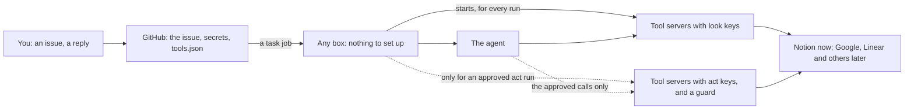

# 0015: Tools from one file in the repo, keys in GitHub, started for each run

## Context
ADR 0014 chose a Cloudflare MCP portal as the one door for tools. Its trial (step 0) found that a
portal needs "an active domain on Cloudflare for the portal URL", and the owner wants no paid
parts. The rest of 0014 stands: agents are adapters, looking and acting are separate, an errand
asks before acting, and the admin panel shows it all.

Also found:
- Notion's hosted MCP server signs in only through a browser.
- Notion's local MCP server is "no longer actively maintained or supported".

Wanted:
- free, and any agent;
- nothing to look after;
- a new box needs no setup for tools;
- start small, with Notion: read your tasks, mark one done, save a note.

## Assumptions, checked (2026-10-01)

| Assumption | How it was checked |
|---|---|
| A tool's key reaches its server through `${VAR}` in the agent's config, with no secret in any file | The real Claude CLI (2.1.283) and a test server: the server saw the 6-character key from `${SHIPIFY_TEST_KEY}` |
| A run can have a server's read tools and be denied its write tools | The real CLI, `--allowedTools` and `--disallowedTools`: the write tool wasn't offered, and the server logged only the read |
| A guard can let through only an approved write | The real CLI, a `PreToolUse` hook given with `--settings`: it blocked `write_note("hi")` and passed `write_note("approved text")`. The server logged only the approved one |
| Other agents can limit a server's tools | Their docs: Codex `enabled_tools` and `disabled_tools`; OpenCode allow, ask or deny with `server_*`; Hermes `include` and `exclude`. Each is tested when it's added |
| Notion on the free plan can search, read, query, update and create through its API | Notion's API docs. The limit is 180 requests a minute (3 a second) on plans below Business, with a 429 and `Retry-After` when exceeded |
| A Notion key sees only the pages connected to it, and can be made read-only | Notion's docs: connections (⋯ → Connections), and the capabilities "Read content", "Update content", "Insert content". **Step 1's first live test:** a write with the read-only key is refused |
| Notion keys don't expire | **Not stated by Notion.** `ship doctor` calls Notion with each key and reports one that's refused |
| A secret can reach only act runs | A GitHub expression in the run step's env: `${{ inputs.reason == 'act' && secrets.X \|\| '' }}`. **Tested in step 2** |

## Options
- **A: buy a domain and keep the portal** (+ 0014 as it is / − about $9 a year: declined).
- **B: Notion's local server, pinned** (+ nothing to write / − unmaintained, and its tool names are
  generated from Notion's API spec, so they can change under us).
- **C: our own gateway Worker on workers.dev,** a self-built portal (+ keys off the boxes / − we'd
  build and keep up OAuth, a proxy and logs).
- **D: tools from one file, started on the box for each run.** Where a provider has no good server,
  ours: a small one in this repo (+ free, any agent, nothing on boxes, keys in GitHub like today's /
  − a key is in the run's environment, so read-only keys and connected pages limit what it can reach).

## Decision
Chosen **D**. C stays the way to move keys off boxes later, with `tools.json` unchanged.



### Where everything lives
Everything lives on GitHub. A box only lends its machine while a run happens, as it does for tasks
today, and keeps nothing afterwards: wipe it or add a new one, and it works the same.

| What | Where it lives | On a box |
|---|---|---|
| The ask, the plan, your `yes`, the result | the issue | — |
| Which tools exist, and which calls look or act | `tools.json` in this repo | — |
| Our Notion tool's code, the skills, the playbook | this repo | checked out for the run |
| The keys | shipify's GitHub secrets | in the run's memory only, gone when it ends |
| A tool server | — | a process the agent starts during the run; it stops with the run |
| What happened | the issue, and the run's log in Actions | — |

The runs stay on boxes rather than GitHub's machines, which would also work: a box is free and
unlimited and keeps the projects warm, while GitHub's machines have 2,000 free minutes a month for
private repos.

### `tools.json`
It sits in this repo, next to `executors.json`, and changes by PR:

```json
{
  "notion": {
    "run": ["tools/notion/server.ts"],
    "keys": { "NOTION_TOKEN": { "look": "SHIPIFY_NOTION_READ", "act": "SHIPIFY_NOTION_WRITE" } },
    "look": ["search", "read_page", "read_database", "query_database"],
    "act": ["update_page", "create_page"]
  }
}
```

- **`run`:** the server to start, either a pinned package's command or ours under `tools/`.
  Alternatively, `url` and `headers` name a remote server that takes a key.
- **`keys`:** the server's variables and the GitHub secrets they come from: a look key and an act
  key. Where a provider can't make a read-only key, both name the same secret and the entry says
  `"oneKey": true`. Look runs then rely on the agent's tool list alone, and the docs say so.
- **`look` and `act`:** every tool the server has, sorted into one of the two. A tool in neither
  list is never offered. A test starts each server, lists its tools and fails on any that isn't
  sorted, so an update can't slip a new tool in.

### A run, on the box
1. **Picks the tools:** every agent run gets the look tools; only an act run gets the act tools.
2. **Writes the agent's config** for them into `.tasks/<n>/`: the servers, `${VAR}` references
   instead of keys, and the allow and deny lists.
3. **Passes the agent only those keys,** with the others blank. Act keys are never in a look run's
   job: `task.yml` passes them only when the run's reason is `act`.
4. **A missing key** leaves that tool out, and the prompt says so ("Notion isn't connected: …").

### Our Notion tool
About 150 lines in `tools/notion/`, with tests. It uses Notion's REST API with a pinned
`Notion-Version`, through the official MCP SDK.

- **Look:**
  - `search`: pages and databases, by words;
  - `read_page`: properties and content, as text;
  - `read_database`: its properties and their choices, so a status is only set to one that exists;
  - `query_database`: rows, with a filter, 25 at a time.
- **Act:**
  - `update_page`: properties, such as Status to Done;
  - `create_page`: in a database or under a page, with text.
- It waits as Notion asks on a 429 (up to three times) and keeps its answers short.
- It says plainly when a page isn't connected: "connect it in Notion: ⋯ → Connections → Shipify".

### Errands: a yes before acting
The concrete form of 0014's errands:

1. **Plan.** The look run ends with `actions` in its result: for each one, a tool, its exact input
   and a sentence. The box posts them and records their fingerprint, and the task waits on you
   (`needs you`).
2. **Your `yes`.** An exact command, matched by the box, that comes after that post. The box then
   starts an act run (a dispatch with reason `act`).
3. **Act.**
   - The act run checks the approval again: your `yes`, after the post, the same fingerprint, and
     no edit since.
   - It then runs the agent with the act tools and a guard that lets through only the approved
     calls, each once.
   - It replies with what was done, from the guard's log rather than the agent's word, with links.
- **`no`, a new comment, or an edit** drops the plan. A comment plans again.

### Agents and keys
- **Claude Code first:** its allow and deny lists, and the guard as a hook.
- **Codex, OpenCode and Hermes** get look tools through their own lists when they're added (0014,
  step 4). An act run needs a guard for each call, so act runs stay with Claude Code until another
  agent has one.
- **Keys** live in shipify's GitHub secrets, set by the owner with `gh secret set`. The Keys section
  lists them with their dates, and `ship doctor` calls each provider once with each key.

### Adding a tool is a task
"Add Todoist tools" is a task like any other. The agent:
1. finds the provider's MCP options and picks one with a key that lasts: a server the provider
   runs, a maintained package, or, where neither exists, a small server of ours in `tools/`;
2. writes the `tools.json` entry, pins the package, and adds the key's line to `task.yml`;
3. runs `ship tools check`, which starts each server and lists its tools, and sorts every tool into
   look or act (CI runs the same check);
4. opens a PR saying exactly which key to create, with which permissions, and the `gh secret set`
   line.

You create the key, set it, and merge. A tool with a key and an MCP server already takes minutes of
the agent's time. One we write ourselves (as with Notion) is a small change with tests. A provider
that allows only a browser sign-in gets its own plan first (Upkeep, below).

### Upkeep: kept small on purpose
Rules every tool follows, so tools don't turn into upkeep:
- **Keys that last.** A tool joins with a key that doesn't expire, or expires at most yearly with
  the Keys section's 30-day warning.
- **No browser sign-in on a box,** ever. A provider that only allows one (Google's sign-in, Notion's
  hosted server) waits for its own plan.
- **A tool joins when a real task needs it,** not before, and leaves by deleting its entry.
- **Our own tools offer only the calls tasks use** (six for Notion). Their names never change, and
  the provider's API version moves only when we choose.
- **Every part says what expires, who renews it, and how you hear.**

The whole yearly upkeep, with Notion added:

| What | How often | Effort |
|---|---|---|
| This PC's GitHub token, Claude's token, and Cloudflare tokens that have a date | about once a year each, warned 30 days ahead in Keys | a couple of minutes each |
| Notion keys | none expected; `ship doctor` says if one is refused | none |
| Updates to the MCP SDK | Dependabot PRs, tested by CI | merge when green, as for other packages |
| Our Notion tool | only when Notion retires the API version it pins (old ones keep working for years) | a small change with tests |

### Edge cases

| Situation | What happens |
|---|---|
| **Setup** | |
| No Notion key set | Notion is left out of every run, and the prompt says how to add it. Tasks are otherwise unchanged |
| Only the read key | Looking works. An errand that would change Notion says there's no write key |
| A page isn't connected to the integration | Notion answers "not found"; the tool says to connect it (⋯ → Connections → Shipify) |
| A new box | Nothing to do: the tool is in this repo and installed by the job's `pnpm install`, and the keys come from GitHub |
| You replace a key | `gh secret set` again; the next run uses it |
| **Running** | |
| Notion is slow or down | The tool stops waiting after 30 seconds and says so. A question answers with what it has; an act run reports what it did and didn't do |
| Notion rate-limits (429) | The tool waits as `Retry-After` says, up to three times |
| A huge database | Queries return 25 rows a page, with short properties, and say when there are more |
| Two tasks at once (`--tasks 2`) | Each run starts its own tool servers; nothing is shared |
| A tool server crashes | The agent sees its tools gone and says so; the run carries on without it |
| **Permissions** | |
| A look run tries to change something | The act tools aren't offered, and the read key can't write anyway: Notion refuses |
| A server update adds an unsorted tool | CI fails on the update until the tool is sorted into look or act, or left off |
| An agent with no per-tool list | Gets no tools |
| A page's text tells the agent to change something | Look runs can't. An act run makes only the approved calls |
| **Errands** | |
| A `yes` before the plan, or from someone else | Ignored |
| An edit or a new comment after the plan | The plan is dropped; a comment plans again |
| Two `yes` | The first starts the act run; a plan is used once |
| The world changed (the task is already Done) | The act run checks first and says it's already done |
| An act run breaks halfway | The reply lists what was and wasn't done, from the guard's log; "continue" plans the rest |
| An act run started without a valid `yes` (a dispatch by hand) | It checks, does nothing, and says why |
| A plan left for more than 24 hours | Planned again before acting |
| **Repeats** | |
| A repeat that only reads (a daily digest of open tasks) | Look tools; no `yes` needed |
| A repeat that would change things each time | It asks each time. Approving changes to your own data once, when a repeat is set up, comes later |
| **Upkeep** | |
| Notion changes its API | Our tool pins `Notion-Version`; moving to a new one is a change with tests |
| A key stops working | `ship doctor` reports it, a run that meets it says so, and Keys shows the date it was set |
| The MCP SDK updates | Dependabot opens a PR; CI runs the tool's tests |
| **Privacy** | |
| Notion text in a run | It goes to the model, as code does. Logs keep the agent's summary only, in this private repo |

## Consequences
- **Free:** no new services; any box works with no setup.
- **Replaces 0014's portal,** its step 0 and the domain. The rest of 0014 stands.
- **Easier:** a tool is one entry, one pinned package or a small server, and its keys.
- **Harder:** keys are in each run's environment, limited by read-only keys and connected pages.
  Option C can move them off boxes later.
- **Built in steps,** each one tested, then run for real on the Pi before the next. Steps 1 and 2
  reach the owner together, as the first version: reading alone isn't useful enough. Every change
  asks for a `yes`, including changes to the owner's own Notion.
  1. **Look tools, with Notion:**
     - `tools.json` and our Notion tool's look tools;
     - the Claude Code adapter, and keys in `task.yml`;
     - the sorted-tools test, `docs/tools.md`, a Notion skill, and the playbook.

     Live test: "question: what's open in my Tasks?", then a write with the read key is refused.
  2. **Errands:**
     - `actions` in the result, the exact `yes` and the act run;
     - the guard, the report, and the 24-hour rule.

     Live test: "mark *Pay rent* done" makes one change after one `yes`, and none without it. A
     page whose text asks for another change gets none.
  3. **Views:** Tools in the admin panel, the Notion keys in Keys, and the key check in `ship doctor`.

  Later: look tools for Codex, OpenCode and Hermes (0014, step 4), Google, Obsidian as a git
  repo, and keys off the boxes (C).

## Confirmation
- **Tests:**
  - every tool is sorted;
  - the adapters write configs with no secrets in them;
  - an act run never starts without a valid `yes`;
  - the guard blocks calls that weren't approved.
- **Live:** each step's test on the Pi, above.
