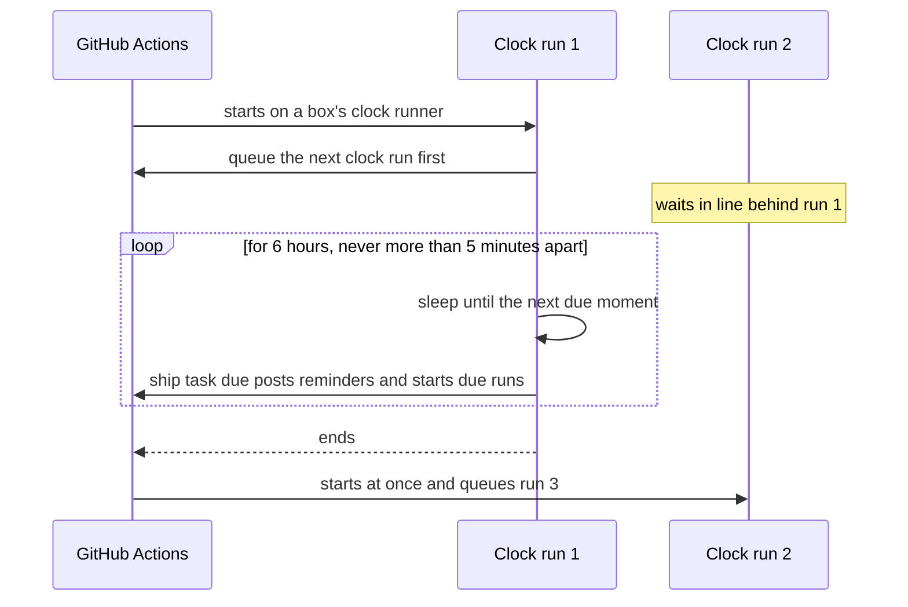

# 0016: The clock keeps itself going: each clock run queues the next

## Context
ADR 0013's clock (`automations.yml`, every 15 minutes) is started by GitHub's scheduler, and so is
the weekly clean-up (`task.yml`, Mondays). In this repo the scheduler has never fired:
- not since the clock was added at 06:52 UTC on 2026-10-01;
- not after four commits to `main`, or after switching the workflow off and on;
- not for two test workflows that tick every 5 minutes, one on GitHub's machines and one on a box.

GitHub calls the scheduler best effort. Reports of it never firing in some private repos, while
`workflow_dispatch` works, are open and unanswered from July to September 2026. Without a working
clock, the Pi health check (shipify #16) doesn't run at 09:00, and no repeat does.

Wanted: on time, free, no service outside GitHub and the boxes, surviving restarts, nothing to
watch.

## Assumptions, checked (2026-10-01)

| Assumption | How it was checked |
|---|---|
| A run can queue its own next run with its own token | Live: a three-link test chain on homepi. Each link queued the next with `github.token`; the next waited behind it and started 14 seconds after the one before ended |
| A queued run waits for a free runner | GitHub's docs: "If the job remains queued for more than 24 hours, the job will fail." Shorter waits are fine |
| A queued run keeps the commit it was queued at | Live: all three links ran the commit current when the first was queued |
| A run's token lasts long enough | GitHub's docs: on self-hosted runners it's refreshed for up to 24 hours. Each clock run lasts 6 |
| A box's runner time is free | Self-hosted runners use no GitHub minutes, as every task already does |
| GitHub's scheduler doesn't fire here | Live: 0 scheduled runs, including the two test workflows (above) |
| A box restart doesn't lose the queued run | It follows from the queueing rule above. **Live check:** the next 04:30 restart after step 2 (there is one whenever an update needs it) |

## Options
- **A: wait for GitHub's scheduler** (+ nothing to build / − it doesn't fire here, and nobody can say
  when it will).
- **B: an outside cron service** that starts the clock (Cloudflare, cron-job.org) (+ exact / − a
  service outside GitHub, and a key kept there: declined).
- **C: cron on a box** (ADR 0013's option A) (− GitHub keys kept on the box; rejected there).
- **D: each clock run queues the next,** on a small clock runner on every box (+ only GitHub and the
  boxes, free, on time to the minute, survives restarts / − one more runner per box. A chain that
  breaks needs a nudge, and task runs, `ship doctor` and the box commands give one).

## Decision
Chosen **D**.

### How it works
1. **A clock runner on every box.** `box add` and `box up` register a second runner,
   `<box>-clock`, labelled `shipify-clock`, as its own service from the same unit definition, in its
   own folder. Only the clock runs there, so tasks never wait for it and it never waits behind a
   task.
2. **A clock run** (`automations.yml`, `runs-on: [self-hosted, shipify-clock]`):
   - **first queues the next clock run** (a dispatch with its own token), retrying 3 times;
   - **then ticks for 6 hours:**
     - it runs `ship task due`, which now also returns the next due moment;
     - it sleeps until that moment, or for 5 minutes at most, so a 09:00 reminder goes out at
       09:00 and a repeat set up mid-sleep waits at most 5 minutes;
   - **ends after 6 hours,** and the queued run starts straight away.
3. **New code arrives within a tick.** Each tick compares `main`'s newest commit with its own. When
   `main` is newer, it queues a fresh next run, which replaces the queued one, and ends.
4. **Everything time-based starts from the clock:**
   - repeats, as above;
   - **the weekly clean-up** (`task sweep`, `doctor`, cache prune): when Actions shows no clean-up
     run in the last 7 days, the clock starts one, as a `task.yml` dispatch with reason `sweep`.

   GitHub's schedule lines stay as a backup: if the scheduler ever fires, its run simply joins the
   chain.
5. **Bringing it back when the chain breaks:**
   - every task run checks for a clock run that's running or queued, and starts one if there's
     none;
   - `ship doctor --yes`;
   - `ship box add`, `start` and `restart`.

   No clock state of its own exists to lose.
6. **Seeing it:** `ship box list` and the admin panel show clock runners as "clock", never as a
   task runner stuck busy. The admin panel's Automations view (ADR 0014, step 5) shows the clock's
   last tick and the next due moment.

### Where everything lives

| What | Where |
|---|---|
| The clock's workflow and code | this repo |
| When each repeat is due | its status comment (ADR 0013), unchanged |
| When the last clean-up ran | Actions' run history |
| On a box | a runner registration and its service, made again by `box add` |

### Edge cases

| Situation | What happens |
|---|---|
| No box online | The queued run waits, up to 24 hours. Overdue repeats run once when a box is back |
| Every box off for more than 24 hours | The queued run fails. The first task run, `ship box start` or `ship doctor --yes` after that starts the clock again |
| A box restarts during a clock run (04:30 updates) | That run is lost; the queued one starts when the box is back |
| Two boxes | One clock at a time (one concurrency group), on whichever clock runner is free. If one box dies, another's clock runner takes the queued run |
| Queueing the next run fails three times | The run's log says so. The next task run, `ship doctor` or a box command starts the clock again |
| Someone starts the clock by hand, or GitHub's scheduler fires | That run waits behind the running clock and replaces the queued one, so there's still one chain |
| A tick fails (GitHub's API is down) | It's logged, and the next tick tries again. A due job stays due, so nothing is skipped |
| A tick takes long (many repeats) | Ticks never overlap: the run is one loop |
| A task runs during a clock run | It runs on the task runner, undelayed |
| `ship box stop` | It stops both runners, and `ship box start` starts both and the clock |
| Tokens | Each run lasts 6 hours, well within its token's 24 |
| Cost | Free: a box's runner time costs no minutes, and between ticks the clock is a sleeping process that uses no CPU |
| Actions history | About 4 clock runs a day instead of 96, each with one line per tick |

## Consequences
- **Changes how ADR 0013's clock is started, and where it runs.** Repeats themselves (kinds, the
  form, quiet runs, pausing) are unchanged.
- **The weekly clean-up no longer depends on GitHub's scheduler.**
- **Each box runs one more small runner,** a few dozen MB of memory, mostly asleep.
- **Built in steps,** each tested, then live on the Pi before the next:
  1. **The clock runner:**
     - `box add` and `box up` register it; `box start`, `stop`, `restart`, `remove` and `list` handle
       it; the admin panel shows it as "clock";
     - the owner runs `pnpm ship box add shipify-pi --yes` once, which asks for the Pi's password.
  2. **The self-renewing clock:**
     - the loop, queueing the next run, the 6-hour hand-over and the early hand-over on new code;
     - `ship task due` returning the next due moment, and the revival checks in task runs and
       `ship doctor`.

     Live: a reminder set for an exact minute arrives on that minute; the chain carries on after a
     box restart; a task during a clock run isn't delayed.
  3. **The weekly clean-up from the clock.** Live: it runs once when the last one is a week old,
     and not again until the next week.

## Confirmation
- **Tests:**
  - the next due moment;
  - the sleep is never longer than 5 minutes;
  - the hand-over when `main` is newer;
  - the clean-up is due after 7 days, and not before;
  - a task run starts the clock only when none is running or queued.
- **Live:** each step's checks on the Pi, above. `ship doctor` reports a clock with no tick in
  15 minutes.
