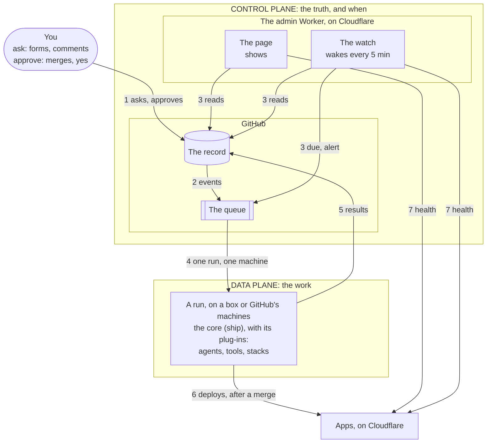
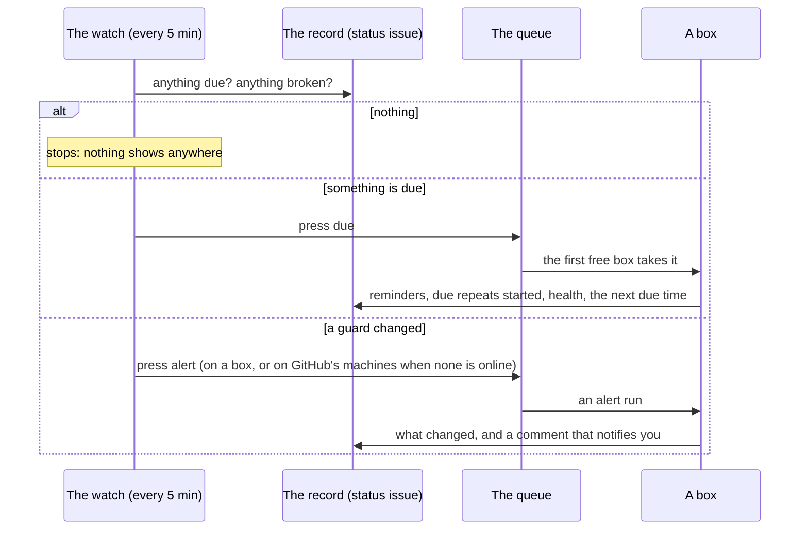

# 0019: Two planes: GitHub keeps the record and the queue, the watch keeps time and guard, boxes do the work

## Context
Shipify grew piece by piece: tasks (ADR 0012), repeats (0013), tools and agents (0014, 0015, 0017),
the clock (0016). Each part works, but nothing says where one part ends and the next begins, so
every new need raises the same questions again: where it runs, which key it holds, what it may
write.

The clock shows the cost. It's off since 2026-10-01 (the owner's choice), because:
- it kept a run asleep on a box all day, on a second runner per box;
- a clock run always showed on the Actions page.

Without it:
- repeats don't run;
- the weekly clean-up starts only by hand;
- nothing notices a box that's gone offline, or an app that's stopped answering.

The owner asked for two things:
- **a clear architecture:** its parts, the boundaries between them, and the words every doc uses;
- **a clock and a guardian in it:** clean, light, robust, free, and growing by adding rather than
  changing.

This ADR decides both. It supersedes ADR 0016, and changes how ADR 0013's repeats are started.

## The architecture
In one line: **you ask and approve on GitHub; GitHub keeps the record and the queue; the watch
notices time and trouble; boxes run the core, which does the work.**



### The two planes
- **The control plane is the truth, and when.** GitHub is most of it: the record and the queue. The
  watch is the one part that stays awake, to notice time passing and things breaking. It's always
  on, and does no work.
- **The data plane is the work.** Every run happens here, on a box (free) or on GitHub's machines
  (only what a box can't do: CI after a merge, deploys, an alert while no box is online). Its
  machines keep nothing, so they come and go, and more of them is more capacity.
- **The core is code, not a place.** `ship` arrives with each run, does that run's job with its
  plug-ins (agents, tools, stacks), writes its results, and leaves. It's the only part that knows
  how tasks work, and the planes around it don't change it (ADR 0010).
- **Apps are what Shipify ships,** outside both planes. Each keeps the app contract (ADR 0001):
  `/health` and `/.well-known/shipify.json`.

### Who can do what
Nothing on Cloudflare is in charge. The truth is the record, and the decisions are yours and the
core's. The admin Worker is a window (the page) and an alarm (the watch). That's deliberate: a part
that can't write can't do damage, and there's never a second truth to keep in step.

| Part | Knows | Decides | Can change |
|---|---|---|---|
| **You** | everything | what gets done, and every approval | anything |
| **The record** (GitHub) | everything Shipify knows | nothing: it keeps | nothing by itself |
| **The core** (`ship`, inside a run) | what its run reads from the record | how to do this run's job | its own results: replies, the status issue, a PR. Never a merge |
| **The watch** | what it reads, for one check | only when to press a button | nothing: it presses `due` or `alert` |
| **The page** | what it reads, for one view | nothing | nothing |
| **A box** | nothing between runs; it keeps only caches | nothing | nothing: it runs what the queue hands it |

### A run, from a box's side
A box knows nothing about the watch, Cloudflare, timers or guards. It can't tell who started a run
(you, a merge or the watch), and doesn't need to. Every run is the same thing: an event in, one job,
results out.

```
the queue hands the box   a run: its workflow, its event, its inputs (a task's number, a reason)
the box                   checks out Shipify's main → ship <command> → writes the results → exits
it keeps                  caches only: Node, pnpm, the agent's CLI, checkouts. No keys, no state
```

Each kind of run has one job:

| Run | Its event | Its job | Where |
|---|---|---|---|
| **a task run** | an issue, a comment, a merged plan, "run again" | one round of a task | a box |
| **a due run** | `due` pressed | whatever is due now, and when the next thing is | a box |
| **a clean-up** | started by a due run | tidy one box | that box |
| **an alert** | `alert` pressed | note what changed on the status issue | a box, or GitHub's machines when none is online |
| **CI and deploys** | a merge | check, then ship | GitHub's machines |

### One Worker, two parts
The page and the watch are one Worker: the admin Worker that already serves the Shipify page. It's
built from the repo `shipify-admin`, named `shipify` on Cloudflare, and lives at
shipify.aayush69work.workers.dev. Those are three names for one thing, and docs say **the admin
Worker**.

| | The page | The watch |
|---|---|---|
| Started by | you, opening the page | Cloudflare, every 5 minutes |
| Entry point | `fetch` (as now) | `scheduled` (new) |
| Reads | Cloudflare, apps, GitHub (`CF_READ_TOKEN`, `GH_READ_TOKEN`) | the same, with the same readers |
| Writes | nothing | nothing; it presses `due` or `alert` (`GH_WATCH_TOKEN`, which only it uses) |
| Reached by | HTTP, behind Cloudflare Access | nothing: it has no URL |

**Why not a separate Worker:** it would be a new project (a repo, a pipeline, its own copies of both
read keys) for about 100 lines, and the watch's readers would be copies of the page's. The cost of
sharing is that a bad deploy of the page could stop the watch too. The merge run checks before it
deploys, and if the watch does stop, the daily check notices within a day. If the watch ever grows
beyond a few checks, it moves into its own Worker, with no change to the contract.

### The boundaries
Each boundary has one direction and one key, as narrow as it can be. A leaked key stays inside its
boundary.

| # | Boundary | What crosses it | Key |
|---|---|---|---|
| 1 | **You → the record** | asks (a form, a comment), approvals (a merge, a `yes`) | your GitHub login. Nothing else approves |
| 2 | **The record → the queue** | GitHub's own events start runs: an issue, a comment, a merge, a merged plan | none: GitHub itself |
| 3 | **The admin Worker → GitHub** | the page and the watch read the status issue, runs and runners; only the watch presses buttons (`due`, `alert`). Neither writes the record | `GH_READ_TOKEN` (read); `GH_WATCH_TOKEN` (start runs), the watch's only write |
| 4 | **The queue → a machine** | one run to one machine, by its labels | boxes: their runner registration; GitHub's machines: GitHub's own |
| 5 | **A run → the record** | results: replies, labels, the status issue, PRs | keys that exist only during that run: the run's token, the bot's one-hour token |
| 6 | **A merge → an app** | a deploy, by the project's pipeline on GitHub's machines, or publishing a merged plan | a deploy key, only during that run: from the project's secrets, or shipify's for a merged plan |
| 7 | **The admin Worker → apps** | public reads of `/health` and `/.well-known/shipify.json`; Cloudflare's script list to find them | `CF_READ_TOKEN` (read) |
| 8 | **Inside a run: the core → plug-ins** | agents (adapters, ADR 0017), tools (`tools.json`, ADR 0015), stacks (the `make` contract, ADR 0010) | the run's keys, handed on as each plug-in's own rules say |

### The rules every part keeps
1. **One record.** Everything Shipify knows is on GitHub. Anything kept elsewhere is a cache that can
   be rebuilt: a box's checkouts and caches, the page's 60-second memory.
2. **One path.** Everything that happens is a run, started by your event, a merge or the watch. Each
   run shows on Actions and reports on an issue.
3. **The control plane decides, and the data plane does.** The page and the watch never do work.
   Boxes keep nothing.
4. **One key per boundary, as narrow as it can be.** A box holds no key to GitHub's API between
   runs: its runner registration only lets it take runs.
5. **Safe to repeat.** Any check or run can happen twice, or be missed once, without harm: what's
   due stays due until a run does it.
6. **Grow by adding.** More boxes, apps, timers or guards add rows, not parts.
7. **Approvals are yours.** Merges and `yes` are the only approvals. No part of either plane approves
   for you.
8. **The core names nothing at the edges.** Agents, tools, stacks, hosts and the timer all plug in.
   Anything that can press `due` can be the timer.

### The words
Every doc uses these words, and only these. They replace "the clock", "clock runner" and "sweep".

**Places**

| Word | Means |
|---|---|
| **control plane** | the truth and when: GitHub (the record, the queue) and the watch |
| **data plane** | where runs happen: boxes, and GitHub's machines |
| **the record** | everything Shipify knows, on GitHub: tasks and their status comments, the status issue, PRs, plans and ADRs, variables, secrets |
| **the queue** | GitHub Actions' runs waiting for a machine. It gives each run to one machine, and holds it up to 24 hours |
| **the status issue** | the record's page for the platform: the watch, guards, what's coming up, recent events, clean-ups |
| **the admin Worker** | the one Cloudflare Worker built from the repo shipify-admin (named `shipify` on Cloudflare, at shipify.aayush69work.workers.dev): the page and the watch |
| **the page** | the Shipify page: the record and the hosts at a glance. Read-only |
| **the watch** | the admin Worker's check every 5 minutes: it keeps time (timers) and guard (guards), reads, and presses buttons |
| **a box** | a machine with Shipify's runner. It keeps nothing, so it can join, leave or be rebuilt |
| **GitHub's machines** | GitHub-hosted runners. They cost minutes, so they do only what a box can't |
| **an app** | what Shipify ships, hosted on Cloudflare, keeping the app contract |

**Work**

| Word | Means |
|---|---|
| **a run** | one GitHub Actions run, the unit of work: an event in, one job, results out |
| **a task run, a due run, a clean-up, an alert** | the kinds of run, each with one job (the table above) |
| **a button** | a run the watch can start: `due` or `alert`. You can press them too (Actions → watch → Run workflow) |
| **a timer** | something due at a time: a repeat, the daily check, a box's weekly clean-up |
| **a guard** | something that should stay true: each box online, each app answering. When one breaks or mends, the watch presses `alert` |

**Code**

| Word | Means |
|---|---|
| **the core** | `ship`, Shipify's own code: it runs the flow inside each run, and names no stack, agent, tool, host or timer (ADR 0010) |
| **a plug-in** | what the core works through without naming it: an agent (its adapter), a tool (`tools.json`), a stack (the `make` contract), a host (its stack) |
| **the contract** | what two parts agree on, and nothing more: the app contract, the `make` contract, and the watch's contract (below) |

## Assumptions, checked (2026-10-01)

| Assumption | How it was checked |
|---|---|
| GitHub's own schedule can't be the timer | Live: 0 scheduled runs, ever, in all four repos (ADR 0016's tests, and the API today) |
| GitHub has no free way to delay a run in a private repo | Environment wait timers need a paid plan for private repos (GitHub's docs). The repos are private, in a free organization (the API) |
| Cloudflare's free plan fits the watch | Cloudflare's limits page: Cron Triggers on the free plan, 5 per account; 10 ms of CPU per run, and waiting on a fetch isn't CPU; 15 minutes of wall time; 50 subrequests per run; 100,000 requests a day |
| The page's key already reads what the watch reads | shipify-admin's spec: `GH_READ_TOKEN` reads Administration (runners), Actions, Issues and Variables on shipify |
| The page already finds apps and judges their health | shipify-admin's `cloudflare.ts` and `admin.ts`: discovery by the app contract; live, paused, failing or unknown, with a 3-second limit |
| Runs the watch starts cost no minutes | They run on boxes, like every task. The exception is an alert while no box is online |
| The queue holds a run while no box is online | GitHub's docs: a queued job fails after 24 hours, not before (also ADR 0016) |
| **To check, step 4:** a fine-grained token with only Actions write can start a run | the first press of `due` with the real token |
| **To check, step 4:** a check that waits 4 minutes stays alive on the free plan | a test check on the deployed Worker. If it doesn't, the guard confirms on the next check, with its own note on the status issue |
| **To check, step 4:** PR previews of the Worker don't run its timer | Cloudflare's docs and a preview. If they do, the handler does nothing outside production |
| **To check tonight:** how long the Pi is offline in its 04:30 restart | the runner's online and offline times. A box guard waits longer than this before it alerts |

## Options
- **A: the clock again** (ADR 0016, switched on) (+ built and tested / − a runner held on a box all day, a
  clock run always on Actions; not what the owner wants).
- **B: GitHub's own schedule on boxes** (+ nothing new / − it has never fired here, and when it does,
  a row on Actions every few minutes).
- **C: a timer on each box** (systemd) (+ on time / − a GitHub key on every box, against rule 4, and tied
  to boxes, against rule 3).
- **D: boxes take turns watching the record, with locks** (the owner's idea) (+ no outside service / −
  it rebuilds what the queue already does (one run to one machine, locks, hand-over when a machine
  dies). It needs a GitHub key on every box between runs, the issues it would lock have no real
  locks, and a box watching all day is option A again).
- **E: the watch, in the admin Worker on Cloudflare** (+ always awake without a box; nothing on Actions
  when nothing happens; reads with the key it has; free; the apps already live there / − one new
  key, which can only start runs, kept on Cloudflare).
- **F: a delayed run on GitHub** (environment wait timers) (− a paid plan for private repos).

## Decision
Chosen **E**. It's the only option that keeps every rule above:
- boxes keep nothing, and hold no key between runs;
- nothing on GitHub stays awake;
- the one new key does one thing.

### The watch
One check every 5 minutes, in the admin Worker: a `scheduled` handler next to the page's `fetch`.
Each check:
1. **Reads the record.** The status issue's state (found by its label, `shipify-status`), the
   watch's recent runs, and the runners.
2. **Timers.** It presses `due` when the status issue's `watch.next` has passed, or the last due run
   is a day old (the daily check). Not while a due run is queued or running, and not within an hour
   of a failed one.
3. **Guards:**
   - **Boxes** (runners labelled `shipify-box`). A box offline now, still offline 4 minutes later,
     and not yet reported: it presses `alert`. A box reported offline that's online again: it
     presses `alert` (back).
   - **Apps** (Workers that keep the app contract). An app failing its `/health` now, still failing
     a minute later, and not yet reported: it presses `alert`. A reported app that's live again: it
     presses `alert` (back). A paused app (its URL off, `ship down`) never alerts.
   - An alert runs on a box when one is online, and on GitHub's machines when none is (about a
     minute).
4. **Nothing else.** It writes nothing and remembers nothing between checks: everything it knows, it
   reads again.



### The watch's runs (`watch.yml`, replacing `automations.yml`)

| Run | Started by | Runs on | Does |
|---|---|---|---|
| **due** | the watch: something's due, or once a day | any box | sends due reminders; starts due agent repeats (each its own task run, as now); starts a box's clean-up when its last one is a week old; writes this box's health; works out `watch.next`; notes the check |
| **cleanup &lt;box&gt;** | the due run | that box (its own label, `box-<name>`) | the weekly clean-up, as now: stuck tasks, old worktrees and `.tasks` folders (deleted tasks too), doctor, cache prune, Node 22 fixes |
| **alert** | the watch, when a guard changes | a box, or GitHub's machines when no box is online | writes what changed on the status issue; comments when the set of problems changes, which notifies you |

Each can be started by hand (Actions → watch → Run workflow), which is also how each is tested. The
CLI follows the words: `ship watch due`, `ship watch cleanup`, `ship watch alert`. They replace
`ship task due`, `ship task sweep` and `ship task clock`.

### The contract between the core and the watch
It lives in the status issue's hidden state, versioned (`"v": 2`). The core owns all the logic:
the watch only compares a time, reads two lists, and presses a button.

| The watch reads | Written by |
|---|---|
| `watch.next`: when the soonest repeat is due | the due run, from every repeat's own status comment; setting up, editing or resuming a repeat moves it earlier when that repeat is sooner |
| `watch.last`, and that run's result | the due run |
| `boxes.<name>.offline`: since when it's been reported offline | alert runs |
| `apps.<id>.failing`: since when it's been reported failing | alert runs |

| The watch presses | With |
|---|---|
| `watch.yml`, `run: due` | nothing else |
| `watch.yml`, `run: alert` | `findings`: names and states only, such as `{"boxes":{"homepi":"offline"}}`. The run checks it against fixed states before writing a word |

`docs/watch.md` describes the contract. Each side tests against a recorded status issue.

### The status issue

```
The watch: last due run 09:00 (fine) · next due 2026-10-02 09:00 · its run
### Guards
Boxes: homepi online, all fine (health 09:00) · Apps: 3 live
### Coming up        (the repeats: task, next, schedule)
### Recent           (the last 30 events)
### Clean-ups        (each box: last run, result, doctor's checks)
```

The page shows the same, read from the status issue: one record, two views.

### Boxes
- **One runner per box,** labelled `shipify-box` and `box-<name>`.
- **The clock runner goes:** its service, its folder and its registration.
  `ship box add <box> --replace --yes` removes them, once per box, and the box's setup version
  becomes 2, so `ship doctor` flags a box still on 1.
- Nothing else on a box changes.

### Keys
- **`GH_WATCH_TOKEN`** is fine-grained:
  - the shipify repo only, Actions read and write, for a year;
  - a runtime secret of shipify-admin, used only by the `scheduled` handler;
  - the page lists its expiry date with the other keys.

  Leaked, it can start, cancel or delete runs in shipify, and nothing else. Revoke it on GitHub.
- **README rule 6** becomes:
  > Free only. No paid service, no domain. Keys live with their boundary: GitHub's secrets, each
  > box's runner registration, and the admin Worker's narrow keys on Cloudflare, where the apps
  > already run.

### Cost

| | |
|---|---|
| Cloudflare | free: one timer, about 300 checks a day, a few milliseconds of CPU each |
| GitHub minutes | 0 for due runs, clean-ups and alerts on boxes; about 1 per alert from GitHub's machines, only while no box is online. CI after a merge is unchanged (ADR 0018) |
| GitHub API | about 40 reads an hour from the watch, against 5,000 |
| The Actions page | a due run a day, plus one per due repeat; a clean-up a week per box; an alert only when something breaks or mends |

## Edge cases

| Situation | What happens |
|---|---|
| Nothing due, nothing broken | No run. The Actions page stays quiet |
| The watch misses checks (Cloudflare is down, or a bad deploy) | Nothing is lost: what's due stays due, and the next check catches up. After a day without a due run, task runs and `ship doctor` say the watch has stopped. The page shows its last due run |
| Two checks press `due` at once | One due run at a time (its concurrency group). The second finds nothing left to do |
| A due run fails | The failure shows on Actions. The watch waits an hour before pressing again, so a broken run doesn't repeat every 5 minutes |
| `watch.next` is wrong (lost in a race, or edited by hand) | Too early: the due run does nothing and corrects it. Too late: the daily check corrects it |
| No box online | Due runs wait in the queue, up to 24 hours. The box guard alerts from GitHub's machines |
| The Pi's 04:30 restart | Back within the guard's 4-minute wait: no alert (checked tonight, step 0) |
| A box you stop on purpose (`ship box stop`) | One "offline" note, and one "back" note after `ship box start` |
| A box removed (`ship box remove`) | Its runner is gone, so the guard forgets it, and the next due run drops it from the status issue |
| Two or more boxes | Due runs and alerts go to any box. Each box gets its own clean-up through its own label |
| An app paused (`ship down`) | Paused isn't failing: no alert |
| An app failing | One note after two failed checks a minute apart, and one "back" note when it's live again |
| An app deleted | Cloudflare's script list no longer has it: forgotten |
| More than about 20 apps | One check makes about 2 calls per app, under the free plan's 50. Past that, a second timer takes the app guards (the free plan allows 5) |
| Two runs write the status issue at once | The later write wins. Each writer reads again just before it writes, and the next due run rewrites the whole state from the record. Comments, the notifications, are never lost; at worst one is said twice |
| The status issue is deleted | The next due run makes a new one (as now), and the watch finds it by its label |
| `GH_WATCH_TOKEN` missing or expired | The watch logs it and presses nothing. The page shows the key's state, 30 days ahead of expiry; after a day, task runs say the watch has stopped |
| `GH_READ_TOKEN` refused | The watch can't read the record, so it presses nothing and logs why. The page already says so (its spec) |
| A finding names something unknown | The alert run writes only fixed states for boxes and apps it can name. Anything else is dropped and logged |
| GitHub is down | Checks fail quietly; the next one tries again |
| A repeat set up between checks | Its run moves `watch.next` earlier, so the watch sees it within 5 minutes |
| A task finishes in the middle of a due run | No conflict: the task's run writes its own issue, and the due run writes the status issue |

## Consequences
- **Supersedes ADR 0016,** and changes how ADR 0013's repeats are started: by the watch's due run.
  Repeats themselves (kinds, the form, quiet runs, pausing) don't change.
- **Gone:**
  - `automations.yml`;
  - the 6-hour clock loop (`commands/clock.ts`);
  - the chain and its restart checks (`ensureClock` and the rest of `lib/clock.ts`, in task runs,
    `ship doctor` and the box commands);
  - the clock runner on every box (`box add`, `box/setup.sh`, start, stop, restart, remove, list);
  - the page's clock runner states;
  - the words "clock", "clock runner" and "sweep".
- **New:**
  - `watch.yml` (due, cleanup, alert) and `ship watch`;
  - about 100 lines in the admin Worker (the check, and its timers and guards, sharing the page's
    readers);
  - one key;
  - a label per box;
  - `docs/watch.md`.
- **The page stays read-only.** Its HTTP routes are unchanged, `GET` and `HEAD` only. The watch has no
  route: Cloudflare starts it, and only it holds `GH_WATCH_TOKEN`.
- **The architecture above becomes the README's opening section,** and its words the glossary.
- **Later, each only when it's needed:**
  - **more guards,** each one more line in the same check, with no new parts:
    - a key expiring, 30 days ahead (the page already knows the dates);
    - a run stuck in the queue for an hour.
  - **asking and scheduling from the page:**
    - first as links that open GitHub's forms, already filled in: no key, and you still submit on
      GitHub;
    - later, if you want it, the page creating the issue itself, behind its sign-in.
  - **outside events** (Notion, email) becoming tasks.

  The page making issues, and outside events, widen boundary 3 with a key that creates issues, so
  each gets its own ADR first. However an issue is made, it's an ordinary task on the one path: the
  admin Worker asks, the same as you, and never approves.

## Build, in steps
Each step is tested, then live, before the next.

| Step | What | Who |
|---|---|---|
| 0 | **This plan.** Tonight's 04:30 restart measures how long the Pi is offline | you merge |
| 1 | **Shipify, one PR:** `watch.yml` and `ship watch`; status issue v2 (reads v1); `watch.next` written by repeats; the clock removed (code, workflow, box setup, setup version 2, a label per box); the clean-up treats a deleted task as closed, and removes `.tasks` folders with worktrees; doctor and task runs check the watch's last due run; docs (below); tests | I build, you merge |
| 2 | **The Pi, once:** `pnpm ship box add shipify-pi --replace --yes` (it asks for the Pi's password): one runner, label `box-homepi`, setup version 2. Then I press `due`, `cleanup` and `alert` by hand and check each on the status issue | you, then me |
| 3 | **The key:** create `GH_WATCH_TOKEN` (GitHub → Settings → Developer settings → Fine-grained tokens: owner aayush-t-apps, only shipify, Actions read and write, a year), then `gh secret set GH_WATCH_TOKEN -R aayush-t-apps/shipify-admin`. Never paste it anywhere else | you |
| 4 | **The admin Worker, one PR** (its change doc and spec): the check every 5 minutes, timers, box and app guards, the page's watch section from the status issue, the key on the Keys list, and the clock runner states removed; version 1.4.0. Live: the checks in step 5 | I build, you merge |
| 5 | **Your end-to-end test** (below) | you |
| 6 | **What the test found,** in `docs/context.md` | I write, you merge |

**Your end-to-end test:**
1. `pnpm ship box list`: the Pi has one runner. `pnpm ship doctor`: setup version 2.
2. A Reminder for 10 minutes from now: it arrives within 5 minutes of its time. Actions shows one
   due run, and nothing else.
3. An hour with nothing due: no new runs on Actions.
4. `pnpm ship box stop shipify-pi` for 10 minutes: the status issue says homepi is offline, in one
   comment that notifies you. `pnpm ship box start shipify-pi`: "homepi is back".
5. `sudo reboot` on the Pi: no alert.
6. `pnpm ship down playground --yes`: the page shows it paused, and no alert. Then
   `pnpm ship up playground --yes`.
7. The next day: one daily due run, its time on the status issue and on the page.
8. A clean-up: Actions → watch → Run workflow (`cleanup`, box `homepi`), then its section on the
   status issue.

## Docs
Written in step 1 (step 4 for the Shipify page):
- **README:**
  - the architecture above as its first section (planes, parts, boundaries, keys, rules);
  - the glossary in these words;
  - rule 6 reworded.
- **`docs/watch.md` (new):** the contract, timers and guards, adding one, edge cases.
- **The other docs:**
  - `docs/design.md` and `docs/tour.md` (the code map);
  - `docs/box-setup.md` (one runner, the label, re-adding a box);
  - `docs/tasks.md` (repeats);
  - `docs/setup.md` (the new key, and where every key lives);
  - `docs/roadmap.md` and `docs/context.md`;
  - `AGENTS.md` (a row for the watch).
- **ADRs 0013 and 0016:** their status lines point here, and the ADR index is updated.
- **shipify-admin:** its spec (goal, architecture, API, security, limits), a change doc and its
  CHANGELOG.

## Confirmation
- **Tests in shipify:**
  - `watch.next` from repeats, and when a repeat is set up, edited or resumed;
  - the due run sends what's due and starts each box's clean-up after a week;
  - alerts write only fixed states, and comment only when the set of problems changes;
  - status issue v1 is read as v2;
  - the clean-up removes deleted tasks' worktrees and `.tasks` folders;
  - task runs and doctor flag a due run over a day old;
  - no code mentions the clock.
- **Tests in shipify-admin:**
  - the check's decisions as pure functions: due or not, already queued, after a failure, box
    offline twice, app failing twice, paused, back;
  - the buttons it presses;
  - nothing pressed without `GH_WATCH_TOKEN`;
  - previews do nothing.
- **Live:** the end-to-end test above. Then `ship doctor` reports the watch's last due run, and the
  page shows it.
