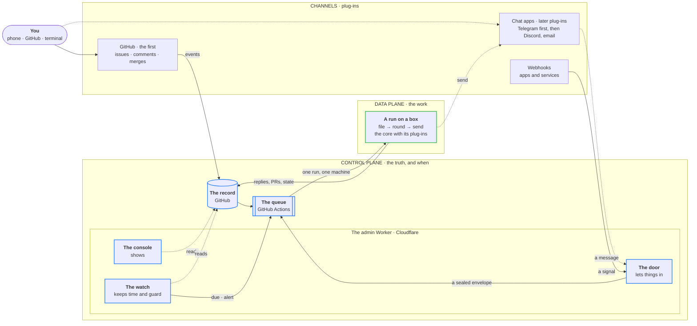

# 0027: An operating system for your work: a plug-in kit, the door, recipes, a notebook, the console

## Context
Shipify does one loop well: you open an issue, a box works on it, you merge. ADR 0019 made every run
"an event in, one job, results out", but both ends are GitHub. You can only ask on GitHub, and you
only hear back on GitHub. A webhook can't start anything, a reminder can't reach your phone except
as a GitHub notification, and a tool can be read or changed but never be where an answer goes.

The owner asked, on 2026-10-03, for the next shape of the whole system. Each ask is numbered so
[Every ask, covered](#every-ask-covered) can show where it's answered:

| # | The ask |
|---|---|
| R1 | Work can start from anywhere, through one clean interface: a GitHub task, the watch's timers, a webhook, Telegram, Discord, email |
| R2 | Any agent, with its plug-ins and skills, the same whatever started the work |
| R3 | Tools that extend cleanly and work together, and tools as outputs: a PR, a Telegram message, an email |
| R4 | Wiring such as "on a timer or a webhook, do this and message me", written as clean markdown with clear inputs and outputs, and professional skills |
| R5 | A clear answer on state: keep, move or change it; why GitHub and not a database; what that gains and loses; whether it bites later; how it scales |
| R6 | Efficient, free, simple, robust, and able to grow a long way |
| R7 | Good names, a product feel, and a way to keep evolving |
| R8 | A personal assistant, a project manager, and work across teams |
| R9 | Separate modules for different kinds of boxes, stacks, deploy systems and control planes |
| R10 | The admin Worker does more, instead of adding a new system |
| R11 | Every edge case decided up front: nothing loose |
| R12 | Docs end to end in every step: README, docs, skills, guides, playbooks, AGENTS.md, and clean-up |
| R13 | Setup simple enough for someone less technical |
| R14 | Later: one management console for inputs, keys, secrets and observability |
| R15 | Every piece of work starts from a fresh `main` |
| R16 | Robust and easy to extend **first**: the plug-in layers, their contracts and their tests before any new tool, channel or provider. Telegram and the rest come after, as plug-ins |
| R17 | Every new setup tested end to end, with a quick way to fire a webhook and test-run anything |
| R18 | The full docs pass and clean-up as the build's last step |

This ADR is the whole design. It's built in steps (below), each tested and live before the next,
and each listed in the roadmap until it's done. **The order (revised the same day, at the owner's
ask):** first the plug-in kit, proven with what exists today (GitHub, Notion, Claude Code); then the
door with webhooks, recipes, the notebook, guided setup and the console, each with its own live
tests; then the full docs pass and clean-up. Every new provider, Telegram included, is a plug-in
added after that. Telegram is designed in full here so the contracts fit a real chat app, but it
isn't built first.

## In one line
**Shipify is a small operating system for your work. Anything can knock (the door), the record
remembers, boxes do the work, and the answer comes back where you are (send). You still approve on
GitHub, and only there.**

## The operating system, part by part
Most of the operating system already exists. This ADR adds input and output, and names the rest.

| In an operating system | In Shipify | |
|---|---|---|
| the disk | **the record**: GitHub's issues, PRs, repos and variables | as now |
| the scheduler | **the queue**: GitHub Actions, one run to one machine | as now |
| the processors | **boxes**, each with its **slots** | as now |
| the kernel | **the core**: `ship`, which runs the flow and names nothing at the edges | as now |
| the clock | **the watch**: every 5 minutes, timers and guards | as now |
| the drivers | **plug-ins**: agents, tools, stacks, hosts, and now **channels** | grows |
| input | **the door**: one way in for everything outside GitHub | **new** |
| output | **send**: one way out to wherever you are | **new** |
| programs | **recipes**: markdown files that wire a trigger to a job and an answer | **new** |
| your home folder | **the notebook**: what Shipify remembers about you, as pages you can edit | **new** |
| the screen | **the console**: today's Shipify page, renamed; it becomes the management console later | renamed, grows |
| sudo | **approvals**: your merge, your `yes` | as now |
| one computer | **a cell**: one complete Shipify (an org, its boxes, its admin Worker) | named |



Nothing new is always on, nothing new keeps state, and nothing new costs money. The door is a few
routes in the admin Worker you already run. Send is a step in the run you already have.

## The state: why it stays on GitHub
**Decided: the record stays on GitHub. No database, no store of our own.** Anything kept elsewhere
is a cache that can be rebuilt (rule 1 of ADR 0019, unchanged).

**Shipify's state is human-paced; an app's state lives in the app.** Shipify keeps asks, answers,
approvals, schedules and history. That's tens to hundreds of writes a day, each one a person or a
timer. It's small, slow and needs an audit trail, which is what GitHub is built for. Fast,
high-volume data belongs to apps, which already have KV and D1 as stack options (ADR 0022).

**What we get by keeping it on GitHub**
- **Nothing to run:** no server, database, backups, migrations or uptime to look after. Free.
- **History for everything:** who said what, when, and every edit (issues keep their edit
  history). The audit trail comes free.
- **A screen on every device:** the GitHub app, notifications, search and links work today, for
  you and anyone you invite.
- **Security we don't have to write:** sign-in, two-factor, permissions, branch protection and
  merges as approvals.
- **Events become runs:** a change in the record starts work through the queue. A database would
  need its own triggers, queue and workers, which is a second system.
- **Everything else stays disposable:** a box, the admin Worker, a whole machine can be lost and
  rebuilt from GitHub.
- **Agents already know it:** `gh` and `git` are tools every agent speaks.

**What we give up, and how much it matters**

| We give up | How much it matters |
|---|---|
| Speed: each read or write is 0.1–0.5 s, and a run starts in seconds | Shipify is an assistant you write to, not a chat. The door answers within a second; the work takes a minute or two. Read-only commands (`/status`) are answered by the door at once |
| Queries: no joins or totals across the record | Totals (minutes, usage, a weekly digest) are worked out by a run or the console from list reads, and shown. They're derived, never stored as truth |
| Rate limits: 5,000 requests an hour for a key or the bot; 1,000 an hour per repo for a workflow's own token, which a round uses for the task's issue; at most 80 writes a minute and 500 an hour per key | A round makes roughly 20–30 GitHub calls (measured in step 1), so the workflow token carries about 40 rounds an hour. A busy person makes 20–100 a day. If a cell ever needs more, the round's issue calls move to the bot's token (5,000 an hour and up), one setting; past that, a team grows by cells, each with its own limits |
| Transactions: two writers can race on one comment | One run per task at a time (the queue's concurrency groups), read just before each write, and the status issue rewritten whole by the next due run (as now) |
| Size: a comment or issue body holds at most 65,536 characters | Status state stays small; long replies are cut with a note (as now); notebook pages are split by topic |
| GitHub being up | When GitHub is down, asks wait (the door returns an error, so the sender retries later) and apps keep serving: they run on Cloudflare and don't need GitHub |

**Will it bite later?** Only in ways we can see coming, each with an answer ready:

| If this happens | Then |
|---|---|
| A source fires many times a minute | It's a signal, not a record: it points at a check recipe, which writes only when its answer changes. A rate rule at the door blocks floods |
| A team of many people asks all day | More cells, each with its own record, keys, boxes and agent plan. Cells share code, not state |
| We want reports across months | A recipe writes the report as a notebook page or a reply. A cache (KV or D1) for the console can come later, rebuildable from the record, never the truth |
| GitHub changes its terms or price | The core reaches the record through one module (step 1). Forgejo (free, self-hosted) has the same issues, PRs and Actions-style runners, so a second record plug-in is a port, not a rewrite. `gh` exports everything |

Choosing a database as the truth is the hard decision to undo. Keeping GitHub as the truth, behind
one module, keeps every later choice open.

## Assumptions, checked (2026-10-03)

| Assumption | How it was checked |
|---|---|
| The admin Worker's key, `GH_ADMIN_TOKEN`, can start any of shipify's workflows, not only `watch.yml` | GitHub's permissions: Actions write is repo-wide. shipify-admin's spec and `security.md`: "start, cancel or delete shipify's runs". Only its code limits it to `watch.yml` today (`watch.ts`). Using it for the door needs this ADR, as `watch.md` asks of any widened boundary |
| A dispatch takes up to 25 inputs, and now answers with the run's id | GitHub's REST docs, "Create a workflow dispatch event": "The maximum number of properties is 25"; the response holds `workflow_run_id` and `run_url` |
| **To check in step 2:** the largest envelope a dispatch takes | A test dispatch of 32 KB. If it's refused, envelopes keep to what passes, and a hook's data over it is refused with 413 |
| `concurrency.queue: max` keeps every pending run in order | ADR 0021, already relied on by `task.yml` |
| A dispatch from a key starts a run, though writes with the workflow's own token don't | ADR 0021; the watch's presses since 2026-10-01 |
| GitHub's limits for the record | GitHub's REST docs: 5,000 requests an hour for a key or an app's installation (up to 12,500 with many repos or users); 80 content-creating requests a minute and 500 an hour; 1,000 an hour per repository for a workflow's own token |
| **To check in step 1:** how many GitHub calls one round makes, and with which token | Counted from a round's calls with the fake `gh` and from a live round's log. Estimated at 20–30, most with the workflow's own token (`SHIPIFY_ISSUES_TOKEN`) |
| A task must be opened by you, and the bot's comments never count as yours | `cli/commands/task.ts`: `taskRun` blocks an issue not opened by `SHIPIFY_OWNER`; `isBot` comments stay context, never new input. A task the door files is opened by the bot, so the core learns the door's mark (below) |
| Runs named `task #<n>` are how the core finds a task's active run | `activeTasks()` reads the run's display title. Door runs keep that name once a task has a number |
| A task waiting for a box already has its own state | `cli/lib/task.ts`: the phase `waiting` shows "Waiting for a box: a box picks this up when one is free" |
| A comment on a closed task more than a minute after the close reopens it | `taskRun` (`AFTER_CLOSE_MS`). A message to a closed task does the same |
| Comment commands are one list, kept in step with the docs by a test | `COMMANDS` in `cli/lib/task.ts`; `tests/task.test.ts` checks each is in the status help and in `docs/tasks.md`. New commands (`send …`) join the list and the docs together |
| The core sends to you from two places only | a task's `reply()` and the status issue's alert comment (`updateStatusIssue`). Send hooks onto exactly these |
| Telegram proves a webhook is ours with a secret header, retries failures, and can be held to one delivery at a time | Telegram's Bot API docs: `secret_token` is sent as `X-Telegram-Bot-Api-Secret-Token`; on a non-2xx answer "we will repeat the request and give up after a reasonable amount of attempts"; `max_connections` 1–100 |
| The door can answer you instantly without the bot's token | Telegram's Bot API docs, "Making requests when getting updates": the webhook's answer can carry one method call, such as `sendMessage` |
| A reply in Telegram carries the message it replies to | Telegram's Bot API docs: `reply_to_message` is "the original message" |
| Each Telegram update has its own increasing id | Telegram's Bot API docs: `update_id` |
| **To check when the Telegram plug-in is built:** Telegram's limits on a message's length (4,096 characters) and a bot's file downloads (20 MB) | A test message and a test file. Send keeps well under both |
| The admin Worker fits the door on the free plan | Cloudflare's limits page: 100,000 requests a day, 10 ms of CPU per request (waiting on a fetch isn't CPU), 50 subrequests per request, 64 variables per Worker. The door uses 1–3 subrequests and microseconds of CPU for its checks |
| A free rate rule can guard the door | Cloudflare's WAF docs: the Free plan has one rate-limiting rule, counted per IP over 10 seconds, that blocks |
| The admin Worker accepts only `GET` and `HEAD` today, enforced in code and by tests | shipify-admin: the guard in `admin.ts` runs before every route; `app.test.ts` and the e2e tests expect 405 for `POST`. The door changes exactly this, for `/door/*` only |
| Worker code runs only for paths in `run_worker_first` | shipify-admin's `wrangler.jsonc` (`/health`, `/.well-known/shipify.json`, `/api/*`). `/door/*` joins the list |
| Access lets a path through only with a Bypass entry | `docs/setup.md` and shipify-admin's spec: the Bypass app lists `/health` and `/.well-known/shipify.json`. `/door/*` is added by you, once (setup) |
| The platform's request log writes the path, never the query, headers or body | shipify-admin's `src/shared/platform.ts` and `logger.ts`. So no secret ever goes in a door path |
| **To check in step 2:** whether Cloudflare's own Workers Logs keep a request's query string | A test request. If they do, a hook's key moves to a header for every sender that can set one, and the URL form is documented as the fallback with that cost stated |
| An email handler needs the stack's Worker entry to pass it on | shipify-admin: the stack-owned `src/worker/index.ts` hands Cloudflare only `fetch` and `scheduled`. Email in is a stack change (`ship upgrade`) |
| **To check before email in is built:** whether a Worker can see a sender's SPF, DKIM or DMARC result | Cloudflare's Email Routing docs don't say. Email in is built only if a sender can be proven; until then it isn't offered |
| Discord can be used without a connection kept open | Discord's docs: interactions arrive over HTTPS, must be answered within 3 seconds, and their token works for 15 minutes; a modal can answer a button. Plain messages in a channel need the gateway (an open connection), which isn't used |

## Options
- **A: a new Worker for the door** (+ the page stays read-only / − a new project, a new pipeline,
  a second copy of the GitHub key, and readers duplicated from the page; against the owner's ask
  for no new system).
- **B: the door in the admin Worker** (+ no new system, no new GitHub key: it uses the key the watch
  already has, for the same kind of write, starting a run; the console's readers answer `/status`;
  already on the domain and the free plan / − the admin Worker takes public `POST`s, so its guard
  and tests change, and a bad deploy stops the console, the watch and the door together).
- **C: boxes fetch messages themselves** (Telegram's `getUpdates` on a timer) (+ no public URL / − a
  channel key on every box between runs and a box always awake, against ADR 0019's rules 3 and 4;
  no answer when no box is online).
- **D: an automation service** (n8n, Zapier, Make) (+ many connectors / − paid or self-hosted, a
  second record of truth, approvals outside GitHub).
- **E: a database as the control plane** (D1 with a queue and a scheduler) (+ fast queries / −
  everything [the state section](#the-state-why-it-stays-on-github) gives up keeping, and a second
  system to secure and keep up).
- **F: the chat as the record** (Telegram or Discord holds the conversation) (+ fast / − no PRs,
  no approvals, no audit; and the record splits across apps).

## Decision
Chosen **B**. The admin Worker becomes three parts: **the console** (shows), **the watch** (keeps
time and guard) and **the door** (lets things in). None of them writes the record, keeps anything
or decides anything. Each only reads, or presses a button.

### 1. Channels, the envelope and the door
**A channel** is a way you and Shipify talk: GitHub is the first, as now; chat apps (Telegram first,
then Discord) and email are plug-ins added later. **A signal** is something an app or service sends:
a webhook. Both come in through **the door**, a few routes in the admin Worker under `/door/`:

| Route | For | How it proves the sender | Built |
|---|---|---|---|
| `POST /door/hook/<name>` | a signal from an app or service | an HMAC of the body in a header, or a key in the query for senders that can only call a URL | step 2 |
| `GET /door/ping` | `ship doctor`, setup and `ship selftest` check the door is reachable and has its key | a signed time, within 5 minutes | step 2 |
| `POST /door/telegram` | your messages to your Shipify bot | Telegram's secret header, then your user id in a private chat | with the Telegram plug-in |
| `POST /door/discord` | your slash commands, buttons and modals | Discord's Ed25519 signature, then your user id | with a Discord plug-in |
| `email()` | your mail to Shipify's address | the sender's proof, once one can be checked | with an email plug-in |

The door does five things, in order, and nothing else:
1. **Proves the sender,** before reading anything else. Anything unproven gets a plain 401 and a
   log line with the route and the outcome only.
2. **Answers at once, if it can:** a chat channel's `/status`, `/needs` and `/help` are answered
   from what the console already reads (boxes, tasks waiting for you, apps, the watch), with no run.
3. **Builds the envelope:** one small, versioned JSON shape for everything that comes in.
4. **Seals it:** an HMAC with the door key, so a run can tell the envelope came from the door.
5. **Presses `task.yml`** with the envelope, using `GH_ADMIN_TOKEN`, and answers the sender: a
   hook gets 202 and the run's id; a chat gets "Got it", "Added to #81", or "No box is online:
   it'll start when one is".

```jsonc
// The envelope, v1, here from a chat (a later channel). A hook's has trust "signal", its recipe
// and its data, and no task. Small: files travel as references, never as bytes.
{
  "v": 1,
  "id": "telegram:832211907",         // where it came from and its own id: handled once
  "at": "2026-10-03T08:01:12Z",       // when the door let it in
  "channel": "telegram",              // the channel or hook that sent it
  "trust": "you",                     // "you" or "signal" (below)
  "from": "telegram:51234567",        // who, as the channel names them
  "task": 81,                         // the task it continues, or null for a new one
  "title": "bigger margins on cards", // the text's first line, 60 characters at most: the run's name
  "text": "bigger margins on cards",
  "files": [{ "name": "shot.jpg", "ref": "AgACAgQAAxk…" }],
  "recipe": null,                     // a command or a hook names a recipe
  "data": null,                       // a hook's body (signals only, 32 KB at most)
  "seal": "…"                         // HMAC-SHA256 of the rest, with the door key
}
```

GitHub stays a channel as it is: its door is GitHub's own events. Nothing about tasks opened on
GitHub changes.

The door answers only in production (`APP_ENV`), as the watch does: a preview of the admin Worker
never presses anything.

### 2. Trust: you, or a signal
Every envelope has one of two trust levels, set only by the door from how it proved the sender. Its
text can never raise it.

| | **you** | **signal** |
|---|---|---|
| Comes from | your proven account on a channel, or a recipe you merged, on its timer or command | a webhook: a proven source with untrusted content |
| Can start | a task round, a recipe, a command | only the recipe its hook names |
| The agent gets | the `task` profile, as now | the `signal` profile: no web, no network from the shell, only the recipe's tools |
| Tools | look, as now; act after a `yes`, or a recipe's standing approval | look, and only its recipe's standing acts |
| Writes the notebook | yes | never |
| Can approve | never from a channel: approvals stay on GitHub | never |

**Approvals stay on GitHub.** A `yes` sent in Telegram gets "Approvals stay on GitHub", with a button
that opens the task there. Your merge and your `yes` comment on GitHub, signed in with two-factor,
remain the only approvals (rule 7). Approving from a channel can come later, with its own ADR, if
you want it.

### 3. Continuing a task from a chat
This is how every chat channel works once one is added (Telegram first). It's part of the
channel contract now, so the first chat plug-in only fills it in. No table maps chats to tasks.
**The task's number travels in the conversation:**
- **Reply** to any Shipify message, and you're continuing its task: every message the bot sends ends
  with its task's number and link.
- **Start with `#81`** to continue task 81 without replying.
- **Anything else is a new task**, read the way a blank issue's title is read today (`spotter: …`,
  `question: …`, `do: …`).
- **Commands** work as comments do today: `use opus`, `again`, `preview`, `start over`, `publish`,
  `stop repeating`, `resume`, `no`, and the new `send telegram` and `send off`. Only `yes` is
  refused (above). `ping` as a new message is the box's health check, as a `ping` issue is today.
  `/status`, `/needs` and `/help` are answered by the door. A recipe's command (`/brief`) runs that
  recipe.

Each message is also written into the record: the run posts it on the task as "**You, on Telegram:**
…", so GitHub shows the whole conversation, wherever it happened.

**The door's mark.** Today a task must be opened by you, and the bot's comments never count as
yours. A task or comment the door files is written by the bot, so it starts with a hidden mark
(`<!-- shipify-door {"id":…,"channel":…} -->`), written only by a **file** run that checked the
seal. The core reads marked text as yours **for asking and for commands, never for `yes`**: an
errand's `yes` still has to be your own comment on GitHub. (An agent with the bot's token could
write the mark too; it can already edit a task's state, so this adds nothing it couldn't do. It
still can't approve.)

### 4. Two runs, three steps: file, round, send
Something from the door becomes two runs of `task.yml`. Keys live only in the step that needs them:

| Run · step | Command | Does | Has |
|---|---|---|---|
| **file** run, named `door: <title>` | `ship task file '<envelope>'` | checks the seal and the envelope's age; skips an envelope already filed; opens the task, labelled with its channel, or adds the message to it; stores your photos and files on shipify's `shipify-files` branch (never merged, like a project's `shipify-shots`) and links them; then starts the task's round (reason `door`) | the door key, the channel's key, the bot's token |
| task run, named `task #<n>` · **round** | `ship task run <n> --reason door` | the task's round, exactly as today: the agent, `ship pr`, screenshots, the status comment. The linked files arrive the way linked files do today (ADR 0021). It writes what to send to `.tasks/<n>/send.json` | the run's keys as today. **Never a channel key or the door key** |
| task run · **send** | `ship task send <n>` | sends that answer to the task's channels | the channel's key |

- **The agent never holds a channel's key or the door key:** they exist only in steps the agent
  doesn't run in.
- **A run started on GitHub** (an issue, a comment) has no file run, and runs **send** only when the
  task has a channel.
- **Names stay meaningful:** the core finds a task's active run by its name `task #<n>`, so the round
  keeps it; the file run's `door: <title>` keeps your words visible on Actions even if it never
  files them.
- **Order:** file runs for one task wait their turn in its own queue (`door-<task>`, every pending
  run kept in order). The reason `door` behaves like a comment: a round with nothing new since the
  last one does nothing, so three quick messages make one or two rounds, never three.
- **Files are part of the record:** stored on the branch, linked from "You, on Telegram", so any
  slot or box can fetch them, and you can open them on GitHub. Up to 5 files of 10 MB each per
  message.

**When no box is online,** the door can see it (it reads the runners, as the console does). It then
presses the file run on GitHub's machines (about a minute of billing) and doesn't start a round:
the message becomes a task in the `waiting` phase that exists today ("Waiting for a box"), so
nothing waits in the queue, where it could expire. When a box comes back, the watch's `alert` run
(box back) starts the round of every task the door filed that's still waiting, oldest first. The
daily due run does the same, in case an alert was missed.

### 5. Replies out: send
**Replies are free; acts need a yes.** An answer to *you* is a reply: it always goes, and the core
sends it after the round, so it never depends on the agent remembering. Changing anything outside
(a Notion page, someone else's inbox) is an act and needs your `yes` or a recipe's standing
approval.

| What | Goes to |
|---|---|
| A task's answers | GitHub, as now, and the channel the task came from |
| "Needs you" (a PR to merge, a question, a list waiting for `yes`) | GitHub, and your default channels, as one line with links |
| A reminder (a repeat with no agent) | its task, as now, and your default channels |
| The watch's alerts (a box offline, an app failing, and back) | the status issue, as now, and your default channels |
| A recipe's answer | its log issue, and the channels in its file |

- **GitHub is the first channel, and no special case.** Step 1 moves today's two places that speak
  to you (a task's reply, the status issue's alert comment) behind the channel contract, with
  GitHub's `send` writing the same comments as now. Every later channel plugs in at that same seam.
- **A chat channel's message** (once there is one) is the whole answer when it fits in one message
  (about 3,500 characters, under Telegram's 4,096). Otherwise it's the answer's first paragraph,
  which the playbook already asks to stand alone, with "the rest is on GitHub". Either way it ends
  with the state (Needs you · Done · Failed), the task's number, and buttons that open the task and
  the PR. Screenshots go as photos.
- `send <channel>` and `send off` in a task change where its answers go, like `use` does for the
  model.
- Your default channels are the repo variable `SHIPIFY_SEND` (empty: GitHub only, as today).
- **A send that fails never fails the round:** one retry after 5 seconds, then the run's details say
  "<channel>: not sent (why)". The record already has everything.

### 6. Tools: four verbs
A tool can now do up to four things, declared in `tools.json`. The core reads the verbs and never
names a tool (rule 8):

| Verb | Means | Who calls it | Notion (today) | Telegram (a later plug-in) |
|---|---|---|---|---|
| `in` | the door takes this tool's messages | the door | – | ✓ |
| `look` | read | the agent, any run | ✓ | – |
| `act` | change something | the agent, only in an approved run, through the guard | ✓ | – |
| `send` | deliver an answer to you | the core, in the **send** step | – | ✓ |

GitHub's channel comes with the record plug-in, so it has no entry here. A chat channel's entry,
as the Telegram plug-in will add it:

```jsonc
"telegram": {
  "description": "Your Shipify bot on Telegram: you write to it, it answers you",
  "in": { "door": "telegram" },
  "send": ["node_modules/.bin/tsx", "tools/telegram/send.ts"],   // reads the answer as JSON on stdin
  "keys": { "TELEGRAM_TOKEN": { "send": "SHIPIFY_TELEGRAM_TOKEN" } },
  "check": ["node_modules/.bin/tsx", "tools/telegram/send.ts", "--check"]
}
```

A tool with `in` or `send` is a **channel**. Adding one (Slack, ntfy, email out) is:
- a folder in `tools/`;
- an entry in `tools.json`;
- its secret's line in `task.yml` (as for Notion's keys today);
- a route in the door, if it has `in`;
- its setup in `ship channels add`.

Neither the core nor the round changes.

### 7. Recipes
**A recipe is a markdown file that wires a trigger to a job and an answer.** Recipes live in
`recipes/` in this repo, so you approve one by merging it, and its tools, acts and channels are
right there in the PR.

```markdown
---
on:
  - every weekday at 8:00          # the Repeat form's words (ADR 0013)
  - command brief                  # /brief in a channel
do: agent                          # agent · check · forward
use: sonnet                        # any agent and model, as a `use` line
skills: [notion]                   # skills/ the agent reads first
tools: [notion]                    # what it may look at
act:                               # standing approval: only these calls, these fields fixed
  - notion.create_page: { parent: "1f2e…" }
send: [github]                     # its log issue; add a chat channel once there is one
quiet: true                        # nothing to say: say nothing
example: recipes/morning-brief.example.json   # sample input for dry runs and tests
---
# Morning brief
What's due today in my Tasks database, then anything overdue. Three lines at most, the most urgent
first. Save the brief as a page under Daily notes.
```

**Three kinds, cheapest first:**

| `do:` | For | The agent | Example |
|---|---|---|---|
| `forward` | passing a signal on: the body is a template, `{{data.field}}` filled from the hook's data | never | "a new star on spotter's repo → Telegram" |
| `check` | a value that matters only when it changes: a script (`recipes/<name>.mjs`) prints it | never; a `handover` line lets it ask for one round | a price, a page, a port, disk space |
| `agent` | judgement: summaries, PRs, reading and deciding | every run | the morning brief, weekly dependency PRs |

**Triggers** (`on:`): a schedule (the Repeat form's words, the same parser), `hook <name>` (a signal
at `/door/hook/<name>`), `command <name>` (from a chat channel, once there is one). **`again`** on a
recipe's log issue runs it now, from GitHub, as it does for an operation today.

**Where they run:** a `forward` or `check` recipe runs whole in one short run with no agent (the
file run for a hook or a command, a run the due run starts for a schedule), so it can hold the
channel's key and send itself. An `agent` recipe runs a round like a task, followed by **send**.

**Each recipe has a log:** an issue, "Recipe: morning-brief", labelled `recipe`, opened by its first
run. Its status comment holds the last runs, the next time, and a check's last value, the same way
a repeat's does. Closing the issue pauses the recipe and reopening resumes it. The file says what
to do; the issue remembers when it was done.

**Standing approval:** a merged recipe's `act` list replaces a `yes` for those calls only. Today the
guard (`tools/guard.mjs`) matches a call's whole input, each listed call once. For a recipe it
matches the listed fields exactly and leaves the rest free (a page's title and text change every
morning; its parent never does), at most 5 calls per run unless the recipe says otherwise. Anything
else is blocked, and the reply says what. Changing the list is a PR, so you see it before it's live.

**Recipes and repeats:** repeats (ADR 0013) stay the quick way from the phone. "Make this a recipe"
in a repeat's task turns it into a recipe PR, with its schedule, kind and text. Reminders stay
repeats.

`ship recipe new <name>` writes one from a template, and `ship recipe check` explains any mistake in
plain words. `pnpm verify` runs the check, so a broken recipe can't merge.

### 8. The notebook
**The notebook is what Shipify remembers about you**, kept as pages in the record: issues labelled
`notebook`, one per topic ("Notebook: about me", "Notebook: people", "Notebook: preferences").
- **You can read and edit any page** in the GitHub app at any time. GitHub keeps every edit's history.
- **Every round reads it:** the prompt gets each page's title and first line, plus the full pages
  up to 16 KB. The agent reads the rest with `ship notebook read <topic>`.
- **Writing:** the agent's result can suggest notes. The core writes them after the round (read just
  before writing) and the reply says what it noted ("Noted under Preferences: Sonnet for
  questions"). Only rounds with trust **you** can write. A signal never can.
- **Never a secret:** notes pass the same secret scan as commits, and a match is refused.
- A page that would pass 60,000 characters isn't added to: the reply asks to split it.

### 9. The admin Worker, grown
| Part | Started by | Reads | Writes | Reached by |
|---|---|---|---|---|
| **the console** (today's page) | you, opening it | the record, Cloudflare, apps | nothing | `GET`, behind Access |
| **the watch** | Cloudflare, every 5 minutes | the record, runners, apps | presses `due` or `alert` | nothing: no URL |
| **the door** | a channel or a hook | the runners; for `/status`, what the console reads | presses `task.yml` with a sealed envelope; answers the channel inside the same request | `POST /door/*` (Access Bypass), each route proving its sender |

**What the admin Worker never does:** write the record, send through a channel outside its own
answer, keep anything between requests, or decide what work means. It presses buttons, as the watch
does today.

How its code changes (step 2):
- The `GET`/`HEAD` guard lets `POST` through for `/door/*` only. Its tests keep 405 for everything
  else.
- `/door/*` joins `run_worker_first`.
- The watch's presser takes the workflow's name, and the door uses it for `task.yml`.
- The door is one file, `src/worker/door.ts`: pure checks plus one press. It reuses the console's
  readers.
- It never logs a body, a header or a key. Request logs show the path, and no secret is ever in a
  path.
- **When to split it out:** once the door passes a few hundred lines or needs a key the admin Worker
  doesn't hold, it moves to its own Worker with the same contract, as ADR 0019 says of the watch.

### 10. Keys and boundaries
The door uses `GH_ADMIN_TOKEN` for what it already does: starting shipify's runs. One key is new in
the build (the door key), and each channel plug-in brings its own. Values never appear anywhere;
setup stores them for you.

| Key | What it may do | Where it lives | Expires |
|---|---|---|---|
| `SHIPIFY_DOOR_KEY` | prove the door's inputs: Telegram's secret header and each hook's key are derived from it, and it seals envelopes | shipify-admin secret (the door); shipify secret (the **file** run only); the PC's `credentials.env` (setup) | never; `ship door rotate` replaces it everywhere at once |
| `SHIPIFY_TELEGRAM_TOKEN` (with the Telegram plug-in) | your bot: send answers, fetch your files, check its webhook | shipify secret (the **file** run, the **send** step, and the due and alert runs; never the agent's step); `credentials.env` (setup) | until you revoke it in @BotFather |

Variables (not secret), on shipify: `SHIPIFY_SEND` (your default channels) and **`SHIPIFY_DOOR`**
(`closed` shuts the door: every route answers 503 within a minute, with nothing pressed; the
admin Worker reads it with the console's 60-second memory). Each chat plug-in adds its own, such
as `SHIPIFY_TELEGRAM_CHAT` (your chat id, so the door lets only you in and send writes only to
you).

**Three boundaries join ADR 0019's eight:**

| # | Boundary | What crosses it | Key |
|---|---|---|---|
| 9 | A channel → the door | your messages, a hook's data | the channel's proof, made from the door key (Telegram's secret header, a hook's key or signature) |
| 10 | The door → the queue | a sealed envelope, as a run | `GH_ADMIN_TOKEN` (starting runs, as the watch does); the seal, with the door key |
| 11 | A run → a channel | answers, alerts | the channel's key, only in the run's **send** step |

**If one leaks:**
- **The door key:** someone could start rounds as you, which costs agent use and makes noise. They
  can't approve, can't read the answers (they go only to your chat) and can't change code without
  your merge. Run `ship door rotate`.
- **A channel's key (the Telegram token, later):** someone could message as your bot. Revoke it in @BotFather and run
  `ship channels add telegram` again.
- **`GH_ADMIN_TOKEN`:** the same as today. A forged envelope fails the seal, so it alone can't start
  a round as you.

### 11. Plug-ins and their contracts: the modules
Every edge of Shipify is a plug-in with a one-page contract. The core speaks the contract and names
no plug-in. There's one plug-in of each kind today, and a second is built when a real need appears:
the rule that already holds for stacks.

| Kind | The contract | Today | Next, when needed |
|---|---|---|---|
| **record and queue** | read and write a task, its comments and state; open and read PRs; start a run; list runners | GitHub (`cli/lib/github.ts`, `providers.ts`) | Forgejo or Gitea (self-hosted, free), GitLab |
| **box** | takes runs by its labels, passes `ship doctor`, keeps nothing | a GitHub runner per slot on Debian or Ubuntu (`box/setup.sh`) | a container image (any Docker host); **capability labels** (`cap-browser`, `cap-arm64`, `cap-gpu`) that a task or recipe can ask for with `needs:`; throwaway VMs |
| **stack** | the `make` targets | ts-worker, ts-static, ts-package, custom-* | Go, Python, Docker, extracted from a second real project |
| **host and deploy** | `make deploy`, `/health` with the commit, the app contract | Cloudflare, inside the stacks | Fly, AWS, a box serving apps |
| **agent** | prompt, model, effort and tools in; result, report and usage out | Claude Code (`cli/lib/agents/claude.ts`) | Codex, opencode |
| **tool and channel** | an MCP server and its verbs (`in`, `look`, `act`, `send`) | Notion (a tool); GitHub (the first channel, with the record) | Telegram (designed here), a webhook channel out (ntfy, Discord or Slack webhooks), Discord, email, Gmail, Calendar, Linear |
| **door route** | prove, build the envelope, seal, press, answer | hooks (step 2) | Telegram, Discord, email |
| **timer** | read the record, press `due` or `alert` | the watch | any cron that can press a button |

`docs/plug-ins.md` (new, step 1) holds every contract on one page, with how to add each kind. The
core's test that it names no stack, host or language grows to cover agents, tools and channels.

**The plug-in kit (step 1): robust first, then easy to extend.** Before any new provider, every kind
of plug-in gets:
- **Its contract as code:** a TypeScript interface and a schema in `cli/lib/plugins/<kind>.ts`, the
  only thing the core imports. `tools.json`, `executors.json` and (step 3) recipes are checked
  against their schemas by `pnpm verify` and `ship doctor`, with plain errors ("tools.json:
  telegram has `send` but no key for it").
- **A conformance test** in `tests/plugins/<kind>.test.ts` that any plug-in of that kind must pass:
  today GitHub (the record and the first channel, against the fake `gh`), Claude Code (the agent,
  against its recorded stream) and Notion (the tool, against the fake Notion). A new plug-in is
  added to its kind's list and passes the same tests before it can merge.
- **A version:** every shape that crosses a boundary has a `v` (the envelope, task state, the
  status issue, `tools.json`), and readers accept the version before it, as the status issue
  already does.
- **Its failure kept in its own step:** a plug-in that fails (a tool's server, a channel's send, an
  agent's crash) is named in the run's details and never takes the rest of the run down. A broken
  entry in a plug-in file disables that entry, not the file.
- **Timeouts on every outside call:** every GitHub call through the record plug-in gets the
  3-minute default (today about 25 don't), every door call 3 seconds, every send 10.
- **Its health in one place:** `ship doctor` runs each plug-in's `check`, the door's `/door/ping`
  and each channel's own check, and the console shows them.
- **A starting folder:** `plugins/_template/<kind>/` (a tool, a channel, an agent adapter), with a
  README that lists what to fill in, the conformance test to add, its docs page and its setup
  step. Adding a provider later is copying a folder, not reading the core.
- **A switch to turn it off:** `SHIPIFY_DOOR=closed`, `SHIPIFY_SEND` empty, a recipe's closed log
  issue, a tool's entry removed, `ship down` for an app, `ship box stop` for a box.

### 12. Cells: teams, and growing past one person
**A cell is one complete Shipify:** an org with its shipify repo (the record and the queue), its
boxes, its admin Worker (console, watch, door), its keys and its agent plan. Cells share code (the
CLI, stacks and `pipeline.yml@v1`) and nothing else. You have one cell today.
- **A team gets its own cell.** A broken cell breaks nobody else, and limits are counted per cell.
  This is how Shipify grows a long way: many small systems that don't fail together, instead of one
  that has to grow forever.
- **Inside a cell, people are approvers or askers.** `SHIPIFY_OWNER` becomes `SHIPIFY_APPROVERS`.
  Anyone else with access to the repo can ask: their tasks run with look-only keys, and their PRs
  and errands wait for an approver's merge or `yes`. People's channel ids map to their GitHub
  logins (`SHIPIFY_PEOPLE`).
- **Cells talk like people do:** one cell asks another by opening an issue in the other's repo,
  through a channel. No shared state.

This is designed now, so the contracts fit it, and built after the build steps, when a second
person or team actually wants in.

### 13. The console, later: managing everything from one place
The page becomes **the console** (the name, everywhere, in step 7's docs pass). It grows in step 6 into
the place to see and manage everything, still reading only from the record and the hosts:

| View | Shows |
|---|---|
| **Setup** | what's done and what's next, as a checklist, each with its one command or link |
| **Channels** | each channel: connected, last message in and out, delivery errors (from the due run's check) |
| **Recipes** | each recipe: its triggers, next run, last result, standing acts |
| **Keys and secrets** | every key: what it may do, where it lives, when it expires, when it was last checked. Names and dates only, never a value (as today's Keys) |
| **Runs and usage** | runs by kind, minutes, agent usage per task and recipe, the door's traffic |
| **The notebook** | its pages, with links to edit them on GitHub |

**Changes stay where approvals are:** every action in the console is a link to the GitHub form, the
PR or the `ship` command that makes it. The console making changes itself needs a write key behind
its sign-in, and gets its own ADR when you want it.

### 14. Setup for anyone
Setting Shipify up should feel like setting up a phone: one guided command, plain words, one step at
a time.
- **`pnpm ship setup`** (step 5) walks the whole way from nothing: the GitHub org, Cloudflare, this
  PC, the bot, a box, the playground, the watch, the door. Each step:
  - checks the real world first (`ship doctor`'s checks), so it knows where you are without storing
    anything: stop any time, run it again, and it carries on;
  - says in one or two plain sentences what to do and exactly where to click, then waits and checks
    again;
  - shows ✓ when a step is done, and if something's wrong, what to fix in words, never a stack trace.
- **`pnpm ship door setup`** (step 2, and one of `ship setup`'s steps) makes the door key, stores it
  in the three places it lives, and tells you the one thing to add in Cloudflare (`/door/*` to the
  Bypass app), with the link. Then it runs `ship door check` (below).
- **`pnpm ship hook new <name>`** (step 2) makes a hook and saves its URL and signing secret to
  `~/.config/shipify/hooks/<name>` (never printed), with how to paste them into the sending app.
- **`pnpm ship recipe new <name>`** (step 3) asks what should start it, what it should do and where
  to answer, and writes the file and its example input. `pnpm ship pr shipify --yes` opens it for
  your merge.
- **Each channel plug-in brings its own `ship channels add <name>`,** the same way. As designed for
  Telegram, about five minutes:
  1. "Open Telegram, search for @BotFather, send `/newbot` and pick a name."
  2. "Paste the token it gives you." The input is hidden, then checked with Telegram before anything
     is stored, and saved to `credentials.env` and shipify's secrets.
  3. "Send `/start` to your new bot." It finds your chat id itself.
  4. It points the bot at the door and sets the variables.
  5. It sends "Shipify is connected ✅. Reply `ping`." Your `ping` goes through the door, a box
     answers with its health, and the answer arrives in the chat: every part checked end to end.
- **Keys are typed only by you,** into hidden prompts in your own terminal or GitHub's own pages.
  Setup never prints one, and an agent never asks for one (AGENTS.md).
- **`docs/getting-started.md`** is rewritten around `ship setup` (step 7), with every manual step kept
  below it as the fallback, and **`docs/setup.md`** keeps the reference for every key.

### 15. Firing and testing, end to end
Every new setup is tested end to end, and anything can be fired and test-run in seconds:

| You want to | Run | What happens |
|---|---|---|
| check the door is up and has its key | `pnpm ship door check` | a signed `GET /door/ping`, then a signed signal to the built-in `ping` hook: a box answers with its health on the status issue (and your default channels). Every part, door to box to answer, in about a minute |
| fire a hook, exactly as its sender would | `pnpm ship hook fire <name> [--data file.json]` | a correctly signed `POST` to the live door with the recipe's example (or your file); prints the run's link and, when it's done, what the recipe answered |
| see what a recipe would do, without doing it | `pnpm ship recipe run <name> --dry [--data file.json]` | runs it on this PC with its example input: a `forward` shows the message, a `check` shows its value and whether it would speak, an `agent` runs the round with look-only keys, and every send and act is shown instead of made |
| run a recipe for real, now | `pnpm ship recipe run <name>`, or `again` on its log issue | a real run, the same as its trigger |
| fire by hand from anywhere | the `curl` line `ship hook new` saved beside the hook | the same signed request, for a sender you're setting up |
| check that everything still works | `pnpm ship selftest [door\|recipes\|notebook\|all]` | each built part's live check, in order: the door, a test hook through a `forward` recipe, a `check` that speaks once, a `--dry` agent recipe, a notebook note read back. Test tasks are labelled `selftest`, and it closes and cleans them up afterwards, so the record stays tidy |

- **Every recipe carries an example input** (`recipes/<name>.example.json`, or inline). `ship
  recipe check` runs it dry, so a recipe that can't handle its own example can't merge.
- **Every step adds its own checks to `ship selftest`,** so after each merge one command proves the
  whole system end to end. The weekly clean-up runs `ship selftest door` too and notes the result,
  so a door that stopped answering is noticed within a week even if nothing used it.
- **Test runs can't leak:** `--dry` never sends or acts; `selftest` sends only to GitHub unless you
  pass `--send`; test signals carry `"test": true` in their envelope, which the file run labels
  `selftest`.

### 16. The rules every part keeps
ADR 0019's eight rules stay. Four join them:
9. **One way in, one way out.** Everything from outside GitHub comes through the door as a sealed
   envelope; everything to you goes out through send.
10. **Replies are free; acts need a yes; approvals live on GitHub.**
11. **Outside text asks, never approves or remembers.** A signal can't approve, can't write the
    notebook, and runs with look-only keys and its recipe's standing acts.
12. **The agent never holds a channel's key.** Keys live only in the steps around the round.

### 17. The words
These join the glossary, each with one meaning. "The page" becomes "the console" everywhere.

| Word | Means |
|---|---|
| **the door** | the admin Worker's routes under `/door/` where everything from outside GitHub comes in: it proves the sender, seals an envelope and presses a run |
| **channel** | a way you and Shipify talk: GitHub first; chat apps (Telegram, Discord) and email as plug-ins later. A tool with `in` or `send` |
| **signal** | something an app or service sends in (a webhook). Its source is proven; its content is never trusted |
| **envelope** | the one shape everything from the door takes: where from, who, which task, the text, files, a seal |
| **seal** | the door key's signature on an envelope, checked by the **file** run |
| **send** | the verb that delivers an answer to you through a channel, and the run's step that does it |
| **recipe** | a markdown file in `recipes/` that wires a trigger (a time, a hook, a command) to a job (`forward`, `check`, `agent`) and an answer |
| **standing approval** | a merged recipe's `act` list: those calls only, with those fields, without a `yes` each time |
| **the notebook** | what Shipify remembers about you: issues labelled `notebook`, one page per topic, yours to edit |
| **the console** | the admin Worker's page: everything at a glance, and later the place to manage it all. Formerly "the page" |
| **cell** | one complete Shipify: an org, its boxes, its admin Worker, its keys. Cells share code, never state |
| **approver** · **asker** | someone whose merge or `yes` approves · someone who can ask but not approve |
| **contract** | (unchanged) what two parts agree on; every plug-in kind has one in `docs/plug-ins.md` and in code |
| **the plug-in kit** | each kind's contract as code, its conformance test, its starting folder and its switch: what makes a new provider a folder, not a change to the core |
| **selftest** | `ship selftest`: every built part's live check, end to end, cleaned up after |

The tagline becomes: **Ask from anywhere. A box does the work. You approve on GitHub.**

## Edge cases
Rows about Telegram or a chat apply once a chat channel plug-in is added; everything else applies
from the step that builds it.

**Plug-ins and tests**

| Situation | What happens |
|---|---|
| A plug-in fails its kind's conformance test | `pnpm verify` fails, so it can't merge |
| A broken entry in `tools.json`, `executors.json` or a recipe | `pnpm verify` and `ship doctor` refuse it with a plain message. At run time only that entry is off, and the run's details name it |
| A plug-in hangs or crashes | Its step times out and is named in the run's details; the run carries on wherever it can, and the record keeps what was done |
| An older shape arrives (a task's state, the status issue, an envelope) | Read as the current version, as the status issue's v1 is today |
| `SHIPIFY_DOOR=closed` | Every door route answers 503 within a minute, and nothing is pressed. `ship door check` says the door is closed |
| `ship hook fire` at a hook with no recipe | The file run answers "no such recipe" and drops it; `hook fire` prints that |
| `ship selftest` fails halfway | It still closes and cleans up what it made, and says which check failed, with the run's link |
| `ship selftest` while real work runs | Its runs queue like any other, labelled `selftest`; it never touches a task it didn't make |
| The PC's GitHub key can't read issues | `selftest`, `hook fire` and `door check` read each outcome from the run on Actions, which that key can read, so the PC needs no new permission |

**At the door**

| Situation | What happens |
|---|---|
| A request without the right proof (a wrong secret header, a bad signature, an unknown hook key) | 401, nothing read beyond the proof, one log line (route and outcome). No run |
| Someone else writes to your bot, or adds it to a group | Ignored with a 200, so Telegram doesn't retry. No reply, which doesn't confirm the bot is Shipify's |
| A flood of requests | Cloudflare's free rate rule on `/door/*` blocks it per IP. Proven requests that still flood a hook queue behind that recipe (below) |
| A body over 64 KB, or a hook's data over 32 KB | 413. The sender learns at once; nothing is cut silently |
| GitHub is down, or the press times out (3 s) | 503, so Telegram retries later. Nothing is lost unless Telegram gives up, and the due run's daily webhook check reports that on the status issue |
| `GH_ADMIN_TOKEN` refused (expired, revoked) | 200 with "Shipify can't reach GitHub: its admin key needs replacing", and the setup link, so Telegram doesn't retry for hours. The console already warns 30 days before it expires |
| The door key missing on the Worker | Every route answers 503 and logs `door_unconfigured` once per request. `ship doctor` and the console's Setup view show it |
| The same Telegram update delivered twice | The **file** run finds the envelope's id already on the task (or on a recent task) and stops. Handled once |
| Two messages a second apart | Telegram sends one at a time (`max_connections` 1, set by setup). For the same task they queue in order; new tasks run side by side |
| No box online | The door presses the **file** run on GitHub's machines with no round, the task waits in the `waiting` phase, and the door's answer says so. The box-back alert starts its round |
| The **file** run fails (GitHub down mid-run, a bad envelope) | It fails before any task exists, or before its round starts. Its name (`door: <title>`) keeps your words on Actions, and the due run's daily check lists door runs that never filed, on the status issue and to your channels |
| A box online when the door looked, then gone for over a day | The run expires in the queue. Its name holds the envelope's text, so Actions still shows it, and the due run's stuck-run line (built in step 2) reports it on the status issue and to your channels |
| A bad deploy of the admin Worker | The console, the watch and the door stop together. The merge's check runs first; Telegram retries undelivered messages; `ship doctor` checks `/door/ping`, and the daily due-run check notices a silent door. Fixed by the next deploy or a rollback |
| An edited Telegram message | Not delivered (setup asks Telegram only for new messages and button presses). The help text says to send a new message |
| A voice note, sticker or location | Answered at once by the door: "I can read text, photos and files". No run |
| A photo or file over Telegram's limit, or over 10 MB, or a sixth file | The **file** run notes it on the task and in the answer; the round runs without it |
| A Telegram message longer than an envelope allows | Can't happen (Telegram's own limit is lower). A hook's long body is the 413 above |
| A reply to a message that isn't Shipify's | No task number is found, so it's a new task |
| `#81` names a closed task | The same as a comment on it on GitHub today |
| `#81` names something that isn't a task (a PR, the status issue, a notebook page) | "#81 isn't a task", and nothing runs |
| A `yes` from a channel | "Approvals stay on GitHub", with a button to the task. Nothing is approved |

**Trust and security**

| Situation | What happens |
|---|---|
| A hook's data says "ignore your instructions" | It runs as a **signal**: the `signal` agent profile (no web, no network from the shell), look-only keys, only its recipe's standing acts with fixed fields. It can't write the notebook, and answers go only to your channels |
| Text claims `trust: you` | Trust comes only from the door's proof and the seal, never from what an envelope says |
| Someone pastes the door's mark into a comment | The mark counts only on text the bot wrote. Other people's comments start nothing, as today, and yours are yours anyway |
| An old envelope is pressed again (a leaked admin key) | Its id has been handled, and an envelope over 26 hours old is refused |
| The agent tries to message someone | It has no channel key and no send call. **Send** writes only to the task's channels, at your ids from variables |
| A leaked hook URL | That hook's recipe runs on whatever data is sent: look-only, with its own standing acts. Rename the hook, or rotate the door key, which changes every hook's key |
| A secret pasted into a chat | It's in the record like any comment. Delete the comment on GitHub and rotate the secret; the notebook refuses it anyway |
| Logs | The door logs the route, the channel, the envelope id and the outcome. Never a body, a header, a key or your text |

**Recipes**

| Situation | What happens |
|---|---|
| A broken recipe file | `ship recipe check` (part of `pnpm verify`) refuses the PR. If one reaches `main` anyway, the due run skips it and notes it once on its log and the status issue |
| A recipe deleted by a merge | The next due run closes its log issue as retired. Its hook then answers "no such recipe" from the **file** run, which drops it |
| A recipe's log issue closed by you | Paused: its timer, hook and command do nothing, and the command answers "paused". Reopen to resume |
| Its time passes while no box is online | It runs once when a box is back, not once per missed time (as repeats do) |
| A check's script fails | Noted on its log. After 3 failures in a row, one message to you; then quiet until it works again |
| A hook fires many times quickly | Its recipe runs one at a time. A `check` or `forward` keeps only the newest waiting delivery; an `agent` recipe keeps them all, in order |
| `forward` names a field the data doesn't have | Left blank, and noted once in the run's details |
| The agent tries an act its recipe doesn't list, or with other fields | The guard blocks it, and the answer says what was blocked |
| A recipe changes while it's running | That run uses the file as it was when the run started |
| Two recipes claim the same hook or command | `ship recipe check` refuses the second |
| A recipe names a channel that isn't set up | `ship recipe check` warns; at run time the answer stays on its log issue and the run's details say why |

**Send**

| Situation | What happens |
|---|---|
| Telegram is down, or you blocked the bot | One retry, then "not sent (why)" in the run's details, and once on the status issue if it keeps failing. The record has everything |
| The answer is long | The summary goes to the chat with a link; the full answer stays on GitHub |
| Telegram can't show the answer's formatting | It's sent again as plain text |
| No channels set up | **Send** does nothing; everything works as it does today |
| A task opened on GitHub | Its answers stay on GitHub. "Needs you" also goes to your default channels, unless `SHIPIFY_SEND` is empty |

**The notebook**

| Situation | What happens |
|---|---|
| You edit a page while a run writes to it | The core reads just before it writes; the later write wins, and GitHub's edit history keeps both |
| A note would make a page too long | Refused, and the answer asks to split the page |
| A page is closed or deleted | It's no longer read. Reopen it to bring it back |
| Notes that conflict with each other | The newest stays, and the older line is replaced, not repeated. You can always fix a page by hand |

**Setup**

| Situation | What happens |
|---|---|
| Setup stops halfway | Running it again checks everything and carries on from the first step not done |
| A wrong bot token is pasted | Telegram refuses it in the check, and nothing is stored |
| `/door/*` isn't in Access's Bypass app | The end-to-end check fails with "Cloudflare Access is blocking the door: add `/door/*` to the Bypass app", and the link |
| The door key differs between the Worker and shipify | `/door/ping` passes but the **file** run refuses the seal: `ship doctor` says "the door key differs: run `ship door rotate`" |

**Growth**

| Situation | What happens |
|---|---|
| Many messages a day | Two dispatches (the file run, then the round) and a round's 20–30 GitHub calls per message: about 40 rounds an hour on the workflow's token, more on the bot's if ever needed ([the state](#the-state-why-it-stays-on-github)). The console shows the door's traffic |
| More boxes or slots | More capacity, as now (ADR 0020). Nothing else changes |
| A second person | Step 8's approvers and askers, in the same cell |
| A team | A new cell, made with `ship setup`, sharing only code |

## Cost

| | |
|---|---|
| Cloudflare | free: the door adds a few hundred requests a day to the admin Worker's 100,000, and one free rate rule |
| GitHub minutes | 0 for door runs on boxes; about 1 per message only while no box is online (the **file** run on GitHub's machines). CI is unchanged |
| GitHub API | one dispatch per message from the door (the admin key), one from the file run, and a round's calls, as now |
| Channel plug-ins, later | free ones only: Telegram, ntfy, Discord and Slack webhooks |
| The agent | only for rounds that need judgement. Commands, `/status`, `forward` and `check` recipes use none |

## Consequences
- **Easier:**
  - any app or service can start work through a hook, and a chat app is one plug-in away;
  - every part can be fired and tested end to end in seconds;
  - wire any service to Shipify with a recipe file;
  - Shipify remembers what matters about you;
  - a new channel, tool or kind of box is a plug-in, not a rewrite;
  - setup is one guided command.
- **Harder:**
  - the admin Worker takes public `POST`s, so it's tested as an exposed service;
  - one new key now (the door key: setup stores it, `ship door rotate` replaces it), and each channel plug-in later brings its own;
  - `task.yml` gains the file run, and a send step after each round;
  - recipes are a second way to repeat things, beside repeats.
- **Amends ADR 0019:** the admin Worker gains the door; "the page" becomes "the console"; boundaries
  9–11 and rules 9–12 join. Its "outside events becoming tasks" and "asking from the page" later items
  are answered here.
- **Amends ADR 0013:** recipes join repeats; a check (its step 2) is a recipe kind.
- **Amends ADR 0015:** tools gain the `in` and `send` verbs, and recipes' standing approvals.
- **Amends shipify-admin's spec:** the console is no longer `GET` only; the door is a story with its
  own acceptance criteria and limits (its change doc, step 3).
- **The roadmap:** the build steps replace "next" until they're done. "Checks that repeat without
  the agent" is closed by step 3; "down alerts beyond GitHub" by the first channel plug-in after
  the build; "box labels for where a task runs" and "a container image for boxes" become the box
  contract's next plug-ins.

## Build, in steps
The whole build comes first, through the console and the docs pass. New providers come after it,
each as a plug-in on the kit. Each step is a PR or two, tested on the box and live before the next,
and adds its checks to `ship selftest`. You merge each one.

| Step | What | PRs | Your part | Live check |
|---|---|---|---|---|
| 0 | **This plan** | this one | merge it | – |
| 1 | **The plug-in kit and the groundwork, no change in behaviour.** Each kind's contract as code (`cli/lib/plugins/`) and its conformance test, passed by GitHub (record and first channel), Claude Code and Notion; schemas and versions for `tools.json` (the four verbs) and `executors.json`; every GitHub call through the record plug-in, with timeouts (the 19 raw `gh` calls in doctor, operate, evolve, bot and task join it); today's replies and alerts through the channel contract; the agent's name out of the core; `tests/core.test.ts` also refuses agent, tool and channel names; the envelope's type and seal (tested, not wired); `task.ts` (2,984 lines) split into `cli/commands/task/` by file, round, send, repeats, errands and the due run; starting folders in `plugins/_template/`; `ship selftest` with its first check; the calls a round makes, counted | shipify | merge | `ship selftest`: every plug-in's check and a due run, fine. A normal task, a repeat and a due run behave exactly as before |
| 2 | **The door and signals.** shipify: `task.yml`'s envelope input, the file run, the `door` reason, the send step's wiring, waiting for a box, the never-filed and stuck-run lines in the due run, the built-in `ping` hook, `ship door setup/check/rotate`, `ship hook new/fire`. shipify-admin: `door.ts` (`/door/hook/<name>`, `/door/ping`), the method guard, `run_worker_first`, the presser for any workflow, `SHIPIFY_DOOR`, its spec and change doc; version 1.9.0 | shipify, then shipify-admin | add `/door/*` to the Bypass app; run `ship door setup` | the step 2 tests below, then `ship selftest door` |
| 3 | **Recipes.** `recipes/` with `forward`, `check` and `agent`; schedule and hook triggers (and `command`, ready for chat channels); log issues, `again`, pausing; standing approvals in the guard; the `signal` profile in `executors.json`; example inputs; `ship recipe new/check/list/run [--dry]`; "make this a recipe" | shipify | merge a first recipe | the step 3 tests below, then `ship selftest recipes` |
| 4 | **The notebook.** Its pages, reading in every round, writing after, `ship notebook read`, the secret scan, the trust rule | shipify | – | "remember I like dark mode" lands on a page; the next task follows it; a hook's recipe can't write it; `ship selftest notebook` |
| 5 | **Setup for anyone.** `ship setup`, guided from nothing, built on doctor's checks | shipify | walk it once on today's setup | every step ✓ on this PC; with a key removed, it says exactly what to do |
| 6 | **The console.** Setup, Plug-ins (each one's health), Recipes, Keys and secrets, Runs and usage, the Notebook, the door's traffic | shipify-admin | – | every view on the phone, behind sign-in |
| 7 | **The docs pass and clean-up**, across both repos (below) | shipify, shipify-admin | read it | `ship selftest all`; every doc link and command checked |
| After | **Providers, each as a plug-in on the kit:** Telegram (designed here in full), a webhook channel out (ntfy, Discord, Slack), Discord, email (once a sender can be proven), more tools (Gmail, Calendar, Linear), other agents (Codex, opencode), a second record (Forgejo), box kinds (capability labels, a container image), cells with approvers and askers. Each copies a starting folder, passes its kind's conformance test, adds its `ship channels add` or setup step and its selftest check. Only one that widens a boundary needs its own short ADR | as needed | ask for it | its own selftest |

**Your end-to-end tests, step 2:**
1. `pnpm ship door setup`, then `pnpm ship door check`: the `ping` hook's answer appears on the status
   issue within about a minute.
2. `curl -X POST` to `/door/hook/ping` with no signature: 401, and no run on Actions.
3. `pnpm ship hook fire nope`: "no such recipe", and nothing else runs.
4. Set `SHIPIFY_DOOR` to `closed`: `ship door check` says the door is closed. Set it back.
5. `pnpm ship box stop shipify-pi`, then `ship door check`: the door says no box is online and the
   check waits. `pnpm ship box start shipify-pi`: the answer arrives.
6. Fire the same signal twice with the same id: handled once.

**Your end-to-end tests, step 3:**
1. A `forward` recipe on a test hook: `ship hook fire test-forward` puts the message on its log issue.
2. A `check` recipe fired three times with the same value, then a new one: it speaks once, then
   once more.
3. `ship recipe run morning-brief --dry` shows the brief and the page it would create, and creates
   nothing. Its real run at 8:00 creates the page.
4. A standing act fired with a different parent: blocked, and the answer says so.
5. `again` on a log issue runs it now; closing the log issue pauses it, and `ship hook fire` then
   gets "paused".

## Docs and clean-up
Docs are part of done (a standing rule from this plan's PR on: `AGENTS.md` and `CONTRIBUTING.md`
say it, the ADR template gains **Setup** and **Docs and clean-up**, and the change template **Docs
and clean-up**). This build, at the owner's ask, does its full docs pass and clean-up as its last
step. Until then, each step keeps the reference docs right, so nothing on `main` misleads you or an
agent.

| Step | Keeps right as it goes (reference) |
|---|---|
| 1 | `docs/plug-ins.md` (new: every contract, how to add each kind), `docs/cli.md` (`selftest`), `docs/configuration.md` (`tools.json` verbs and version), `docs/tour.md`'s code map (the record plug-in, `cli/commands/task/`), `docs/agents.md` (the agent's name only in its adapter), `CHANGELOG.md` |
| 2 | `docs/door.md` (new: routes, hooks, the envelope, firing and checking), `docs/security.md` and `docs/setup.md` (the door key, `SHIPIFY_DOOR`, boundaries 9–10, the Bypass entry), `docs/cli.md` (`door`, `hook`), `docs/troubleshooting.md` (the door); shipify-admin: `docs/spec.md`, a change doc, `AGENTS.md` (the door's file and rules) |
| 3 | `docs/recipes.md` (new: kinds, triggers, standing approval, examples, dry runs), `docs/tasks.md` (recipes beside repeats; the commands table, which a test keeps in step), `docs/configuration.md` (recipe front matter), `docs/agents.md` (the `signal` profile), `docs/cli.md` (`recipe`), `playbooks/task.md` (reading a recipe and a signal's data) |
| 4 | `docs/notebook.md` (new), `docs/security.md` (what's remembered, never secrets), `playbooks/task.md` (when to suggest a note) |
| 5 | `docs/cli.md` (`setup`), `docs/getting-started.md` (one line pointing at `ship setup` until step 7) |
| 6 | shipify-admin: `docs/spec.md` (the console's views), a change doc, `README.md` |

**Step 7, the full pass:**

| Updates | Removes or replaces |
|---|---|
| `README.md` (the tagline, "How it works" as the operating system, the parts, "Get started" in five lines with `ship setup`), `docs/design.md` (the OS table, boundaries 9–11, rules 9–12, the plug-in kit), `docs/glossary.md` (every new word), `docs/getting-started.md` (rewritten around `ship setup`, manual steps as the fallback), `docs/README.md` (the index), `docs/tour.md` (the flows through the door, recipes and the notebook), `docs/watch.md` (the door beside the watch), `docs/tools.md` (the four verbs, standing approvals), `docs/operations.md` (selftest after every release), `docs/context.md`, `docs/roadmap.md`, `guides/recipe-template.md` (new), `skills/` (adding a plug-in well; writing a good recipe), `AGENTS.md` (rows for recipes, hooks, the notebook, selftest); shipify-admin: `README.md`, `AGENTS.md`, `DESIGN.md` | "the page" → "the console" everywhere, in both repos and the UI's title; the "GET and HEAD only" claims, replaced by the exact rule; shipify-admin's ADR 0001 line on a read-only GitHub key; ADR 0013's "step 2" note, pointed here; the roadmap items this build closed; the tour's old `task.ts` section list; anything the steps left behind (old flags, dead code, unused docs), found by a sweep of every link and command |

**Kept tidy as it runs:** the weekly clean-up (ADR 0019) also closes the logs of deleted recipes,
removes `.tasks` folders of finished door tasks, runs `ship selftest door`, and reports notebook
pages near their size limit.

## Every ask, covered

| Ask | Where |
|---|---|
| R1 work from anywhere, one interface | [1 Channels, the envelope and the door](#1-channels-the-envelope-and-the-door) (hooks in step 2); [7 Recipes](#7-recipes) (timers, hooks, commands); [3 Continuing a task from a chat](#3-continuing-a-task-from-a-chat) (chat channels, after the build) |
| R2 any agent, plug-ins, skills | [7 Recipes](#7-recipes) (`use:`, `skills:`); [11 Plug-ins](#11-plug-ins-and-their-contracts-the-modules) (the agent contract, its conformance test) |
| R3 tools that extend, tools as outputs | [6 Tools: four verbs](#6-tools-four-verbs); [5 Send](#5-replies-out-send); the plug-in kit in [11](#11-plug-ins-and-their-contracts-the-modules) |
| R4 "a timer or hook, then message me", in markdown | [7 Recipes](#7-recipes): `forward`, `check`, `agent`, with example inputs |
| R5 state: keep, why, gains, losses, later, scale | [The state](#the-state-why-it-stays-on-github) |
| R6 efficient, free, simple, robust, scalable | [Cost](#cost); [16 Rules](#16-the-rules-every-part-keeps); [12 Cells](#12-cells-teams-and-growing-past-one-person); [Edge cases](#edge-cases) |
| R7 names, product, evolving | [The operating system](#the-operating-system-part-by-part); [17 The words](#17-the-words); [Build, in steps](#build-in-steps) |
| R8 assistant, project manager, teams | [8 The notebook](#8-the-notebook) and channels (assistant); recipes such as a weekly digest, and [13 The console](#13-the-console-later-managing-everything-from-one-place) (project manager); [12 Cells](#12-cells-teams-and-growing-past-one-person) (teams) |
| R9 modules for boxes, stacks, deploys, control planes | [11 Plug-ins and their contracts](#11-plug-ins-and-their-contracts-the-modules) |
| R10 the admin Worker does more, no new system | [Options](#options) (B); [9 The admin Worker, grown](#9-the-admin-worker-grown) |
| R11 every edge case | [Edge cases](#edge-cases) |
| R12 docs end to end, clean-up | [Docs and clean-up](#docs-and-clean-up); a standing rule from this plan's PR on |
| R13 setup for anyone | [14 Setup for anyone](#14-setup-for-anyone); step 5; a standing rule from this plan's PR on |
| R14 a management console | [13 The console](#13-the-console-later-managing-everything-from-one-place); step 6 |
| R15 a fresh `main` first | done on the PC (a session hook), and for every agent in AGENTS.md, in this plan's PR |
| R16 robust and extensible before new providers | the plug-in kit in [11](#11-plug-ins-and-their-contracts-the-modules), step 1; [Build, in steps](#build-in-steps): providers only after step 7 |
| R17 tested end to end, quick firing and test runs | [15 Firing and testing](#15-firing-and-testing-end-to-end); each step's tests; `ship selftest` |
| R18 the docs pass and clean-up last | [Docs and clean-up](#docs-and-clean-up), step 7 |

## Confirmation
- **Tests in shipify:**
  - the plug-in kit: each kind's conformance test, run against every plug-in of that kind; schemas
    refuse broken entries with plain messages; older versions read as current;
  - envelopes: the seal, the age limit, once only, trust set only by the seal, `test` labelled;
  - the **file** run: a new task, a continued task, a closed task, not a task, a hook with no
    recipe, files, waiting for a box;
  - keys: the round's environment never has the door key or a channel's key (a test runs a round
    with both set and reads what the agent was given);
  - send: GitHub's channel writes exactly today's comments; a failed send leaves the round as it
    was; no channels means GitHub only;
  - recipes: front matter, triggers, `forward` templates, `check` speaking only on change, standing
    approvals in the guard (listed fields pass, others blocked), the `signal` profile, paused and
    retired logs, `--dry` never sends or acts, each example input runs;
  - the notebook: read limits, trust, secret scan, size limit;
  - `selftest`, `hook fire` and `door check`: signing, reading outcomes from Actions, clean-up;
  - `tests/core.test.ts`: the core names no tool, channel or agent.
- **Tests in shipify-admin:**
  - the door's proofs as pure functions, for every route, with good, bad and missing proofs;
  - `POST` passes only under `/door/*`, and 405 stays for everything else (the existing tests,
    narrowed);
  - presses: the right workflow and inputs, no box online, GitHub down (503), key refused, closed;
  - nothing logged but route, channel, id and outcome;
  - previews do nothing at the door.
- **Live:** each step's checks, then `ship selftest all` after every step and every release.
