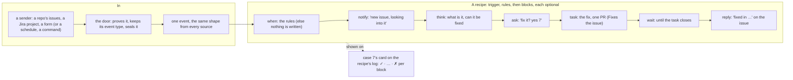

# 0029: Connections: a recipe is a list of blocks, from any sender to any answer

## Context
ADR 0027 set out two of the owner's requests:
- **R3:** "tools as outputs: a PR, a Telegram message, an email".
- **R4:** "on a timer or a webhook, do this and message me, written as clean markdown with clear
  inputs and outputs".

It built the parts: the door, recipes (`forward`, `check`, `agent`), send. On 2026-10-03, after
ADR 0028, the owner asked for the parts to work as one pattern:
- "the input output connection pattern I kept telling about, with properly controlled templates";
- "if I set a webhook, clean simple response processing and output";
- "a Jira ticket or an open source issue raised comes in as a webhook … a recipe would be several
  things written down and plugged in: notify there was an issue and it's being processed, an agent
  finds the resolution, raises a PR, sends on Telegram, replies back on the issue … all optional and
  attachable … templates make setup convenient … random dangling issues and PRs create noise";
- "proper intuitive and helpful setup with no missing pieces end to end";
- "the core stays intact … no breakages or underlying loose concepts; harden carefully";
- on Repeats: "separate clean attachments? keep the vocabulary and processes clean";
- and, on the draft: code changes through tasks, a smaller first part, "make it robust and properly
  reviewed".

**A sweep of the input–output chain** (2026-10-03) found where it breaks today:

| Stage | Today | The gap |
|---|---|---|
| **In** | the door takes any signed webhook (`cli/lib/plugins/door.ts`; shipify-admin `src/worker/door.ts`) | **the sender's event type is dropped** (`X-GitHub-Event`); **one hook feeds one recipe** (`cli/lib/recipes.ts:333`); each sender's payload differs, tying a recipe to one sender; a hook's data is capped at 32 KB, so large GitHub deliveries are refused (413) and GitHub doesn't retry; connecting takes five manual steps |
| **Processing** | a recipe is **one** step: `forward`, `check` (a script) or `agent` | **no chaining** ("tell me, look into it, fix it, reply"); no rules to drop noise; no vetted starting points |
| **Out** | a comment on the recipe's log; `send:` names channels (none plugged in yet) | **no reply to the sender's thread**, **no PR** from a recipe, **no notification** without subscribing by hand |
| **Noise** | every signal and answer is a new comment | following one event through several steps would leave comments, issues and PRs that never close |
| **Seeing it** | each run's log in Actions | nothing shows "this came in, this is where it stands" |

**The draft was then reviewed four ways,** each against the code: security and trust; consistency
with the code and earlier ADRs; clarity, setup and noise; robustness. **A second round** checked the
revision against those findings and the code again. Every finding of both rounds, and how it's
answered, is in [Review: what changed](#review-what-changed). The design below is the reviewed one.

## In one line
A **recipe** is a short list of **blocks** after its trigger and its rules. Each event that passes
the rules becomes a numbered **case** on the recipe's log, shown as one **card**. Every case ends:
done, dropped (your `no`, or an expiry) or failed, and nothing waits forever. Code changes only through a **task**, opened only on your
`yes`. **Templates** turn a use case into a recipe in a few answers, and **`ship connect`** sets one
up from nothing, one checked item at a time.

## The model



### The owner's example, end to end
An issue is opened on spotter (or, with the Jira source, a ticket in a Jira project):

| # | | What happens | Where you see it |
|---|---|---|---|
| 0 | **in** | GitHub sends `issues: opened` to `/door/hook/spotter`. The door proves GitHub's signature, keeps the event type, trims the payload, seals it and starts the file run | — |
| 1 | **when** | `kind: issue_opened`, not from a bot, about spotter itself: it passes. An edit, a close, the bot's own reply or another repo's event writes nothing | — |
| 2 | **notify** | "New issue in spotter: «Login broken on Safari», looking into it" (case 7) | Telegram; the card appears (one GitHub notification) |
| 3 | **think** | the agent reads the issue and a read-only copy of spotter at `main`: severity, cause, fixable, a summary | the card |
| 4 | **ask** | "Case 7: fix it? The task will be: «…». Reply `yes 7` or `no 7`" | one "needs you" comment (a GitHub notification), and Telegram with the link |
| 5 | **task** | on your `yes 7`: a task opens, `spotter: spotter-issues case 7`, with the brief you saw, and only that. The agent works on it as on any task (spotter's checkout, `make verify` on the Pi, **one** PR, screenshots, your comments there), with a token for spotter alone. Its PR says `Fixes spotter#42` | the card links the task and its PR |
| 6 | **notify** | "PR ready for case 7: <link>" | Telegram |
| 7 | **wait** | until the task closes: your merge closes it, and the issue on spotter (`Fixes`) | the card: "waiting for your merge" |
| 8 | **reply** | on the issue: "Fixed in <PR>, thanks for reporting!" (fixed words and Shipify's own fields) | the issue, for its reporter |

Attach only what you want:
- **Tell me, and thank the reporter:** notify · reply.
- **Sort it and tell me only the bad ones:** think · notify with `if:`.
- **Fix it without the triage:** ask · task · wait · reply.

A Jira ticket goes through the same blocks: every source gives the same event shape (§2).

**What it leaves behind:**
- one card on the recipe's log;
- one task, only because you said `yes 7`, closed by your merge;
- its PR, merged;
- the issue, closed by `Fixes` and answered.

If you say `no 7`, or don't answer in 3 days, the case ends and leaves only its card.

## The core, unchanged
This plan extends the operating system and keeps every one of its rules (README "How it works",
ADR 0019, ADR 0027 §16):

| The rule | Kept by |
|---|---|
| **Two planes:** GitHub keeps the record and the queue, a box runs what the queue hands it | a case's state is on its log; a box keeps nothing between Actions runs |
| **The door only proves, seals and starts** | its change copies a fixed list of event headers, trims a payload by a fixed rule, and answers a *proven* `ping` without starting anything. It reads nothing of shipify's |
| **The watch only reads and presses** | the due run only starts rounds (a log's, a task's); it never changes a case itself |
| **The core names no tool, channel or agent** | blocks call the source, channel, tool and agent contracts; GitHub, Jira and Telegram are plug-ins with conformance tests |
| **One record, on GitHub** | the log: its unedited signal comments, its status comment (each case's state), its cards (views only) |
| **Approvals are yours, on GitHub** | a code change from outside waits for your `yes <n>`; a PR waits for your merge; nothing from a channel approves |
| **A signal is data, never instructions, and never writes the notebook** | in every block, including a task a case opens (§4) |
| **Free, no new service** | none added; budgets and rate caps bound what a busy sender can spend |

## One word, one thing
Each word means exactly one thing, here and in the docs:

| Word | Is | Isn't |
|---|---|---|
| **sender** | what calls the door: a repo's webhook, a Jira project, a form | a source (the sender is the thing; the source is the plug-in that reads it) |
| **source** | the plug-in that proves and reads a sender's deliveries: `github`, `generic`, `jira` | a schedule or a command (those are triggers, not sources) |
| **hook** | a sender's address at the door: `/door/hook/spotter`, bound to one source | one recipe's (every recipe on it listens) |
| **connection** | a hook, its line in `hooks.json` (its source and repo, reviewed), and the sender's webhook that calls it ("spotter's connection"), set up by `ship connect` | a recipe |
| **delivery** | one call from a sender to the door | an event (one delivery carries one event, or is dropped) |
| **event** | one thing that happened, in the one shape every source gives (§2). The sender's own name for it is its **event type** (the envelope's `event_type`) | the raw payload (`event.raw`, trimmed) |
| **signal** | an event from a sender, kept as its unedited comment on the log (ADR 0027's word) | a case (a signal starts one) |
| **recipe** | a reviewed file: its trigger (`on`), its rules (`when`), its blocks | a Repeat; a task |
| **block** | one item of a recipe's list, from the fixed set of eight (§3) | a plug-in (blocks call plug-ins) |
| **case** | one event (or one scheduled time) going through one recipe, numbered on its log: case 7 | an Actions run (a case uses several); a task |
| **card** | case 7's one comment, edited as it goes: a view. It's found by its mark to be updated, never read for state | the log's status comment, where each case's state is kept |
| **log** | a recipe's one issue: its signals, cards and status, assigned to you. Closing it pauses the recipe | a task |
| **task** | an issue you open, or a case opens after your `yes`: a conversation with the agent that can end in PRs. **The only place code changes** | a case |
| **Repeat** | a task that comes back on a schedule, set up from the phone (§9) | a recipe |
| **ask** | the block that waits for your `yes <n>` or `no <n>` | `think`'s question (that's `question:`) |
| **`yes <n>`** | your approval of case n's ask, as your own comment on its log; on a task, `yes` approves its listed changes (ADR 0015) | a merge, which approves a PR |
| **channel** | where words reach you beyond GitHub: Telegram, email (ADR 0027), named in `send:` | the sender's thread (that's `reply`) |
| **template** | a vetted recipe with blanks, its samples and its golden cards | a block's words |

**Retired, or not used:**
- `forward`, `check` and `agent` as kinds to write: they still read, as block lists (§1);
- `offer` (the first draft): it's `ask`, then `task`;
- `fix` as a block (the second draft): a fix is a `task`;
- "one hook, one recipe";
- "pipeline", which already names `pipeline.yml`.

## No breakage
Everything that works today keeps working. Where something changes, it's named here:

| Today | After this plan |
|---|---|
| Tasks, Repeats, the forms, `remember:`, `recipe:` (ADR 0028) | unchanged. `recipe:` picks a template first |
| The selftest recipes (`do: forward`, `do: check`) and any recipe written that way | read as block lists, with the same answers on the same log; `ship selftest recipes` passes unchanged. A check that's unchanged still posts nothing |
| An `agent` recipe you start (its schedule, `again`) | `think` in a case you started runs as today's agent recipe does (the task profile); only a case from outside gets §4's read-only `think`. An `agent` recipe with `act` keeps today's act round until part 2 brings `update` |
| A recipe's log: `again`, closing to pause, three failures pausing | unchanged. **Changed:** the log is assigned to you; failures caused by an event (a locked thread, a missing field) don't count toward the three; on a paused log, `yes` and `no` answer "paused" |
| `again` on a log | unchanged for a scheduled or command recipe (it runs now). **Changed:** on a hook's recipe it answers "say `again <n>`", since repeating the last event would reply to its sender twice; `again <n>` retries case n from its failed block, keeping its trust |
| The envelope (version 1) and the door's routes | unchanged; `event_type` and `proof` are optional fields an older box ignores (Assumptions). **Changed:** a GitHub delivery may be up to 256 KB and is trimmed to fit (§2) |
| `ship hook new` and `ship hook fire` | kept. **Changed:** `hook fire` becomes `hook test`: it sends the source's sample with its event type, and reports each recipe's case or "filtered" |
| Standing approvals, the guard, the signal profile (#91) | unchanged; `update` uses them as they are |
| The watch's alerts on the status issue and your default channels | unchanged: Telegram's setup adds it to your default channels (`SHIPIFY_SEND`), so alerts reach it with no recipe |
| The console | **changed:** part 1's admin PR teaches it the new log body, so nothing reads wrong in between; part 3 adds Connections |

**Amended here, by name:**
- **ADR 0027 §2,** "a signal never files a task" (`docs/door.md`, `cli/commands/task/file.ts:8`):
  a case may open a task only after your `yes <n>`, as a **case's task** with its own limits (§4).
- **ADR 0028 §1,** "a recipe opens no PRs" (`docs/recipes.md`, `playbooks/task.md`, `AGENTS.md`, the
  Recipe form's How, `recipe new --do`): a recipe's case can lead to a PR through a task after your
  `yes`. "A dependency update is a Repeat job" still holds; `value-watch` is the other way.

**Each part is held to this table:**
- the full test suite, before and after;
- `ship selftest`, live, after each merge;
- every template's golden cards.

## Assumptions, checked

| Assumption | How it was checked |
|---|---|
| An older box accepts an envelope with new fields | `openEnvelope` (`cli/lib/plugins/door.ts:100-110`) checks the seal over the envelope as sent; zod drops unknown keys. Either side can deploy first |
| GitHub names the event in `X-GitHub-Event`, and sends a `ping` when a webhook is made | GitHub's webhook docs |
| GitHub's signature covers the body only | GitHub's docs: so the event type and delivery id are unproven, and §2 binds them (one source per hook, the body's shape, dedup by content) |
| GitHub deliveries fit once trimmed | the door's data cap is 32 KB (`door.ts:17`). PR and workflow-run payloads carry full repo objects that pass it. **Checked first in part 1:** each event a template uses fits after §2's trim, with GitHub's sample payloads; one that doesn't stays off the source's list |
| The bot can comment on the org's issues | `BOT_PERMISSIONS` (`cli/commands/bot.ts:15`, `issues: write`), installed on all the org's repos (`docs/setup.md`) |
| A task can be marked as a case's | the door's mark (`doorTask`, `context.ts:87`) shows how a run-opened issue is trusted; a case's task gets **its own mark**, because a door task's body is read as your words (forms, `use`, the title's access words), which a case's must never be (§4) |
| Closing a task closes its PRs | only `taskClosed` does (`lifecycle.ts:28-53`), in the task's own round with the bot's token. A close by the workflow's token starts no job (`due.ts:233`), so expiry dispatches the task's round, never closes it directly |
| A merged PR closes its task | only a PR whose text says `Closes shipify#n` (`links.ts:15-22`); `ship pr` writes that for a task's PR. A task with no PR is answered, then closes after a quiet day (`due.ts:201-238`) |
| An edited comment can't be trusted by its text | the bot's token in every task job can edit comments (`signalsOf` trusts only unedited ones, `recipes.ts:422`). So a case's state is read from the log's status comment, which counts only when its author and its last editor are the workflow's own login. GraphQL's `IssueComment.editor` gives the editor; the record contract gains `commentWriters()` beside `writers()`, with its conformance test. `findStatus` stops accepting any bot as author |
| The PC can make and read a repo's webhooks | `POST`/`PATCH /repos/{o}/{r}/hooks`, `GET …/deliveries`, `POST …/attempts`, with the token's **Webhooks** permission (not on `tapp-pc` yet: `ship connect` asks for it). **Checked first in part 1** |
| A new comment notifies an issue's assignee; an edit doesn't | GitHub's notification docs. **Checked live in part 1** |
| Jira can prove its webhooks | Jira's docs: a webhook secret, or a key in the URL. **Checked in part 4**, before the Jira source ships. A source names the proofs it takes: `github` a signature only; `jira` its signature if Jira sends one, else the URL key |
| A bot token can be limited to one repo | `actions/create-github-app-token` (already in `task.yml`) takes `repositories:`; GitHub mints an installation token for the named repos only |
| A run's close starts no job | `task.yml` runs the task job only when the sender is the owner (`task.yml:84-90`), and a close by the workflow's token starts nothing (`due.ts:233`). So whatever closes a case's task must start its log's round itself (§6) |
| The watch's alerts already reach your channels | `watchAlert` sends them to your defaults (`watch.ts:177-186`, `toDefaults`) |

## Options
- **A. A recipe is a list of blocks** (this). Pros: one shape for every use; each block small and
  tested; old recipes are one-block lists. Cons: a `steps` list to learn, which templates write.
- **B. Chain one-step recipes.** Pros: no new format. Cons: state split across logs, loops, trust
  mixing between links, and a log per link (noise).
- **C. Every event becomes a task.** Pros: tasks already work. Cons: an issue per event (the noise
  the owner named), and a task can't reply on the sender's thread.
- **D. A code-changing block of its own.** Pros: no extra issue. Cons: a second copy of a task's
  round and a weaker way to steer it. A task, opened only on your `yes` and closed by your merge, is
  one issue you asked for.
- **E. A visual builder in the console.** Pros: no file. Cons: the console starts writing (a new
  trust path and keys), and a large build. Templates and `ship connect` give the ease without it.
- **F. Repeats as recipes.** Weighed in §9 and left out.

## Decision
Chosen **A**.

### 1. A recipe: trigger, rules, blocks
```markdown
---
on: hook spotter                 # the trigger: a hook, a schedule, a command (as today)
when:                            # the rules on the event (§2): every one must hold, or nothing is written
  kind: issue_opened
steps:
  - notify: "New issue in spotter: «{{event.title}}», looking into it (case {{case}})"
    send: [telegram]
  - think: "What is it, how bad, which file, can it be fixed in code?"
    fields: [severity, cause, fixable]
    as: triage
  - ask: "Fix «{{event.title}}»? {{triage.summary}}"
    if: { triage.fixable: yes }
  - task: "Fix: {{event.title}}. Likely cause: {{triage.cause}}"
  - notify: "PR ready for case {{case}}: {{task.pr}}"
    send: [telegram]
  - wait: closed
  - reply: "Fixed in {{task.pr}}, thanks for reporting!"
    if: { wait.merged: yes }
use: sonnet                      # the agent's model for think and the task (default: Auto)
expires: 3d                      # an unanswered ask, or a case held back (default 3 days)
budget: 10                       # agent blocks a day for this recipe (default 10)
max_tasks: 3                     # open tasks from this recipe at once (default 3)
example: recipes/spotter-issues.example.json
---
# Spotter issues

House rules for the agent: keep fixes small; never change the public API.
```

- **`on`** is the trigger, as today. A hook's source and repo are its line in `hooks.json` (a reviewed
  file, written into the recipe's PR by `ship connect`), so there's no `from:` to get wrong. A
  delivery to a hook with no line there is dropped.
- **`when`** holds the rules on the event. Each is a field and a value, or a list of values, and
  every rule must hold. Defaults applied to every hook recipe: `author_is_bot: false` (which also
  drops Shipify's own replies), and the event about the hook's own repo. **A hook's recipe must
  name a `kind`,** so nothing takes every event by accident.
- **`steps`** run in order. Each item has exactly one block key. `as:` names its results (the
  default is the block's name), and `{{case}}` is the case's number.
- **`if:`** on an item is a rule in the same form as `when`. An item whose rule doesn't hold is
  skipped, with one exception: **a skipped, unanswered or refused `ask` ends the case there**
  (§4).
- **Old recipes still read:**
  - `forward` → `notify`;
  - `check` → `changed` + `notify`;
  - `agent` → `think` + `notify`, with its standing approval as `update`.
- **`recipe check`** holds the whole list to its source and its sample. It names each miss in
  plain words:
  - a field used that nothing before it gives;
  - a block where §4 doesn't allow it;
  - a channel or tool not set up;
  - a `reply` the source can't make;
  - a `kind` the source doesn't send;
  - a hook recipe with no `kind`;
  - two recipes on one hook with the same rules;
  - budgets on all recipes adding up to more than 30 agent blocks a day.

### 2. In: sources, one event shape, and the door
A **source** is data, `sources/<name>.json`, never code, held to a conformance test. It says:
- how its deliveries are proven;
- its event types;
- for each one, how it reads as the event shape, field by field, with a real sample.

| Field | GitHub `issues: opened` | Jira `issue_created` | A form (generic) |
|---|---|---|---|
| `kind` | `issue_opened` | `issue_opened` | `entry` |
| `title` · `body` | the issue's title and text | the ticket's summary and description | the form's name; its fields, one per line |
| `url` · `id` | its link · `spotter#42` | its link · `SPOT-42` | — · the delivery's id |
| `author` · `author_is_bot` | its opener | its reporter | — |
| `project` | the hook's repo, when it's a Shipify project | the recipe's `project:` | the recipe's |
| `raw` | the trimmed payload | the trimmed payload | the payload |

**Sources in this build:**
- **`github`:** issues, issue comments, pull requests, releases, workflow runs, stars, each kept only
  if its samples fit after the trim;
- **`generic`:** any JSON, mapped by the recipe's own `fields:`;
- **schedules** (as today).

**After:** `jira` (part 4), and chat commands with Telegram (part 4).

**The door's change** (in shipify-admin, merged with part 1; it reads nothing of shipify's):
- **It copies one header** from a fixed list (`X-GitHub-Event`, `X-Shipify-Event`) into the
  envelope as `event_type`, when it matches `^[a-z_.:-]{1,40}$`, and records `proof: signature` or
  `proof: url-key`.
- **It trims a GitHub delivery by one fixed rule.** A delivery signed by GitHub may be up to
  256 KB; anything else keeps today's 64 KB cap. Then:
  - every object under `repository`, `repo`, `head_repository`, `organization`, `sender`,
    `installation`, `enterprise` or `owner` keeps only `login`, `name`, `full_name`, `html_url` and
    `type`;
  - every `body` over 8 KB is cut to 8 KB, saying so.

  Then today's 32 KB data cap applies. The rule and the `github` source share their test files:
  the source's samples, trimmed by the door's rule, must read the same in both repos' tests.
- **It answers GitHub's `ping` only after proving it.** A proven ping gets `200 pong` and starts
  nothing; an unproven one gets 401.

**On the box, before anything is read or written:**
- **A hook is bound to one source and one repo,** by its line in `hooks.json`, a reviewed file. A
  delivery whose proof the source doesn't take (`github` takes only its signature) is dropped.
- **So is one whose event type the source doesn't know,** or whose body doesn't read as that event
  type.
- **So is one about another repo** than the hook's own.
- **One delivery is filed once:** by its delivery id, as today, and for GitHub also by its content
  (the item's id, its action and its time). A captured body replayed under a new delivery id is
  filed once.
- **A GitHub event whose item's time is more than 26 hours old is dropped,** so a replay after the
  duplicate window can't start a case again. `hook redeliver` resends only the last 26 hours.
- **Events from Shipify's own accounts are dropped** (the bot, the workflow's token, a reply tool's
  account), so a `reply` never comes back as a new event.
- **Per hook, at most 20 cases an hour,** counted from the Actions run list (one read, nothing
  stored). Past that, deliveries are dropped, and `ship connections` and the run's log say so.

### 3. The blocks
A fixed set of eight. New abilities come as plug-ins (sources, channels, tools), never new blocks.
**Code changes have one path, a task.**

| Block | Does | Gives | Runs as |
|---|---|---|---|
| **changed** | goes on only when a value differs from last time's (today's `check`), from a template or a script | `value`, `last` | the box, no agent |
| **notify** | words to you: the card, plus `send: [telegram, …]` | — | the box, no agent |
| **think** | an agent answers a `question` in the `fields` you name, reading the event and, when the recipe names a project, a read-only copy of it (§4) | `summary`, your fields | an agent, on the profile the case's trust gives |
| **ask** | shows exactly what comes next (the task's brief, a reply's words), and waits for your `yes <n>` or `no <n>` | `answer` | the box; one "needs you" comment |
| **task** | opens a **case's task** with the brief: as yours, but held to §4's limits. The agent works as on any task; its PR says `Fixes` the sender's issue when it's on the same repo (`ship pr`'s link line gains it) | `issue`, `pr` | its own rounds, on the `case` profile (§4), after your `yes` |
| **wait** | until the case's task closes (`closed`), or a time passes | `merged` | nothing waits on a box; the task's close starts the log's round |
| **reply** | words on the event's own thread (the issue, the ticket), from the source's reply tool. With `close: true`, it also closes it | `url` | the bot for the org's repos; Jira's tool for Jira |
| **update** | a tool's change under the recipe's standing approval (ADR 0027): its fixed fields the recipe's, the free ones filled by the agent from the event and earlier results, through the guard | the tool's answer | an act round, as today's standing approvals; it counts in the budget |

### 4. Safety: what a case may do
Trust is ADR 0027's. A case started by a sender is a signal; one started by a schedule or your
command is yours. On top of that:
- **An `ask` gates everything after it.** A `task`, an `update` that isn't the recipe's standing
  approval, and a `reply` with anything but fixed words and Shipify's own fields (`task.pr`,
  `event.url`, `case`) run only when an earlier `ask` **in this case** got your `yes <n>`. A skipped
  ask, a `no`, or an expiry ends the case there. `recipe check` refuses a list where they come
  before an ask, and the case refuses at run time too.
- **The ask shows exactly what follows:** the task's brief, the reply's words. What it showed is
  what's used, unchanged.
- **`yes <n>` counts only** as your own unedited comment on the log, written after case n's "needs
  you" comment. A bare `yes` never answers a case. A `yes` from a channel opens nothing.
- **A case's task is held to its own limits.** Its mark is its own (`trust: case`, the case's
  number, your `yes` comment's id), never the door's. `taskRun` takes it as yours only through a new
  `caseTask()` check: the mark, written by the workflow's login, with its text edited by no one
  since (`writers()`). Then:
  - **its title is fixed,** `<project>: <recipe> case <n>`, never the event's words or the
    recipe's free text;
  - **its body is the brief you approved, and only that;** no event file;
  - **its rounds read no form, title word or `use` line,** and `task.yml`'s access step never
    widens its token (as it already doesn't for a recipe's log);
  - **its bot token is made for its project's repo alone** (`repositories:`), never the org;
  - **it runs on a `case` profile:** the task profile without WebFetch, WebSearch, `curl` and
    `wget`;
  - **it never reads or writes the notebook,** and gets no tool keys;
  - **it shows its trust on its status:** "a case's task: from outside, approved by you".

  Its agent can still run the project's code through `make verify`, as every task's does. The
  box's user stays the real boundary, as `docs/security.md` says, and giving the agent a user of
  its own is on the roadmap.
- **`think`, in a case from outside, reads and writes nothing:**
  - it works in a fresh copy of its project at `main`, outside the workspace, never a PR's branch
    (a PR comes in as its diff, as data);
  - the copy's `.claude/` and `.mcp.json` are left out, so it loads no settings, hooks or tools from
    it;
  - writes are refused everywhere but its own result file, and reads of the box's own logins
    (`~/.config/gh`, the credentials file) are refused, with the deny rules #91 uses for the guard's
    folder;
  - its environment's `GH_TOKEN` is emptied; it holds only the recipe's look-only tool keys.

  In a case you started (a schedule, your command), `think` runs as today's agent recipe does.
- **Words to an outside thread never carry blanks.** A `reply` or a task's brief with a missing
  field fails, naming it, instead of posting "Fixed in , thanks".
- **Budgets:**
  - each recipe has a daily `budget` of agent blocks (think, task), counted on its log;
  - past it, a case is held until the next day, or your `yes <n>` spends one more;
  - one line a day on the log's status says so, never a comment per case.

### 5. Out: what a case can answer with
- **The card** (always): case n's one comment on the log.
- **Channels** (`send:` on a `notify`): Telegram (part 4), email after. This is the send step of
  ADR 0027 §5.
- **The sender's thread** (`reply`).
- **A project,** through a case's task (`task` → its PR).
- **A tool** (`update`).

Each one is a plug-in with a conformance test. One that isn't set up is named by `recipe check`.

### 6. The record, without noise
- **One home per recipe:** its log, assigned to you. Nothing is opened per event.
- **A case shows a card only when it has something for you:** a notify, an ask, or a failure. A
  quiet case (`changed` with nothing new, an `if:` that skips the rest) leaves no card and counts
  on the log's status: "142 cases this week, 3 with cards".
- **The card is plain markdown,** short lines with tappable links, readable on a phone:
  > **Case 7 · «Login broken on Safari»** · [spotter#42](…) · 10:12<br>
  > ✓ told you on Telegram<br>
  > ✓ looked: likely the cookie's SameSite in `auth.ts` · fixable<br>
  > ✓ you said yes · 10:20<br>
  > ✓ task [#58](…) · PR [#57](…), make verify passed<br>
  > … waiting for your merge
- **On the log, GitHub notifies you only:**
  - when a case's card first appears;
  - when a case needs you (an ask, or a failure you can fix). That's one "needs you" comment at a
    time, deleted once it's answered.

  A case's task and its PR notify as any task does. Telegram carries whatever the recipe's
  `notify` items say.
- **A case is in one of these states:**
  - **running;**
  - **waiting for you** (an ask);
  - **waiting for its task;**
  - **held** (at `max_tasks`, past its budget, or past 10 open cases);
  - then **ended:** done, dropped (your `no`, or an expiry), or failed. `again <n>` takes a failed
    case back from its failed block.
- **The status issue lists every case waiting on you,** with its link, so nothing is missed.
- **Every case ends,** and the deadlines are kept by the log's own round:
  - each log's status keeps its soonest deadline, which the due run adds to `watch.next`, so a
    deadline is met within minutes, not a day;
  - **an ask not answered in `expires`** (3 days) ends the case;
  - **a case's task with no commit on its branch and no comment of yours for 14 days** expires.
    The due run starts its round with reason `expire` (a new reason in `REASONS`), and that round
    closes its PR with the bot's token, then the task, then starts its log's round;
  - **whatever closes a case's task starts its log's round,** so `wait` ends: your merge or your
    close (`task closed` sees the case's mark), or its expiry (the expiry round, itself). The due
    run's quiet-day closing (`mine`) covers case tasks too;
  - **a case held** expires like an unanswered ask.
- **At most 10 cases are open per recipe.** A case past that is held, and keeps only its signal's
  id until there's room.
- **The log stays light:**
  - each round reads the status comment and the comments since its last read, never the whole
    thread;
  - the duplicate check looks back 27 hours (envelopes older than 26 are refused anyway);
  - after 200 cases, once none is open, the log rolls over: part 2 opens with the next case number,
    linked both ways, and part 1 is closed as completed. The newest log is the recipe's, as today.
- **A failed block** marks the card ✗ with why, skips the rest, and posts "needs you" only if you
  can fix it. `again <n>` retries from that block.

### 7. Robustness: state, retries, order
- **Who writes what, on a log:**
  - **the log's round:** the status comment, holding each case's state and the recipe's `next`
    (moved here from the due run's `recipesDue`), and the cards;
  - **the file run:** only a signal comment, then it starts the log's round when none is queued;
  - **the send step:** only its receipts, as a hidden line on the card it sent for. The next round
    marks the line "sent" or "not confirmed";
  - **the due run:** writes nothing on a log, and only starts rounds. A round records the time it
    ran for, so a second dispatch for the same time does nothing.
- **When the log's status fails its check** (an author or last editor other than the workflow's
  login), the round changes nothing. It posts one "needs you": "the log's status was edited by
  <login>: check it, then say `again`".
- **Each block's state is saved on the log's status before the next block starts.** Every outside
  write (a card, a reply, a task) carries a hidden mark, `<!-- shipify-case <log>:<n>:<block> -->`,
  and is looked up before it's written, so a retry after a crash never posts twice.
- **Channels are sent at most once.** A notify marked "sending" is never sent again after a crash;
  its line says "not confirmed". The send step's outbox (`send.json`) is append-only, so two
  notifies in one round both go.
- **A round runs the box's blocks (changed, notify, ask, reply, wait) and ends,** so its send step
  sends the outbox. The next round runs at most one agent block (think, update), then ends. "Looking
  into it" arrives before the agent starts, and no round runs long.
- **Size:** the event stays on its signal comment. The status keeps, per open case, only its block
  states and its fields (at most 6, each at most 1 KB). At most 10 open cases keeps the status
  under 20 KB, well inside a comment's 65,536 characters. A card stays short.
- **Failures caused by an event** (a locked thread, a missing field, a closed ticket) end that case
  and don't count toward a recipe's three-failure pause. Failures of the recipe itself do.

### 8. Templates, against a use-case catalogue
A **template** is a vetted recipe with blanks, in `recipes/templates/<name>.md`, with its samples
and its **golden cards** (the card each sample should make). The tests run every template's list on
its samples against fakes, and compare the cards word for word, so no template goes stale. A test
holds the catalogue: each use case names its template, or why it's later.

| Use case | Template | Blocks | Part |
|---|---|---|---|
| An issue comes in: tell me, and thank the reporter | `issue-ack` | notify · reply | 1 |
| An outside monitor says down, then up | `monitor` | changed · notify | 1 |
| A value on a page, or a tool's version, changes | `value-watch` | changed (a script) · notify | 1 |
| A morning brief from Notion | `daily-brief` | think (Notion, look-only) · notify | 1 |
| An issue or ticket: tell me, look into it, offer a fix, reply when it's done | `issue-to-fix` | notify · think · ask · task · notify · wait · reply | 2 |
| An issue: sort it, label it, tell me only the bad ones | `issue-triage` | think · update (labels, through a `github` tool part 2 adds) · notify `if:` severe | 2 |
| A PR from someone else: review it, and post the review when I say yes | `pr-review` | think · notify · ask · reply | 2 |
| A form entry: tell me, and save it in Notion | `entry-to-notion` | notify · update (its agent fills the page's free fields from the entry) | 2 |
| A new version of a tool: offer the upgrade | `value-watch` + ask · task | changed · notify · ask · task | 2 |
| A Jira ticket, the same as an issue | `issue-to-fix` on a Jira hook | as above | 4 |
| `/brief` from my phone | `daily-brief` (`on: command brief`) | think · notify | 4 |
| The watch's alerts on Telegram | — **no recipe:** Telegram's setup adds it to your default channels | — | 4 |
| A deploy fails, and recovers | `deploy-watch` (changed · notify), **only if you choose it** | changed · notify | 2 |
| Notion telling me a page changed | later: Notion's webhooks need a one-time handshake | | later |
| An email arriving | later: needs a way in for mail | | later |
| One recipe's case starting another | not planned: one list holds the blocks a chain would need | | — |

### 9. Repeats and recipes: separate, sharing their parts
Turning Repeats into recipes was weighed and left out. It would give one engine, and blocks for
Repeats. It would cost:
- the phone-quick setup with no PR, or a looser trust rule;
- the Repeat as a **conversation** ("make it 8am", notes between runs, a PR per run);
- a rewrite of something that works, for no new ability.

They share:
- **the clock:** the watch's due run starts both;
- **channels:** a Repeat's answers can go to Telegram through the same send step, as a task's
  reply can (ADR 0027 §5);
- **the words:** `yes`, `no`, `again`, "stop repeating";
- **a bridge:** "make this a recipe" on a Repeat links the Recipe form, filled in from it.

**The line:** a Repeat is a task that comes back: yours, set up in a minute, a conversation. A
recipe is a reviewed automation: a trigger, rules, then blocks.

### 10. Setting one up, guided: `pnpm ship connect`
One command, like `ship setup`. Each item is checked against the real state, says what it did, and
names the next. You can stop and rerun it: it picks up where you left off, and never asks twice.

```
$ pnpm ship connect
? What should come in?        1. GitHub issues on a repo   2. A form or any webhook   3. A schedule
> 1
? Which repo?                 spotter   (a Shipify project: every template fits)
? What should happen?         1. Tell me, look into it, offer a fix, reply when it's done   (issue-to-fix)
                              2. Tell me, and thank the reporter                             (issue-ack)
                              3. Sort it, and tell me only the bad ones                      (issue-triage)
> 1
? Tell you on Telegram too?   not set up yet (part 4): GitHub notifications for now
? Your model for the agent?   Auto

  ✓ 1. GitHub can call the door: the token has Webhooks permission
  ✓ 2. The recipe: recipes/spotter-issues.md from issue-to-fix, checked; its sample makes this card: …
  ✓ 3. Its PR: <link>, checked by `pnpm verify`
  … 4. Waiting for your merge (merge it from your phone; I'll carry on, or Ctrl-C and rerun later)
  · 5. spotter's connection: its webhook, taking only issues events; GitHub's ping proven: "connected (200)"
  · 6. A test case: a sample issue through every block. The reply, the task and any update only
       show what they'd do. The card appears; the ask says "test: nothing to answer"
  · 7. You're notified: the log is assigned to you
```

- **Item 1, when the permission is missing:** it opens the token's settings page, names the one box
  to tick (Repository permissions → Webhooks: Read and write), waits for Enter, and checks again.
- **A repo that isn't a Shipify project:** there's no code for `think` and nowhere for a `task`, so
  only the templates without them are offered.
- **It ends** with the connection's line from `ship connections`, the log's link, and how to change
  or stop it.
- **From the phone:** the Recipe form, or `recipe: when someone opens an issue on spotter, tell me
  and offer a fix`.
  - The task picks the template, fills it in, checks it on its sample, opens its PR, and replies
    with the same checklist.
  - A schedule's recipe goes live on its merge. A hook's recipe needs one `ship connect` on the PC
    for its webhook, and its log says "one `ship connect` left" until it's done.
- **Another recipe on a connected repo:** `ship connect` adds its event types to the same webhook,
  and tests both.
- **A generic sender** (a form, a monitor):
  - item 5 shows the address, and where its key is, in the sender's own words;
  - it waits for the first delivery, or a `ship hook test`, and confirms it.

**After setup:**

| To | Do | Checked by |
|---|---|---|
| see every connection and recipe | `pnpm ship connections` (hooks, their source and recipes, the cases in flight, failed or missing webhooks, event types a recipe needs that its webhook doesn't send); the console's Connections | the runs, the logs, GitHub's delivery records |
| answer a case | `yes 7` or `no 7` on its log: one tap from the notification or Telegram | the card |
| retry one | `again 7` | the card |
| resend what GitHub couldn't deliver | `pnpm ship hook redeliver <hook>` (the same ids, so each is filed once) | `ship connections` |
| change a recipe | its file in a PR (the Change form, or `shipify: …`). The PR ends with "then `pnpm ship connect <hook>`" when its event types change | `recipe check`, its golden cards |
| pause one, or resume it | close its log, or reopen it (from the phone). Deliveries while paused are dropped and counted | the log's status |
| remove one | delete its file in a PR. `ship connect --remove <hook> --yes` removes the webhook once no recipe needs it; `ship connections` shows webhooks whose recipes are gone | `ship connections` |
| change the door's key | `ship door rotate --yes` resets each connected webhook's secret too | `ship connections`, then a test |
| know it all still works | `pnpm ship selftest connections` (a generic hook feeding two recipes: one takes the sample, one filters it; the card is read back), and `ship selftest` after every release | live, through the door |

## Edge cases
- **Duplicates:** the same delivery, or its replay, makes one case (§2).
- **An issue edited ten times** makes no cases: `when` takes `issue_opened` only.
- **Two recipes take the same event:** each makes its own case. `recipe check` warns when their rules
  are the same.
- **A case while another of the same recipe is in flight:** they queue on the log, one round at a
  time. An `ask` or a `wait` frees the queue, because its round ends.
- **`yes 7` on a case that's done, ended or expired:** "case 7 ended on <date>", and nothing runs.
  `yes 7` with words (`yes 7, keep it small`) adds them to the task's brief, after the brief you saw.
- **The task can't pass `make verify`:** it opens no PR and says why on its own thread, as tasks do.
  You steer it there; the card follows it.
- **The task is closed without its PR merging:** `wait` ends with `merged: no`, and a `reply` after it
  runs only `if: { wait.merged: yes }`.
- **The sender's thread is locked or gone:** `reply` fails, and the card says so. The case ends, and
  the failure doesn't count toward a pause.
- **A reply on a repo outside the org:** it needs that repo's token as a tool's key. Without one,
  `recipe check` says so, and `ship connect` doesn't offer the reply.
- **A burst:**
  - the rules run before any read of the record;
  - the webhook takes only the event types its recipes need;
  - 20 cases an hour per hook;
  - the budgets;
  - the log's round starts once for many signals.
- **No box online:** as today. The file run writes the signal on GitHub's machines and applies the
  rules there; the round waits for a box.
- **GitHub couldn't deliver** (the door was down, or GitHub was): `ship connections` lists the
  failed deliveries of the last 3 days, and `hook redeliver` resends them.
- **The webhook was deleted on GitHub's side:** `ship connections` shows it as missing, and
  `ship connect` remakes it.
- **Telegram down:** the line on the card says "not confirmed"; everything else goes on.

## Docs and clean-up
- **New:**
  - `docs/connections.md`: the model, the example, senders, sources and the event shape, the blocks
    and §4's safety, the record, templates and the catalogue, `ship connect`, the after-setup table;
  - `guides/recipe-template.md`, rewritten: start from a template; the blocks.
- **Updated:**
  - `docs/recipes.md`: a recipe is a list of blocks; the old kinds; one hook, many recipes;
    "recipes open no PRs" amended;
  - `docs/door.md`: the event type, proof, the trim, a proven `ping`; "a signal never files a task"
    amended;
  - `docs/tasks.md`: `yes <n>`, `no <n>`, `again <n>` on a log; a case's task;
  - `skills/recipes`: pick a template, place blocks safely;
  - `playbooks/task.md`: a recipe task picks a template; a case's task;
  - `docs/plug-ins.md`: sources and channels;
  - `docs/setup.md`: the token's Webhooks permission;
  - `docs/glossary.md`: sender, source, hook, connection, event, block, case, card, template. "Run"
    stays an Actions run; "pipeline" stays `pipeline.yml`;
  - `docs/security.md`: §4;
  - the Recipe form's How; `README.md`, `docs/README.md`, `AGENTS.md`, `docs/context.md`,
    `docs/roadmap.md`, `CHANGELOG.md`;
  - shipify-admin: `docs/spec.md`, its change docs, `README.md`.
- **Removed:**
  - "one hook, one recipe" (code, docs, tests);
  - the five-step hook setup;
  - `ship hook fire`'s old behaviour (it becomes `hook test`);
  - the drafts' `offer`, `fix` and `shipify` source.

## Build
Four parts. Each is a PR tested end to end, useful on its own, held to the No breakage table, and
adds to `ship selftest connections`.
1. **The core, and the door's change** (shipify, with a small shipify-admin PR, 1.12.0, merged
   first, which also teaches the console the new log body):
   - cases, cards (when a block speaks) and the log as home, status and rollover;
   - recovery after a crash (§7);
   - the event shape; the `github` and `generic` sources; the door's event type, proof, trim and
     proven `ping`; the box's binding, dedup and own-account drop;
   - `when` and `if:`;
   - the blocks changed, notify, think (§4's read-only copy) and reply (fixed words);
   - budgets and rate caps;
   - the old kinds, read as lists;
   - the part-1 templates and their golden cards;
   - `hooks.json` (each hook's source and repo, reviewed), `ship connect`, `ship connections`,
     `hook test`, `hook redeliver`, and the door rotation's webhook reset;
   - the record contract's `commentWriters()`, and the status comment's editor check;
   - the docs.

   **Checked first:** the Webhooks permission; GitHub's samples fitting after the trim; that a new
   comment notifies the assignee and an edit doesn't. **Checked live:** `issue-ack` on spotter,
   set up by following `ship connect` from nothing; a real issue opened; the card and the reply
   seen.
2. **Ask, tasks and the rest (shipify):**
   - ask, `yes <n>`, `no <n>`, `again <n>`;
   - expiry;
   - the case's task: its mark and `caseTask()`, the `case` profile, its one-repo token, the access
     step leaving it alone, `Fixes` in its PR, `task closed` and expiry starting its log's round;
   - wait, and update on its act round, with the `github` tool for labels;
   - replies with an agent's words after an ask;
   - the part-2 templates.

   **Checked live:**
   - an issue on spotter: triaged, `yes`, a case's task, its PR merged, the issue closed by `Fixes`,
     the reply;
   - `no` on another, which leaves only its card;
   - an ask left to expire.
3. **The console (shipify-admin 1.13.0):** Connections, the new log body, the cases waiting on you,
   within the console's read budget.
4. **Telegram, and Jira:**
   - the Telegram channel (out, and `/commands` in); its setup step, which adds it to your default
     channels;
   - the `jira` source, its proof at the door, and its reply tool.

   **Checked live:** a ticket through `issue-to-fix`, told on Telegram. Either half can wait.

## Consequences
- **Easier:**
  - any sender to any answer is a few blocks, from a template, in a few answers;
  - one event is one case, with one card only when it has something for you, and every case ends;
  - code changes only through tasks, on your `yes`;
  - one webhook per repo serves every recipe;
  - setup is one guided command.
- **Harder:**
  - the blocks and §4's rules to learn, though templates and `recipe check` carry them;
  - a binding, a trim and dedup to keep right, which the source's conformance test holds;
  - one more permission on the PC token.
- **Unchanged:**
  - the door's job;
  - trust and approvals;
  - the record on GitHub;
  - cost: no new service, no new minutes; budgets and caps bound agent use.

## Review: what changed
Four independent reviews of the draft, each checked against the code:

| Finding | Severity | Answered in |
|---|---|---|
| A skipped `ask` let a `task` run with no `yes` | high (security; clarity) | §4: an ask gates everything after it; skipped, `no` or expired ends the case |
| A run-opened task reusing the door's mark would read the event as your words (forms, `use`, the title's access words, the notebook) | high (security; consistency) | §4: a case's task has its own mark, a fixed title, the brief only, no forms, no notebook, no widened token |
| Cards edited in place can't be trusted by their text | high (security; consistency) | the record table: state on the log's status, checked by its last editor; cards are views; answers only from your own comment |
| `think` wasn't read-only (acceptEdits on the workspace, the bot's token, a PR's own settings) | high (security) | §4: a fresh read-only copy at `main`, no settings from it, its own result file only, no GitHub token |
| Expiry and `wait` relied on the due run closing tasks, which its token can't, and which starts no job | high (robustness; consistency) | §6: the due run starts the task's round (`expire`); `wait` ends on the task's close; deadlines on `watch.next` |
| GitHub payloads over 32 KB are refused, silently | high (robustness) | §2: the door's fixed trim; samples checked first; failed deliveries listed and redelivered |
| A burst could spend the hour's GitHub calls and the Pi's slots | high (robustness) | §2, Edge cases: rules before reads, webhook event types, 20 cases an hour, budgets, one round for many signals |
| Every hourly check would post a card (noise) | high (clarity) | §6: a card only when a block speaks |
| The fix left the reporter's issue open | high (clarity) | §3 task: `Fixes` in its PR; `reply` with `close: true` |
| `yes 42` used the sender's number (it isn't unique, and it links to shipify's #42); a bare `yes` could approve the wrong case | medium (all four) | case numbers on the log; `yes <n>` only, after its "needs you", unedited, yours |
| The event type and delivery id aren't covered by GitHub's signature; a URL key reached every recipe; replies could loop | medium (security; robustness) | §2: one source per hook, proof recorded, URL keys refused for GitHub, body read as its type, dedup by content, own accounts dropped |
| A reply with an agent's or a stranger's words could post without an ask, or with blanks | medium (security; robustness) | §4: fixed words and Shipify's fields only without an ask; the ask shows the exact words; blanks fail |
| Crash between blocks: a second reply or task; two notifies in one round, only the last sent; "looking into it" after the agent | medium (robustness) | §7: marks looked up before writing, channels at most once, an append-only outbox, box blocks and send before the agent |
| A log with hundreds of cases: every round reads all of it | medium (robustness; clarity) | §6: reads since the last read, a 27-hour duplicate window, rollover at 200 |
| The `shipify` source would double the watch's alerts and need a box | medium (robustness; consistency) | dropped: Telegram joins your default channels, which alerts already reach |
| Earlier decisions changed without being named | medium (consistency) | No breakage: "Amended here, by name" |
| `again` would replay the last event and reply twice | medium (consistency; clarity) | No breakage: `again <n>` on hook recipes |
| `agent` → `think` would lose a started-by-you recipe's notebook writes | medium (consistency) | `think` runs on its case's trust's profile |
| `hook fire` sends no event type; the console reads the old log body; the console can't read webhooks | medium (consistency) | No breakage; part 3; `ship connect` keeps each connection's state on the record |
| One word, two things: `ask`, run, pipeline, connection, destination, event, template | medium (consistency; clarity) | One word, one thing, rewritten |
| `filter` was a block but ran elsewhere, in a different form from `if:` | medium (clarity) | `when` beside `on`, the same form as `if:`; eight blocks |
| Setup: two sittings, a test that might post publicly, templates offered that can't work, a recipe change silently needing new event types | medium (clarity) | §10: the permission first, waiting for your merge, a test that writes nothing, templates fitted to the repo, event types flagged |
| Failures caused by an event paused the recipe; `yes` on a paused log was silent | low (consistency) | §7; No breakage |
| Expiry "touched" by a stranger's comments kept a PR forever; held cases never expired | low (security; consistency) | §6: a commit or your comment; held cases expire |
| An unproven `ping` would make "connected" mean nothing | low (security) | §2: `ping` answered only after proof |
| Part 1 needed the door's change from part 3 | low (robustness; consistency) | Build: the door's change merges with part 1 |
| **Second round:** the status comment would outgrow a comment with ~5 waiting cases | high | §6, §7: the event stays on its signal; the status keeps block states and small fields; at most 10 open cases |
| **Second round:** a case's task could read the event and use an org-wide token with the network | high | §4: the brief only, a token for its project alone, the `case` profile without web or `curl`; the box's user named as the real boundary |
| **Second round:** `task.yml`'s access step could widen a case's task; `taskRun` had no check for its mark | medium | §4: `caseTask()`, the access step leaves it alone; Build part 2 names `task.yml` |
| **Second round:** nothing would start the log's round when a case's task closed, so `wait` never ended | medium | §6: whatever closes it starts the log's round; `expire` joins `REASONS`; `mine` covers case tasks |
| **Second round:** a captured GitHub body replayed after the duplicate window | medium | §2: an item older than 26 hours is dropped |
| **Second round:** the example's `reply` had no `if: { wait.merged: yes }` | medium | §1 |
| **Second round:** "send, then one agent block" can't happen in one round | medium | §7: box blocks end their round, so the send step sends; the next round runs one agent block |
| **Second round:** four writers of the log's status | medium | §7: who writes what; `recipesDue`'s `next` moves to the round; `hooks.json` holds a hook's source |
| **Second round:** the trim missed the 64 KB raw cap, long bodies and `head_repository` | medium | §2: 256 KB for GitHub-signed deliveries, bodies cut at 8 KB, `head_repository` in the list, shared test files |
| **Second round:** `think` still had the bot's token and wrote in the workspace | medium | §4: outside the workspace, writes and the box's logins refused, `GH_TOKEN` emptied; cases you started run as today |
| **Second round:** what runs `update`; labels need a tool; `entry-to-notion` had no agent to fill fields | low | §3: an act round, counted in the budget; part 2's `github` tool; its agent fills free fields |
| **Second round:** end states, the notification count, and six words used two ways | low | §6's one list of states; "on the log"; `event_type`, requests, delivery and signal rows, schedules as triggers, Jira's proofs |
| **Second round:** an editor check failing; the hourly count's home; case numbers after a rollover | low | §7: the round changes nothing and asks you; counted from the run list; rollover carries the next number |

## Every request, covered

| The owner's request | Where |
|---|---|
| "the input output connection pattern … properly controlled templates" (R3, R4) | The model; §1–§3; §8 |
| "a recipe would be several things … attaching blocks", the issue example | §1, §3; The owner's example; `issue-to-fix` |
| "a Jira ticket or an open source issue" | §2: one event shape; `jira` in part 4 |
| "random dangling issues and PRs create noise" | §6: one home, a card only when it speaks, at most two notifications, every case ends, `Fixes` closes the issue |
| "intuitive, helpful setup with no missing pieces" | §10 `ship connect` and its after-setup table |
| "the core stays intact … no breakages or loose concepts" | The core, unchanged; One word, one thing; No breakage (with the amendments named) |
| "Repeats: separate clean attachments?" | §9 |
| "code changes through tasks; a smaller first part" | §3, §4 (the case's task); Build |
| "make it robust and properly reviewed" | four reviews; Review: what changed; §7 |
| R3: a PR, Telegram, email | §3 task; §5; part 4 |

## Confirmation
- `pnpm verify`:
  - every template's list makes its golden cards on its samples;
  - the catalogue names a template, or a reason, for every use case;
  - `recipe check` names every kind of miss, and refuses a `task` (or a reply with an agent's words)
    before an `ask`;
  - an event the rules don't take writes nothing;
  - a skipped or expired ask ends its case;
  - a case's task reads no form or `use` and writes no notebook;
  - a replayed delivery files once;
  - a retry after a crash posts nothing twice.
- `ship selftest connections` passes, live.
- `ship connections` shows each connection, its recipes, its cases in flight and its deliveries.
