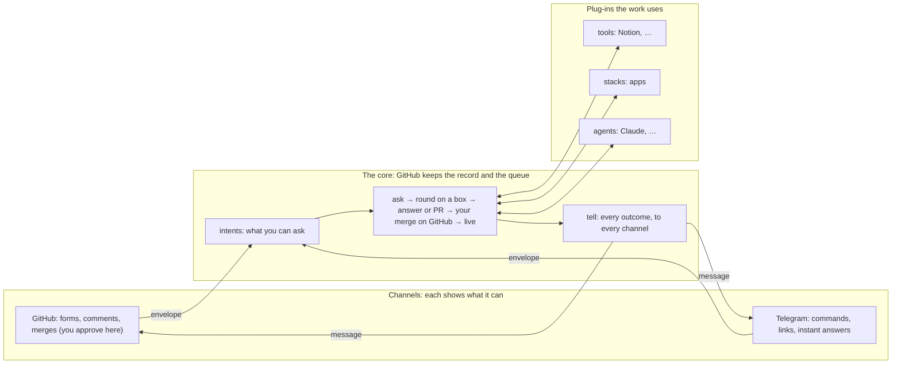

# 0030: One core, any channel: what you can ask defined once, every outcome told, one way to set up, and Telegram on it

## Read this first
GitHub stays the record, the queue and the only place you approve: you merge on GitHub, as today.
The loop doesn't change. What changes:
- **The core defines once** what you can ask, and tells you every outcome, with "Live: <link>"
  after each deploy.
- **Each channel shows as much as it can,** and every plug-in sets up the same way (`ship add`).
- **Telegram is the first channel on it:** you ask, remember, save and see your apps from Telegram.
  Its links open the PR on GitHub, where you merge.
- **First, step 0 makes a box a clean machine you can wipe:** no repo secret on it, ever.

| Step | Afterwards you can | You do |
|---|---|---|
| **0. A box is a clean machine** | nothing new: no repo secret on a box, ever | merge 2 PRs; a Shipify release |
| **1. One vocabulary** | nothing new: what you can ask is written once | merge 1 PR |
| **2. One way out** | see "Live: <link>" after every deploy; hear about every outcome | merge 1 PR |
| **3. One way to set up** | `ship add notion`, `ship remove notion` | merge 1 PR |
| **4. Telegram** | ask, remember, save to Notion, see your apps and get your links from Telegram | merge 2 PRs; `ship add telegram`: make a bot with @BotFather (one paste), tap Start |

**Not in this plan:** merging or approving from Telegram (never: approvals stay on GitHub). Other
people on your Shipify, running your own Shipify from one command, and sharing templates between
Shipifys are each for later, on your yes.

## Context
On 2026-10-04, after reading task #99's answers on recipes, plug-ins and channels, the owner asked:
- "making Telegram work for our use cases … create an app, approve a PR, get the app link from
  easy Telegram … without opening GitHub", "track something … very easy, intuitive, convenient";
- "more modular, customisable, flexible from the channels' point of view, and in setup";
- "store this in Notion at this page", "remember this while building something for a project";
- "plain language I can give my father, who is non-technical";
- "GitHub's queue and state stay part of the pure core";
- "core plug-ins … grouped up, attached to any set of tools, clean answers, setup done well";
- "don't break the flow: it's one loop working in synergy, attachable like blocks";
- "not Telegram first: common core APIs and blocks, mostly the same; they attach and become as
  flexible as the channel allows … on common setup interfaces";
- "I can always work on GitHub, but if it can be done through a UI or Telegram, that's awesome";
- "a common Shipify everyone can use, or share; a system design that can cleanly evolve"; "is it
  decentralised, with no common state?";
- "a plan I can review end to end, with clean-up and the docs update part of it".

Then, on the draft and its reviews:
- "this should never happen: a box is an independent, clean thing that can be wiped" (repo secrets
  copied to a box); "close the security gaps in the new plan; we're fine not protecting `main` for
  now";
- "askers (my father) aren't needed now: a clean, generic setup for now; we'll think about other
  people later";
- "**Telegram in no way merges a code PR.** Handle it in ways that don't change the core principles
  or punch holes. Don't complicate things: keep the flows simple and straightforward."

**A sweep of the code and docs** found:

| Stage | Today | The gap |
|---|---|---|
| **Ask** | 8 issue forms, title words (`new:`, `remember:` …), reply words (`yes`, `again` …) | defined in five places (the forms, the title parser, the access step's copy, the help text, the docs). No chat can ask: the door takes only `ping` and webhooks |
| **Tell** | a comment on the task; a send step | most outcomes reach no channel. **Nothing says "it's live: <link>"** after a merge |
| **Setup** | `ship setup` checks 9 steps | it checks, it doesn't do. Each kind has its own command, and a new channel means editing the workflows for its key |
| **Safety** | ADR 0019: a box knows nothing | **a box holds more than that today** (§0): repo secrets in a merged plan's build, a token that can change workflows and secrets, a preview's deploy key |
| **Telegram** | built in ADR 0029 part 4, archived unmerged | a text channel, never run with a real bot; it adds a sixth definition of what you can ask, and keeps its keys on the box |

**The draft was reviewed four ways** (security; consistency with the code and earlier ADRs;
clarity, setup and docs; robustness and simplicity), each against the code. Then the owner cut it
down: no approvals from a channel, no other people yet. [Review: what changed](#review-what-changed)
lists each finding and where it went.

## In one line
- **One catalog** (`intents.json`) says what you can ask, for every channel.
- **One function** (`tell`) gives you every outcome, ending with "Live: <link>".
- **Each channel** says what it can show.
- **Each plug-in** sets up with `ship add`.
- **Telegram** is the first channel on it, and approvals stay on GitHub.
- **Step 0 first:** a box never holds a repo secret.

## The model



Recipe blocks stay a small fixed set, part of the core. A new ability arrives as a plug-in, and a
tool's act is used in any recipe through `update`, within its standing approval (ADR 0029).

### Your examples, end to end

| You send on Telegram | What happens | You see |
|---|---|---|
| `/new a habit tracker` | the `new` intent files a task; the agent plans; the plan PR opens | "Plan ready: … [Open on GitHub]". You merge it on GitHub (the app works on your phone). After the build: "**Live:** https://habits.app.a69x.in [Open]" |
| `spotter: add dark mode` | a change task; one PR with a preview | "PR ready … [Open PR] [Preview]". You merge it on GitHub. Then "**Live:** … [Open]" |
| `remember spotter: big fonts` | the box notes it on spotter's notebook page, which spotter's rounds read; no agent | "Noted under spotter: big fonts" |
| `/save reading <link> looks interesting` | the `save` recipe adds a page under your "reading" Notion page (one of the pages you named when you set it up) | "Saved to Reading [Open]" |
| `recipe: tell me when the price at <link> changes` | a recipe PR from the `value-watch` template | "Recipe ready [Open PR]". You merge it on GitHub. Then, when it changes: "Price changed: 499 → 449" |
| `/apps` · `/status` · `/needs` | the Worker answers at once, reading what the console reads | each app with its link and health · boxes and runs · what waits for you, each with its GitHub link |

On GitHub everything works as today.

**What it leaves behind:** the task, its PR and its comments on GitHub, as today. Telegram keeps
nothing Shipify needs.

## The core, unchanged
This plan keeps every rule of the operating system (README "How it works", ADR 0019, ADR 0027
§16), and §0 makes one of them true again:

| The rule | Kept by |
|---|---|
| **Two planes:** GitHub keeps the record and the queue; a box runs what the queue hands it | every ask files a task or a comment on GitHub; Telegram and the Worker keep no state |
| **Approvals stay on GitHub** (ADR 0027 rule 10) | unchanged. A channel's `yes` still approves nothing, and nothing merges from a channel. A message that needs you links to the exact PR or comment on GitHub |
| **Only your merge goes live** | unchanged: the pipeline's guard stays as it is |
| **The door only proves, seals and starts a run** | the Telegram route proves the sender and starts `task.yml`, as for any envelope. Its instant answers only read, like the console. Its send route only passes Shipify's own messages to you |
| **The watch only reads and presses** | the Live message is one more line in its check (§5) |
| **A box knows nothing** | §0: no repo secret on a box, ever; publishing and operations run on GitHub's runners; an agent's token is its project's only. Telegram's token lives only in the Worker |
| **The core names no provider** | the catalog, `tell`, `can` and `ship add` name no channel, tool or host. Telegram lives in `tools/telegram/` and the admin Worker's module. `tests/core.test.ts` still bans provider names |
| **Free, no new service** | Telegram's bot API is free; publishing a new app on GitHub's runners is about one billed minute |

## One word, one thing

| Word | Is | Isn't |
|---|---|---|
| **intent** | one kind of request, defined once in `intents.json`: its words, its form, its chat command, what it starts | a task (one request, filed); the `ask` block or the `ask:` title word |
| **person** | someone in this Shipify, with their ids on channels (`on`), GitHub included. Today, only you | a GitHub account |
| **can** | what a channel says it can show: `text`, `links`, `files`, `instant` | a claim the conformance test hasn't checked |
| **setup** (a plug-in's) | the part of its entry that says what you need, its keys and where they go, its steps, its check, and how to remove it | a recipe **block** |
| **Live message** | "spotter is live: <link>", after a production deploy. A staging deploy says "On staging: <link>" | the deploy-watch recipe (failures) |
| **cell** | one complete Shipify: an org, its shipify repo, its boxes, its admin Worker (ADR 0027 §12) | a slice of someone else's Shipify |

## No breakage
Everything that works today keeps working. Where something changes, it's named here:

| Today | After this plan |
|---|---|
| The 8 forms, title words, reply words, `ship forms` | unchanged. The forms stay hand-written; a test holds them, the parser and the catalog to each other |
| Approving: a `yes` comment, the merge button | unchanged, and still only on GitHub |
| `SHIPIFY_OWNER` | unchanged: still the one owner. `SHIPIFY_PEOPLE` only adds your channel ids |
| `SHIPIFY_SEND` | unchanged: your default channels |
| `send: [telegram]` in a recipe | "not set up" until Telegram is added, as today; then it sends |
| The envelope and message, version 1 | new fields are optional. The seal is checked on the envelope as sent (`openEnvelope`), so either side can deploy first; a box that doesn't know a field ignores it |
| `ship bot`, `ship door setup`, `ship connect`, `ship box add`, `ship tools`, `ship selftest <part>` | kept |
| A merged plan's build | the agent builds and checks on the box; `ship publish` then runs on GitHub's runners with the keys (§0). Same result, same retry (`publish`) |
| Operations (down, up, rollback, release) | the same commands; they run on GitHub's runners (§0) |
| A bot's push to a staging app's `main` | only `ship release`'s version bump deploys from a bot push; anything else needs your merge (§0) |
| Previews (the `preview` label) | the same preview, deployed by a fixed step; the PR's own steps run without the deploy key (§0) |
| The console | unchanged and read-only. `/apps` uses its reads |

**Amended here, by name:**
- **ADR 0026:** a merged plan's `ship publish` runs on GitHub's runners, after the agent's build
  on the box (§0).
- **ADR 0027:**
  - §10: Telegram's secret is its own, not derived from the door key, and its token lives only in
    the Worker (§7);
  - §12: `SHIPIFY_PEOPLE` holds your channel ids;
  - §14 (`ship channels add`): `ship add`;
  - the door gains a send route (§4).
- **ADR 0029:** part 4, replaced by this plan.

## Options
- **A. Revive the archived Telegram as it is.** Pros: built and tested. Cons: a sixth definition of
  what you can ask, its keys on the box, its own setup command, and its secret derived from the
  door key.
- **B. One vocabulary in the core, then Telegram on it** (this). Pros: each later channel or tool
  is an entry, not a core change; GitHub keeps working as it does. Cons: steps that move what exists
  without changing it.
- **C. Keep state in the Worker (a database) for speed.** Cons: GitHub stops being the record. Out.
- **D. Merging or approving from a chat.** The reviews showed it needs a second App, a new key, a
  pipeline change and a new trust path. Out, on the owner's word: Telegram links to GitHub, where
  you merge.
- **E. Forms as a web page inside Telegram (a Mini App).** Later, on your yes: commands cover the
  requests first.
- **F. Generate the forms from the catalog.** Cons: a second writer beside `ship forms`. Out: a test
  holds them together instead.

## Decision
Chosen **B**, after **§0**.

### 0. A box is a clean machine you can wipe
**The rule:** a box never keeps a repo secret, and an agent's run gets no repo secret and no
token wider than its own project. Anything that needs keys or a wide token runs on GitHub's
runners. Today a box breaks this in four places, so these come first:
1. **Publishing a merged plan moves to GitHub's runners.** Today the build copies every one-line
   repo secret into a file on the box, door key included, while the agent runs (`task.yml:227-244`).
   - That copy is removed.
   - The box builds and checks, then hands the built project to a job on GitHub's runners, which
     runs `ship publish` with the keys (ADR 0026, amended). It's about one billed minute per new
     app.
2. **Operations move to GitHub's runners:** down, up, rollback, release. They have no agent
   already; now no wide token reaches a box either.
3. **An agent's token is its project's repo only** (shipify only for a task on shipify). It never
   gets workflows, secrets, variables or settings. Today a merged plan's build and an operation
   give it every permission on every repo (`task.yml:142-170`, `bot.ts:12-23`). An `upgrade` task
   keeps `workflows`, for its project's repo only.
4. **Only reviewed code gets the deploy key:**
   - **previews:** a preview runs the PR's own `make preview` with the account's deploy key, which
     can replace any Worker, the admin's included. The PR's steps now run without it, and a fixed
     step deploys what they built under the preview's name;
   - **staging pushes:** a bot's push to a staging app's `main` deploys today. Only `ship
     release`'s version bump still does; anything else needs your merge.

The file job (the door's messages) stays on the box, for speed and minutes. It holds only the door
key, in its one step, with no agent, and it runs only from `main`. Protecting shipify's `main` is
out of scope for now. Item 4 changes `pipeline.yml`, so it ships in a release.

### 1. Intents: one catalog of what you can ask
`intents.json`, beside `tools.json` and `executors.json`, versioned like them:

```jsonc
{
  "version": 1,
  "intents": {
    "change":   { "says": "Change or fix a project", "words": ["<project>: …"], "chat": "change", "form": "1-change", "starts": "task" },
    "new":      { "says": "A new app or site", "words": ["new: …", "try: …"], "chat": "new", "form": "2-new", "starts": "task" },
    "question": { "says": "Ask a question", "words": ["question: …", "ask: …"], "chat": "ask", "form": "3-question", "starts": "task" },
    "repeat":   { "says": "Repeat something", "words": ["repeat: …", "do: …"], "chat": "repeat", "form": "4-repeat", "starts": "repeat" },
    "recipe":   { "says": "Make a recipe", "words": ["recipe: …"], "chat": "recipe", "form": "5-recipe", "starts": "recipe" },
    "remember": { "says": "Remember something", "words": ["remember: …", "remember <topic>: …"], "chat": "remember", "form": "6-remember", "starts": "remember" },
    "operate":  { "says": "Release, take down, bring back, roll back", "words": ["<app>: release", "<app>: down", "<app>: up", "<app>: rollback"], "form": "7-operate", "starts": "operate" },
    "ping":     { "says": "Check that Shipify answers", "words": ["ping"], "chat": "ping", "form": "8-ping", "starts": "ping" }
  },
  "replies": ["yes", "no", "yes <n>", "no <n>", "again", "again <n>", "use <model>", "publish", "preview", "stop repeating", "resume", "start over", "continue"]
}
```

- **Read from it:**
  - the title parser's prefixes, `ACTIONS`, `COMMANDS` and `HELP` (`cli/lib/task.ts`);
  - Telegram's menu (`setMyCommands`, at `ship add telegram`), which is also where its `/help`
    comes from (`getMyCommands`), so the Worker keeps no copy.
- **Held to it by tests:**
  - each form's file, title prefix and labels;
  - the access step's words (`task.yml:141-146`);
  - the reply words' table in `docs/tasks.md`.
- **Not in it:** how a form's answer is read (`form-reader.ts`), Repeat schedules, the forms' fields.
- **From a chat, approving words do nothing,** as today: a `yes` sent on Telegram answers "Approvals
  stay on GitHub", with the link.

### 2. People: your ids on each channel
`SHIPIFY_PEOPLE`, one repo variable, written only by `pnpm ship people` (show it, then `--yes`),
which checks it before writing. Today it holds one person, you:

```json
[{"name":"Aayush","on":{"github":"aayush69work","telegram":"123456789"},"send":["telegram"]}]
```

- `ship add telegram` fills in your Telegram id when you tap Start (§6). The door reads it to know
  a message is yours.
- Unset or unreadable, it's you from `SHIPIFY_OWNER` and `SHIPIFY_SEND`, as today, and the door
  takes no chat messages.
- Ids sit under `on`, so a new channel adds no field.
- Who may do what stays as it is: you, the owner, may; nobody else may. The workflow gates stay on
  `SHIPIFY_OWNER`.
- **Other people later** have room in this list. The reviews' rules for them are kept for that
  ADR:
  - a trust value of their own, which an older box refuses;
  - no keys, and only their own notebook page;
  - no request that widens a token;
  - no GitHub links in their messages.

### 3. Two shapes: the envelope in, the message out
Both are versioned, in `cli/lib/plugins/`, with conformance tests. New fields are optional.
- **Envelope (in):** adds `intent` (a catalog name) and your `on` id as the door proved it.
- **Message (out):** adds `to` (who it's for, for routing in §5) and the kinds `live` and
  `staging`. Its `links` stay as they are: GitHub shows them as links, Telegram as buttons that open
  them.

### 4. Channels say what they can show
- A channel's entry gets `can`:
  - GitHub's: `text, links, files`;
  - Telegram's: `text, links, files, instant` (it answers `/apps` at once).
- **The core builds one message; the channel shows the most it can.** On GitHub a link is a link;
  on Telegram it's a button that opens it. A channel that can't show something gets the plain
  text.
- **A chat channel lives in the admin Worker:** its route (in), how it shows a message (out), its
  instant answers, and its keys.
  - Boxes never hold a chat channel's token. The box's send step hands each message to the door's
    send route, proven by a key derived for sending, which can only pass a message on to you.
  - Shipify keeps the channel's entry (`can`, its setup).
  - A channel that only sends (email, ntfy) can still be a `send` command.
- The conformance test checks each claim, with a fixture.

### 5. One way out: `tell`, and the Live message
- **`tell(message)`** is the one function for everything the core says to you:
  - a task's answer, a PR ready for your merge, a release PR that needs you;
  - a note taken, a Repeat, an errand's result;
  - a close, a failure, the watch's alerts, the Live message.

  Today these go through four paths, and most reach no channel.
- `tell` writes the comment on the record (GitHub, always) and an outbox entry. The send step,
  where no agent is, delivers it (rule 12, as today). The file and watch jobs send their own
  outcomes the same way.
- **Routing, in one place:** an answer goes to the channel you asked from, plus GitHub. What needs
  you, alerts and the Live message go to your `send` channels.
- **What needs you carries its GitHub link:** "PR ready [Open PR]", "Merge to go live [Open PR]",
  "Say yes on GitHub [Open]". You approve there.
- **The Live message, as a line in the watch's check:**
  - when a task's PR merges, its record notes the project and the merge commit;
  - the pipeline already marks that commit `shipify/main` (done or failed, with its run) after the
    deploy and the health check (`pipeline.yml:217-226, 315`);
  - the watch's next due run sees the mark and tells "spotter is live: <link>" (production), or
    "On staging: <link>", or the failure with its run.

  No box slot waits, and it works with no box online. A plan's first publish does the same. The
  `deploy-watch` recipe stays for failures you didn't cause.

### 6. One way to set up: a plug-in's setup, and `ship add`
Every channel, tool and source entry gets the same `setup`:

```jsonc
"setup": {
  "needs": ["The door, set up (pnpm ship door setup)", "A Telegram bot: in Telegram, open @BotFather, send /newbot, copy the token it gives you"],
  "keys": { "TELEGRAM_TOKEN": { "ask": "Paste the bot's token", "to": "worker" } },
  "steps": [
    { "say": "Check the token with Telegram" },
    { "say": "Give the admin Worker the token and a new secret (it redeploys)" },
    { "say": "Point the bot at your door, with the secret" },
    { "say": "Set the bot's menu from intents.json" },
    { "say": "Link you: open the link, press Start" },
    { "say": "Send a test message; reply to it, and see your reply come back as a task" }
  ],
  "check": ["node_modules/.bin/tsx", "tools/telegram/setup.ts", "--check"],
  "remove": ["node_modules/.bin/tsx", "tools/telegram/setup.ts", "--remove"]
}
```

(Each step names its `run` command as well; left out here.)
- **One runner:** `pnpm ship add <name>` shows the plan (what you need, the keys, the steps), then
  does one step at a time with `--yes`.
  - Each step is checked, and a failure stops with the fix. Rerunning picks up where it stopped.
  - It takes keys at a hidden prompt and never prints them. It puts each where its verb runs:
    - a GitHub secret on shipify, for a tool;
    - the admin repo's secret, for a chat channel, which the admin's pipeline gives the Worker on its
      next deploy (one writer, `secrets.runtime` in the admin's `shipify.json`);
    - the PC's credentials file, so `--check` and a later `ship add` work.
  - `pnpm ship remove <name>` undoes it.
- **Keys reach their step as today:** a tool's key lines in `task.yml`, which a test holds to
  `tools.json`. A chat channel adds no workflow lines, since its keys are the Worker's.
- **The same `setup` drives the rest:** `ship doctor` runs each check; `ship selftest <name>` proves
  it live; `ship setup` ends by offering what's there to add.
- **Linking you needs no pause in the bot:**
  - `ship add telegram` shows a one-time link (`t.me/<bot>?start=<code>`, made by the PC, one use,
    an hour);
  - the door takes `/start <code>`, welcomes you, and starts a `link` run that notes your Telegram
    id;
  - the PC reads it and writes `SHIPIFY_PEOPLE`. If the PC stopped waiting, rerunning picks it up.

### 7. Telegram: the first channel on it
Rebuilt from the archived build, used as a source to copy from: its Telegram and Jira parts are
mixed in several files, and its admin commits don't apply cleanly.
- **In** (the admin Worker's Telegram module, `/door/telegram`):
  - Telegram's secret first: a random one, known only to the Worker;
  - then the sender must be you (`SHIPIFY_PEOPLE`), in a private chat; anyone else gets nothing;
  - a message becomes an envelope with its intent: from a command (`/new …`), the title words
    (`spotter: …`), or a reply to one of Shipify's messages (it continues that task);
  - files go by reference, as built.
- **Instant answers** from the Worker's reads:
  - `/apps`: each app's link, health and last deploy. The console's overview gains the links it
    lacks;
  - `/status`, `/needs` (each with its GitHub link), and `/help` (the menu).
- **Out:** the box hands each message to the door's send route, and the Worker sends it:
  - links become buttons that open them;
  - a long answer shows its first paragraph and [Open on GitHub];
  - HTML that Telegram refuses is sent again as plain text, as built.
- **Health:** the watch reads the bot's webhook state and alerts on its last error. `ship door
  rotate` doesn't touch Telegram, since its secret isn't derived.
- **Notes:** a project's name names its notebook page, so `remember spotter: …` goes on "Notebook:
  spotter", which spotter's rounds read (`ops.ts:116-162`).
- **Notion:**
  - the `save` recipe template: `on: command save` and one `update` that makes a page under one of
    the pages you named at its setup ("reading", "ideas"). Its standing approval, a list you merge
    once, fixes the parent to those pages (`one_of`), so each `/save` needs no approval;
  - "track something" is the same template pointed at a Notion database, one row per `/save`;
  - it needs `ship add notion`.

### 8. Cells: decentralised, and what comes later
- **What cells share, and what they never do.** Shipify is decentralised, like git or email: each
  cell is complete and owns all of its state (its record, people, keys, notebook, recipes and
  apps). Cells share three things, and no state:
  - **code,** by version (a release tag, `@v1`);
  - **the shapes,** inside the code (intents, envelope, message, setup, each with its `v`), so
    every cell speaks the same language;
  - **catalogs** (templates, recipes, plug-ins, stacks), pulled on purpose through a PR you review.

  No central server, no shared database, nothing one cell's failure can break in another.
- **Later, each its own ADR on your yes:**
  - other people on your Shipify (§2 keeps the rules);
  - running your own Shipify from one command, and keeping it up to date (which files are
    Shipify's and which a cell's; `ship update` as a PR; host plug-ins so the core names no host);
  - a commons for templates.

## Edge cases

| Case | What happens |
|---|---|
| You send `yes` (or `merge`) on Telegram | "Approvals stay on GitHub", with the link to say it there |
| Someone else writes to the bot, or forwards your message | nothing is filed, and nothing is said: only your Telegram id, in a private chat |
| A made-up request to the Telegram route | refused: the secret is random, known only to the Worker, and on no box |
| `SHIPIFY_PEOPLE` empty or broken | the door takes no chat messages and the watch alerts; GitHub works as today; `ship people` never writes a broken value |
| No box online | the door says so, as today; `/apps` still answers; the Live message still comes (the watch) |
| Telegram is down, or rate-limits | a send retries once, as today; the failure is on the status issue; GitHub has it all |
| A message over Telegram's 4,096 characters | its first paragraph and [Open on GitHub] |
| A deploy that fails its health check | the pipeline rolls back, as today; the watch tells "spotter's deploy failed", with the run |
| Publishing a new app when GitHub's runners are busy | it waits in GitHub's queue; the task says "publishing" until it's done, and `publish` retries it |
| The PC that set up a channel is lost | the keys are on GitHub and the Worker; `ship add <name>` again asks only for what it can't check |
| The catalog and a form disagree | the test fails, naming both |
| Your link code sent twice, or by two people | it works once; if two send it, neither is taken (as built) |

## How it grows
Each likely next thing is an entry or a plug-in, not a change to the core:

| Next thing | Lands as | Core change |
|---|---|---|
| Slack, WhatsApp | a chat channel: its entry in shipify, its module in the admin Worker | none |
| Email, ntfy (send only) | a channel with a `send` command | none |
| Google Calendar, Linear, any API | a tool: look and act, its setup; usable in recipes through `update` | none |
| A new webhook sender | a source (ADR 0029) | none |
| A new kind of request | an entry in `intents.json` | the code it starts, if it's a new kind of run |
| A family member, a stakeholder | a line in `SHIPIFY_PEOPLE`, with a role; its own ADR | who may do what, written once |
| A team | its own cell (ADR 0027 §12) | none |
| Sharing templates, recipes, plug-ins | a commons, copied in as a PR you review; later, on your yes | the runner reads a second place |
| A new recipe block | a core change, on purpose: blocks are the grammar | yes, rarely |
| Another record than GitHub | the record contract (`plugins/record.ts`) | large, and not planned |

## Build
Five steps. Each is useful on its own, held to the No breakage table, tested end to end, and adds
to `ship selftest`. In step 4, shipify's PR merges before the admin's. A step that touches
workflows, stacks or presets also runs `pnpm test:golden`.

0. **A box is a clean machine** (shipify; then a release with the pipeline's part):
   - §0's four items, and the file job's `main`-only check;
   - a `workflows.test` that no repo secret reaches a job on a box, except the agent's own login and
     the door key in the file job's one step, and that no token in an agent's reach has workflows,
     secrets, variables or settings.

   **Checked:**
   - a merged plan's build on playground, end to end: the agent's run has no repo secret and no
     wide token, and publishing on GitHub's runners works;
   - a preview with a `make preview` that tries to read the key, which finds none;
   - a bot push to a staging app's `main`, refused;
   - an operation (`<app>: down`, then `up`) from GitHub's runners.
1. **One vocabulary** (shipify):
   - the catalog and its tests;
   - `SHIPIFY_PEOPLE` (you, with ids under `on`) and `ship people`;
   - the two shapes;
   - the docs that are already wrong.

   Behaviour unchanged. **Checked:** the full suite before and after; `ship selftest all`.
2. **One way out** (shipify): `tell` and its routing; the Live and staging messages through the
   watch.

   **Checked:** a real merge on playground, then "Live: <link>" on its task; a failed deploy's
   message.
3. **One way to set up** (shipify): the `setup` part of entries, `ship add` and `ship remove`, and
   Notion on them; `ship doctor` and `ship selftest <name>` from it.

   **Checked:** `ship add notion` and `ship remove notion` from nothing, with a test key.
4. **Telegram** (shipify, then admin):
   - §7, the door's send route and the link run;
   - the `save` template;
   - then the full docs pass and clean-up.

   **Checked live,** with a real bot:
   - `ship add telegram` from nothing;
   - `/new` to a plan PR, merged on GitHub, built, then "Live:" on Telegram;
   - `spotter: …` to a PR, merged on GitHub, then "Live:" on Telegram;
   - `remember spotter: …`; `/apps`, `/status`, `/needs`; `/save` with Notion;
   - `yes` on Telegram, answered "Approvals stay on GitHub";
   - a stranger ignored.

## Docs and clean-up
Each step updates the docs it changes and removes what it makes obsolete, in the same PR. Step 4
ends with a full docs pass.

- **New:** `docs/channels.md` (step 4): channels and `can`, Telegram's setup and use, in plain
  words.
- **Glossary entries:**
  - step 1: intent, person;
  - step 2: Live message;
  - step 3: setup (a plug-in's);
  - step 4: can, cell (sharpened).
- **Updated, by step:**
  - **Step 0:**
    - `docs/security.md` (the clean-box rule; publishing and operations on GitHub's runners;
      previews), `docs/design.md` (boundaries);
    - `docs/tasks.md` and `playbooks/task.md` (publishing on GitHub's runners), `docs/process.md`;
    - `docs/operations.md` (the release), `docs/box-setup.md` ("What keeps it safe"), `CHANGELOG.md`.
  - **Step 1:**
    - `docs/tasks.md` "What you can ask", held to the catalog: the one place. README,
      `getting-started.md`, `playbooks/task.md` and `config.yml` link to it;
    - `docs/plug-ins.md` (the shapes), `docs/configuration.md` (`intents.json`, `SHIPIFY_PEOPLE`);
    - `docs/tour.md` (code map), `docs/cli.md` (`ship people`), `docs/README.md` (index);
    - `AGENTS.md` (a `ship people` row).
  - **Step 2:**
    - `docs/watch.md` (the Live check), `docs/process.md`, `docs/tasks.md` (what you're told, and
      where);
    - `docs/recipes.md` (`send`), `docs/notebook.md`;
    - `docs/configuration.md` (the `SHIPIFY_SEND` row).
  - **Step 3:**
    - `docs/setup.md`, `docs/tools.md`, `docs/plug-ins.md` (setup), `docs/cli.md` (`add`,
      `remove`), `docs/troubleshooting.md` (Keys and setup);
    - `docs/security.md` (Notion's key rows), `plugins/README.md`, `plugins/_template/*/README.md`;
    - `skills/plug-ins` (its sixth item), `AGENTS.md` and README (Get started, the plug-in row).
  - **Step 4:**
    - `docs/channels.md`, `docs/door.md` (the Telegram and send routes, "later my chats");
    - `docs/recipes.md`, `docs/connections.md`, `docs/notebook.md` (a project's page), `docs/tools.md`
      (`save`);
    - `docs/plug-ins.md` (`can`), `plugins/_template/channel/README.md` (`can`, the Worker module,
      no keys in workflows);
    - `docs/security.md` (Telegram's keys in the Worker), `docs/setup.md`,
      `docs/troubleshooting.md` (Channels), `docs/cli.md`, `docs/README.md`;
    - `recipes/templates/catalogue.json` and the `save` template, `guides/recipe-template.md`;
    - README and `AGENTS.md` (a channel row);
    - shipify-admin `README.md`, `AGENTS.md`, `docs/spec.md` (US9, US10's messages, the Design
      security notes: the door's send route);
    - `docs/roadmap.md` (the archived part 4 removed; later: other people, your own Shipify, a
      commons) and `docs/context.md`.
- **Already wrong today, fixed in step 1:**
  - `docs/door.md`, `docs/plug-ins.md` and `docs/recipes.md` read as if Telegram exists;
  - `docs/tour.md`'s code map names `hook fire` and `agentRound`;
  - `docs/design.md`'s run table and file tree predate ADR 0029;
  - `docs/configuration.md`'s recipe fields lack ADR 0029's;
  - `docs/operations.md`'s selftest list lacks `connections`;
  - `docs/context.md`'s "only `main` branches" and its selftest count;
  - `docs/glossary.md` lacks ADR 0027 §17's words;
  - `guides/plan-template.md` has no Docs and clean-up section;
  - `plans/shipify-admin.plan.md` and roadmap "For new setups" item 1;
  - README's five flows; `form-reader.ts:20`'s example;
  - shipify-admin's README secrets table and `shipify.json` ("public").
- **Collapsed into one place:**
  - the requests (5 copies) into the catalog and `docs/tasks.md`;
  - door setup and adding a tool or channel (4 copies each) into `setup` and `docs/plug-ins.md`;
  - "Telegram archived" (4 copies): removed;
  - the word lists (ADR 0029, `connections.md`) into the glossary.
- **Removed:**
  - the credentials copy in `task.yml:227-244`;
  - the unused Message kind `test`, once the archived setup's use of it isn't copied;
  - `send.ts:88-91`'s single-item outbox and `task.ts:152`'s old form option, once no record uses
    them (checked first);
  - `connect.ts:1416`'s fixed "You're notified" (it reads your channels);
  - the "add send key here" comments in `task.yml` and `watch.yml`;
  - the archived part-4 paragraphs.
- **Left for you** (Shipify never deletes): the merged branches still on GitHub, and the two
  archived branches once step 4 merges. ADR 0027–0029's front matter still says "proposed"; the
  index says what's live.

## Consequences
- **Easier:**
  - asking, remembering, saving and seeing what's live from Telegram, with GitHub unchanged;
  - "Live: <link>" after every deploy, wherever you are;
  - each later channel or tool is an entry, not a core change;
  - what you can ask is written once;
  - setting up is one command per thing;
  - and §0 makes the box what ADR 0019 says it is.
- **Harder:**
  - publishing a new app moves to GitHub's runners (about a billed minute each);
  - a chat channel needs a module in the admin Worker as well as an entry in shipify;
  - the Worker holds Telegram's token and secret.
- **Unchanged:**
  - the loop, the record and the queue on GitHub;
  - approvals, only on GitHub;
  - the pipeline's guard;
  - the door's job and the watch's;
  - recipe blocks;
  - cost: free.

## Review: what changed
Four independent reviews of the draft, each against the code. Then the owner cut approvals from
a channel and other people, which removed many findings' causes:

| Finding | Severity | Where it went |
|---|---|---|
| A merged plan's build copies every repo secret onto the box, door key included | high (security; robustness) | §0.1: the copy is removed; publishing runs on GitHub's runners |
| A full-access run's token, in an agent's reach, can change workflows, secrets and variables on every repo | high (security; consistency) | §0.2, §0.3: the agent's token is its project's; operations and publishing run on GitHub's runners |
| A preview or a bot push to a staging `main` runs the bot's code with a key that can replace the admin Worker | high (security) | §0.4 |
| A dispatched run could run a branch's code with its keys | high (security) | §0: the file job runs only from `main` |
| Telegram's secret came from the door key, which a box holds, so a message could be forged | high (security; consistency) | §7: a random secret only in the Worker |
| Approvals from a channel needed a second App, a new key, a pipeline change, a 40-character commit binding and checks that don't exist on PRs | high (security; robustness; consistency) | out: approvals stay on GitHub (Option D) |
| People arrived after Telegram needed your id | high (all four) | step 1 brings `SHIPIFY_PEOPLE` (you, with your ids) |
| Linking paused the bot for everyone | high (clarity) | §6: the door takes `/start <code>` |
| Askers' trust, keys, notebook and links | high/medium (clarity; security) | out of this plan, by your choice; §2 keeps the rules for their ADR |
| The bot token on the box could be used to send as the bot or move its webhook | medium (security) | §4, §7: chat tokens live only in the Worker; boxes send through the door |
| The Live wait held a box slot for up to 15 minutes | medium (robustness; consistency) | §5: a line in the watch's check, from the pipeline's `shipify/main` mark |
| Per-verb JSON key secrets: values unmasked, rebuilt from one PC | medium (security; robustness) | dropped: tool keys stay one secret each, as today; chat channels need none on GitHub |
| Two writers of the Worker's secrets | medium (robustness) | §6: one writer, the admin's pipeline |
| `door rotate` would cut Telegram off | medium (robustness) | §7: its secret isn't derived; the watch reads its webhook's errors |
| Generating the forms adds a second writer | medium (robustness; clarity) | Option F: tests instead |
| `own` and `ship update`: upstream is your own cell, so your files would spread | medium (robustness; clarity) | §8: its own ADR, later |
| Cloudflare automation in `ship setup` would make the core name a host | medium (consistency) | §8: host plug-ins, in that ADR |
| Word clashes: button, block, ask, Live | medium (consistency) | One word, one thing: setup, intent, Live only for production; no new word for buttons |
| The plan was long, with jargon and code references in the way | low (clarity) | Read this first; plain words; references in the appendix |
| Stack bumps for "the owner merges" | low | none needed: still true |
| The archived build doesn't separate cleanly | low (consistency) | §7: a source to copy from |

## Every request, covered

| The owner's request | Where |
|---|---|
| "making Telegram work … create an app, approve a PR, get the app link" | Your examples; §5, §7; steps 2, 4. You merge on GitHub (on your word: Telegram never merges), and Telegram links you there and sends the Live link |
| "more modular, customisable, flexible from the channels' point of view, and in setup" | §4, §6; How it grows |
| "GitHub's queue and state stay part of the pure core" | The core, unchanged; Option C |
| "track something … very easy, intuitive" | Your examples (`value-watch`; `save` to a database); §7's menu |
| "plain language … my father" | later, by your choice; §2 keeps the rules |
| "store this in Notion at this page", "remember this for a project" | §7: `save` to a named page; a project's notebook page |
| "core plug-ins grouped, attached to any set of tools, clean answers" | The model; §3–§6 |
| "don't break the flow … one loop … attachable like blocks" | The core, unchanged; No breakage; blocks unchanged |
| "not Telegram first … common APIs … flexible as the channel allows … common setup interfaces" | §1, §3, §4, §6; Telegram arrives only in step 4, on them |
| "a common Shipify everyone can use, or share … cleanly evolve"; "decentralised?" | §8; How it grows |
| "work on GitHub, or a UI or Telegram" | No breakage; §4 |
| "a plan to review end to end, with clean-up and docs" | Read this first; Docs and clean-up; Build |
| "a box is an independent, clean thing that can be wiped … close the security gaps"; "fine not protecting `main`" | §0, step 0 first |
| "askers aren't needed now: a clean, generic setup" | no step for other people; §2, §6 |
| "Telegram in no way merges a code PR … no holes … keep it simple" | The core, unchanged (approvals stay on GitHub); Option D; no new App, key or pipeline change for Telegram |

## Confirmation
- `pnpm verify`:
  - the forms, the parser and the catalog agree;
  - each channel's `can` claim passes its fixture;
  - every outcome in §5 reaches `tell`;
  - a `yes` from a channel still approves nothing;
  - no repo secret reaches a job on a box, except the agent's own login and the door key in the
    file job's one step;
  - no token in an agent's reach has workflows, secrets, variables or settings.
- `pnpm test:golden` for step 0 and any other step that touches workflows or stacks.
- `ship selftest all` after each step, with a `channels` part from step 4.
- `ship doctor`: each plug-in's check, and Telegram's menu against the catalog.

## Appendix: where things are today

| What | Where |
|---|---|
| The forms | `.github/ISSUE_TEMPLATE/1-8*.yml`; `config.yml:85-97` (blank-issue words) |
| The title parser | `cli/lib/task.ts:45` (`OPS`), `66-93` (`parseTitle`), `95-100` (`ACTIONS`), `126-170` (`parseTask`), `420-436` (`HELP`), `572-593` (`COMMANDS`) |
| The access step's copy | `.github/workflows/task.yml:108-150` (`141-146`: the words) |
| A channel's `yes`, refused (kept) | `cli/commands/task/round.ts:156-169` |
| The pipeline's guard (kept) | `.github/workflows/pipeline.yml:229-240`; its `shipify/main` mark at 217-226 and 315 |
| The credentials copy (removed in step 0) | `task.yml:227-244` |
| The bot's permissions | `cli/commands/bot.ts:11-23` |
| The envelope and its seal | `cli/lib/plugins/door.ts:23-62, 97-123` |
| The channel contract | `cli/lib/plugins/channel.ts`; delivery `cli/lib/channels.ts`; routing `cli/commands/task/send.ts:35-43` |
| What's sent today | `round.ts:744-766`; `blocks.ts:248-285, 784-801`; `watch.ts:93-103, 178-187`; `file.ts:173-181` |
| A task's close | `cli/commands/task/lifecycle.ts:36-97` |
| App addresses | `registry/projects.json` (`urls`); `project.ts:425-431`; `operate.ts:83-115`; the admin's `workerDetail` (`admin.ts:336-381`) |
| Setup | `cli/commands/setup.ts:44-235`; `bot.ts`; `door.ts:79-177`; `connect.ts`; `box.ts:376-706` |
| The archived Telegram build | shipify `origin/build/connections-4` (81f895e): `tools/telegram/*`, `cli/commands/channels.ts`, `docs/channels.md`; admin `origin/change/connections-channels` (56533c6, 3f6c31a): `src/worker/telegram.ts`, `door.ts:555-643` |

**Assumptions, checked:**

| Assumption | How it was checked |
|---|---|
| Telegram proves its webhook calls | Bot API 10.3 (2026-08-24): `secret_token` comes back in `X-Telegram-Bot-Api-Secret-Token` on every update |
| A link can be a Telegram button | an inline button's `url` opens it; the archived `send.ts` did this |
| An old box ignores new envelope fields | `openEnvelope` checks the seal on the raw envelope, and zod drops unknown keys |
| The Live message needs no wait | the pipeline marks the merge commit `shipify/main` after deploy and health check (`pipeline.yml:217-226, 315`) |
| A box can hand a built project to GitHub's runners | an Actions artifact, uploaded by the box's job and downloaded by the publish job; no key needed to upload. **Checked first in step 0** |
| The admin Worker's secrets have one writer | `secrets.runtime` in the admin's `shipify.json`, given to the Worker by its pipeline |
