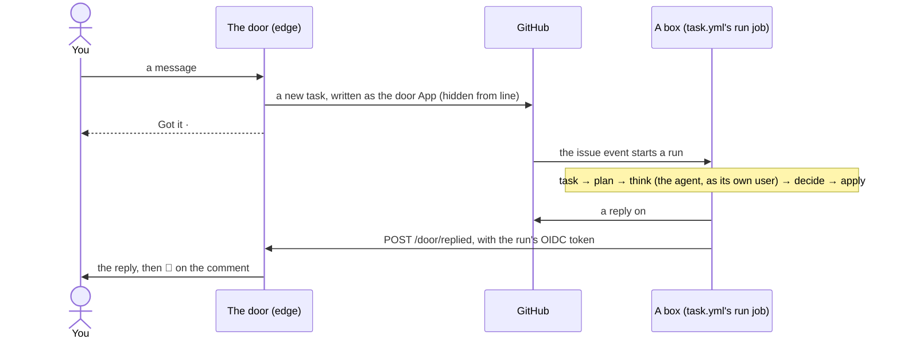

# A tour of Shipify

Read this first. It follows three pieces of real work through the code. The parts and rules on
one page: [design.md](design.md). What Shipify is as a product: [product.md](product.md). Every
doc: [the index](README.md).

## In one minute

- **What it is:** a command line (`pnpm ship`), the workflows that run it, the edge (a Cloudflare
  Worker: the door, the watch and the status page), and the projects layer (stacks, the pipeline,
  playbooks). Agents, tools, chat channels, stacks, checks and recipes plug in, each behind its
  contract ([plug-ins.md](plug-ins.md)).
- **Where state lives:** only in git, GitHub and the hosts. There's no Shipify server or database.
- **Every message lives on a task:** one issue on shipify. Your words reach it from GitHub, or from
  Telegram or the web chat through the door. Every answer is a reply on it, which the door copies
  to Telegram, and the web chat reads in place and notifies your devices of.
- **One run shape:** `task.yml`'s `run` job on a box: task → plan → think (only if needed) →
  decide → apply.
- **Any repo, on any of your accounts:** Shipify's own account through the bot; another one (your
  company's org, your user) through the small repos App its admins install, once you've added it
  (ADR 0045). A task works on one account, and its run holds only what that account may see.
- **The agent only thinks:** it runs as the slot's own Linux user, and asks for changes in
  `result.json`. The box makes them.
- **Projects:** each is its own repo, checked out under `../projects/<id>`. Your merge is the only
  way to production.

## Where things live

```
<workspace>/                  the workspace (not a repo): AGENTS.md and CLAUDE.md point at shipify/
├── shipify/                  this repo
├── projects/<id>/            each project's own repo
└── .worktrees/<id>/<name>/   extra checkouts for parallel work
```

**The run** (`cli/kernel/`, ADR 0031):

| File | What it does |
|---|---|
| `run.ts` | a run's steps, one command each: `ship run task`, `plan`, `agent`, `think`, `decide`, `apply`, `github`, `failed` |
| `snapshot.ts` | reads the task once, in the task step: the issue, its comments and who really wrote each, the status comment, and the account it works on (ADR 0045); then each repo with its own account's key |
| `decide.ts` | plain code, `snapshot → writes`: `plan()` before the agent, `afterThink()` after |
| `words.ts` | the fixed words, and where each is accepted |
| `types.ts` | the snapshot, the writes and the plan, as plain data |
| `think.ts`, `place.ts` | the agent's step: in the slot's sandbox on a box, or a plain folder off one |
| `prompt.ts`, `agent.ts` | the agent's prompt; which agent and model, and the run's times |
| `result.ts` | `result.json`, the only thing the agent writes for the box |
| `apply.ts` | the one place that changes anything: the journal, reply keys, the push from the agent's bundle |
| `keys.ts` | reply keys and call fingerprints, so a repeat is harmless |
| `route.ts` | which chats a reply goes to |
| `door.ts` | tells the door of a new reply, and fetches your files, with the run's OIDC token |
| `mcp-client.ts` | the approved tool calls, made by the box |
| `github-job.ts` | the `github` job: prepare, operate, closing PRs |
| `workflows.ts` | a push that touches workflow files: only when they match the stack |

**What the core and the edge share** (`cli/contracts/`): `shapes.ts` (`Incoming`, `Reply`,
`FileRef`, `ToolCall`, `ToolResult`), `lines.ts` (the hidden `from` and `reply` lines), `labels.ts`
(labels, reply kinds, log event names), `problems.ts` (every error, its words and its fix),
`log.ts`, `mask.ts`, `json.ts`, and `watch.ts` (what the watch reads from the record).

**Around the run:**

| Folder or file | What's in it |
|---|---|
| `cli/cli.ts` | every command (`pnpm ship help`) |
| `cli/lib/sandbox.ts` | the agent's own user per slot: its run folder, commands as that user, what it leaves |
| `cli/commands/task/` | parts the run reuses: `files.ts` (your files, files a run made), `issue.ts` (the status comment), `notebook.ts`, `plans.ts` (a merged plan's needs), `due.ts` (what's due), `deploys.ts` (a deploy's state), `lifecycle.ts` (a box's clean-up, every slot's workspace) |
| `cli/lib/` | `runs.ts` (run details), `notebook.ts`, `repeat.ts` (schedules), `status-issue.ts` (the status task), `tools.ts`, `agents.ts` and `agents/` (the adapters: `claude.ts`, `pi.ts`, `opencode.ts`, and the gate: pi's, and OpenCode's plugin), `agent-install.ts` (an agent installed on a box), `intents.ts`, `channels.ts`, `github.ts`, `accounts.ts` (your accounts, and the one a task works on: ADR 0045), `clones.ts`, `plugins/` (each plug-in kind's contract) |
| `cli/commands/` | the other commands: `plan.ts`, `project.ts`, `evolve.ts`, `workspace.ts`, `upgrade.ts`, `operate.ts`, `box.ts`, `bot.ts`, `setup.ts`, `add.ts`, `doctor.ts`, `plugins.ts` (`plugins`, `selftest`), `tools.ts`, `notebook.ts`, `watch.ts` |
| `edge/` | the edge Worker: the door (`door-in.ts`, `door-out.ts`, `files.ts`, `chat.ts`), the chat channels' adapters (`channels/`), the watch, the status page (`page.ts`, `access.ts`), the web chat (`web/`, and its page in `public/admin/chat/`, its diagram frame in `public/draw/`, its notifications' pictures in `public/note/`), and its PC-side setup in `edge/setup/` |
| `recipes/` | recipes, repeats kept as files ([recipes.md](recipes.md)); `examples/` to copy |
| `.github/workflows/` | `task.yml` (jobs `run` and `github`), `watch.yml` (due, cleanup, alert), `ci.yml` (checks, the edge's deploy, releases), `update.yml` (a new Shipify version, as a PR) |
| `intents.json` | what you can ask: six intents, the chat commands, the help, the fixed words |
| `tools.json`, `tools/` | the tools (Notion's server in `tools/notion/`, Drop's in `tools/drop/`, the MCP protocol in `tools/mcp.ts`), and Telegram's and the web chat's setup steps (`tools/web/`) |
| `executors.json` | the agents and their models, what every agent must never run, and the gateways |
| `checks/` | the scripts repeats can run |
| `.github/ISSUE_TEMPLATE/` | the two forms: Repeat (`4-repeat.yml`) and Operate (`7-operate.yml`) |
| `box/setup.sh` | makes an Ubuntu LTS machine a box: a runner and an agent user per slot |
| `playbooks/task.md` | the agent's playbook in a run |
| `stacks/`, `presets/` | where projects start |
| `plugins/_template/` | starting folders for a tool, a channel or an agent |
| `tests/` | `kernel-decide.test.ts` (every intent, fixed word and edge case), `kernel-flow.test.ts` (runs end to end), `workflows.test.ts`, `tests/edge/`, `tests/plugins/`, the golden stacks |

## 1. A message from Telegram, to its reply

You send the bot "how big is acme-site's bundle?".



1. **The door lets it in.** Telegram's adapter (`edge/src/channels/telegram.ts`) proves the
   webhook and reads it into one message; the door checks you're in `SHIPIFY_PEOPLE`. `/ping`,
   `/apps`, `/repos`, `/notebook`, `/recipes`, `/models` and `/help` it answers itself. Anything else it writes as the door App: a new task, or a
   comment on `#12` when you reply to one of its messages. The first line is a hidden
   `<!-- shipify-from {…} -->` (`cli/contracts/lines.ts`). It answers "Got it · #12".
2. **GitHub starts a run.** The issue event starts `task.yml`'s `run` job, because its sender is the
   door App (`SHIPIFY_DOOR_SLUG`). The task's group, `task-<n>`, keeps its runs in order.
3. **The task, then plan.** The job first makes a copy of Shipify with its CLI built as one file
   (`scripts/build-cli.mjs`, ADR 0051), and every step starts that. `ship run task` reads the task
   once (`snapshot.ts`), and `ship run plan` carries on from that read. `decide.ts`'s `plan()` finds no
   fixed word and no prefix, so it's a question: think, with the **talk** profile. It puts 👀 on your
   comment and says "Working" on the status comment.
4. **Think.** Plan named the task's agent (Claude Code by default), and `ship run agent` installed
   it on the box if it wasn't there (`cli/lib/agent-install.ts`). `ship run think` (`think.ts`)
   runs it through `place.ts`. On a box, that's `cli/lib/sandbox.ts`: user `shipify-agent-<k>`, a
   fresh folder `/srv/shipify-agent-<k>/run-<id>/`, an empty environment, a read-only token on
   stdin, and the agent's login on a pipe (fd 3). The prompt comes from `prompt.ts`, the agent and
   model from `agent.ts`, `executors.json` and its adapter (`cli/lib/agents/claude.ts`, `pi.ts`, `opencode.ts`),
   and the look tools speak `tools/mcp.ts`. It writes `result.json` (`result.ts`).
5. **Decide.** `ship run decide` (`afterThink()`) turns the result into one write, a reply of kind
   `answer`. Nothing to mint.
6. **Apply.** `ship run apply` (`apply.ts`) posts the reply. Its first line is a hidden
   `<!-- shipify-reply {…} -->`: its kind, its key (`keys.ts`) and the chats to copy it to
   (`route.ts`). Run details close it (`cli/lib/runs.ts`). Then `door.ts` calls
   `POST /door/replied` with the run's OIDC token, as soon as the reply is written; the status
   comment comes last.
7. **The door copies it.** It checks the token (shipify's `main`, `task.yml` or `watch.yml`), reads
   the comment, sends it to your chat, and adds 🚀. A reply with no 🚀 after 2 minutes gets one
   short notice from the watch, with its link; nothing is sent twice.

**Carrying on:** reply to the bot's message, or comment on the task. A plain answer like this one
stays (`ship run stay`, `stay.ts`, ADR 0057): for a few quiet minutes the same job reads the task
every 2 s and answers your next words itself, in the same agent session, while the `staying` label
keeps `task.yml` from starting another run. After it, the next run reads only what came after the
cursor.

**Other paths:** `remember: …` writes a note with no agent. A fixed word does its one thing
(`words.ts`). Calls the agent proposes are listed for your Yes (a chat's tap, or `yes` on GitHub), then made by
`mcp-client.ts` with no agent. When your words to a talk run ask for a change to a project, a second
run follows, with the **work** profile; a question gets an answer, and what it would change.

## 2. A change to an app, to Live

You write `acme-site: bigger margins`.

1. **Plan:** the change intent, so think with the **work** profile on acme-site.
2. **Think:** the agent gets its own clone of acme-site, on branch `work`; `think.ts` merges `main`
   in first and notes any conflict. The agent edits, commits, runs its tests, and asks for a PR of
   kind `closes`. Then `think.ts` runs the box's checks as the agent's user (`ship pr --check`, then
   `make verify`). If they fail, the agent gets one round in the same session to fix them. Then
   `think.ts` takes the commits back as a git bundle, even when the checks still fail: decide then
   keeps them on the task's branch with no PR.
3. **Decide:** a push write. It outputs `repo=acme-site`, and `workflows=write` only when the
   workflow files match what the stack renders (`workflows.ts`).
4. **Mint:** a write token for acme-site alone.
5. **Apply:** fetches the bundle into its own clone (hooks off), scans it for secrets, pushes
   `task/<n>-…`, and opens the PR with `Closes`. The reply, kind `needs-you`, carries the PR's link.
6. **You steer:** "a bit less" starts the next run on the same branch and PR. `preview` (GitHub
   only) asks the pipeline for a link. Nothing follows its checks: you look, and ask (ADR 0046).
7. **You merge:** the project's own pipeline (`ship.yml`) checks once, deploys, checks `/health`
   (rolling back on failure), tags, and marks the commit `shipify/main`. The PR's `Closes` line
   closes the task.
8. **Live:** that close's run follows the deploy itself (`followDeploy` in `deploys.ts`, before
   decide): it reads the commit's mark every 15 seconds and replies "**Live:** acme-site at <link>"
   (kind `live`) as soon as it's there, or says the deploy failed, or that it never showed up after
   30 minutes. A staging release and a new project's first deploy have no event of their own: they
   are labelled `deploying`, the watch rings `watch:due`, and `ship watch due`
   (`cli/commands/task/due.ts`) starts the task's run once the pipeline has said.

**A big change** gets a doc PR first (kind `part-of`, no `Closes`). After your merge, `go` on
GitHub starts the build. **In a terminal,** the same change is a branch, `make verify`,
`ship version <p>` and `ship pr <p> --yes` ([process.md](process.md)).

## 3. A new app

You write `new: a tip calculator`.

1. **The plan:** a work run on shipify. The agent writes `plans/<id>.plan.md`
   (`playbooks/plan-app.md`, checked by `ship plan check`) and asks for a `part-of` PR. Apply opens
   it, and replies `needs-you`.
2. **You merge it.** The push to `main` touches `plans/`, so `task.yml` runs `ship task plans`. That
   starts the task's `github` job.
3. **Prepare,** on GitHub's machines: `ship run github` makes the repo, its settings, variables and
   secrets (`github-job.ts`, `cli/commands/task/plans.ts`). A missing key stops it and is named;
   `publish` (or `go`, from GitHub or a chat) starts it again. Then it dispatches the build.
4. **The build:** a work run in a clone of the new, empty repo. The agent follows
   `playbooks/build-app.md` from the stack's files, runs `make verify`, and asks for a PR of kind
   `publish`. Apply makes the first push to the new repo's `main`, with a token for that one repo.
5. **Live:** the pipeline's first run deploys v1.0.0, and the watch follows it as in a change.

## The watch and the box

- **The watch** (in the edge) checks every 5 minutes: repeats that are due, deploys to follow,
  stuck tasks, replies to resend, and boxes, apps and Telegram's webhook. A stuck task is marked
  Stopped, never started again (your `continue` does, ADR 0042); `watch.yml` starts when it adds a
  `watch:` label to the status task. It never needs Actions write ([watch.md](watch.md)).
- **A due run** (`ship watch due`) starts each due task's own run, keeps recipes and their tasks in
  step, keeps "Coming up" on the status task, and starts each box's weekly clean-up
  (`ship watch cleanup <box>`).
- **A box** runs what the queue hands it. Only slots labelled `sandbox` take `run` jobs; `box add`
  adds that label once the sandbox checks out ([box-setup.md](box-setup.md)).

## Where everything is remembered

| What | Where |
|---|---|
| a task's state | its status comment: the intent, the project, the model, the cursor, what's pending, the journal, the runs table |
| what a run did | its reply's run details, the runs table, and the run's log in Actions |
| what you approved | merged PRs, and your `yes` comments |
| repeats | each one's status comment; "Coming up" on the status task |
| what Shipify remembers about you | the notebook: issues labelled `notebook`, a page per topic |
| files the run made | shipify's `shipify-files` branch |
| a project's facts, and what shipped | its `shipify.json`; tags, Releases, `CHANGELOG.md` |
| the boxes | GitHub runners on shipify (`ship box list`); each box's health on the status task |
| secrets | GitHub secrets, the edge's Worker secrets, and this PC's credentials file. Never on a box ([security.md](security.md)) |

## Everyday commands

Every command, with its flags: [cli.md](cli.md).

| You want | Run |
|---|---|
| everything's OK? | `pnpm ship selftest` · `pnpm ship doctor` · `pnpm ship box list` |
| set up, or what's missing | `pnpm ship setup` |
| a plug-in (Notion, Drop, Telegram, the web chat) | `pnpm ship add <name>` · `pnpm ship remove <name>` |
| the door | `pnpm ship door setup` · `pnpm ship door check` |
| the status page | `pnpm ship door page`, then `/admin/status` at the edge's address (`shipify.<your workers.dev name>.workers.dev`, or `shipify.<APPS_DOMAIN>` with your domain) |
| the web chat | `pnpm ship add webchat`, then `<the edge>/admin/chat/` |
| a project's state | `pnpm ship status <id>` · `pnpm ship list` |
| a change from a terminal | branch → `make verify` → `pnpm ship version <p>` → `pnpm ship pr <p> --yes` |
| catch a branch up with main | `pnpm ship refresh <p>` |
| a new stack version | `pnpm ship upgrade <p> --yes`, then `pnpm ship pr <p> --yes` |
| undo production | `pnpm ship rollback <id> [--to vX.Y.Z] --yes` |
| take an app offline, or back | `pnpm ship down <id> --yes` · `pnpm ship up <id> --yes` |

Something's off? [troubleshooting.md](troubleshooting.md).
