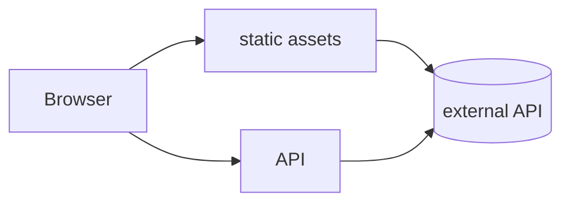

# {{TITLE}}

<!-- One page. Delete any section marked (if …) that doesn't apply. Don't restate platform
     defaults (guides/architecture.md) or conventions in AGENTS.md; link to them instead. `ship plan
     check` says which sections the chosen stack requires. -->

## Goal

[NEEDS CLARIFICATION: who it's for and the one job it does, in 2–3 lines]

## Out of scope

- [NEEDS CLARIFICATION: what this app will not do]

## Stories

<!-- 1–4 stories, highest priority first. Each must be testable on its own; shipping only P1 is a
     working app. Criteria use EARS: "WHEN <trigger>, THE APP SHALL <result>". -->

- **US1 (P1): [NEEDS CLARIFICATION: title]**. As a …, I want …, so that …
  - AC1.1 WHEN … THE APP SHALL …

## Open questions

None.

## UI

<!-- (if the app has screens) Design brief: guides/design-brief.md. -->

- **Main screen:** what it shows and its one primary action.
- **States:** empty, loading, error.
- **Mobile:** works at 360px. **Offline:** not needed. **Installable:** no.

## Hosting

<!-- (if the stack is custom-app or custom-package) How this project's make targets work: language
     and tools, where it runs, how `make deploy` deploys a commit to production (and staging), the
     URLs and health path, secret names, and what it costs. -->

## Design

<!-- Architecture: every app. The rest: if the app has server code beyond /health. Keep it to what
     a reviewer needs. -->

### Architecture

<!-- A context or container view (C4 levels 1–2): who uses it, what you deploy, what it calls.
     Add a sequenceDiagram for a flow that matters. -->

### Data

<!-- What it keeps, where, and why there. Kept on Cloudflare: the front matter's `options` (kv for
     key-value, d1 for SQL tables), with each table or key shape here, the free limits it stays
     within, and what a rollback does to it (stacks/_cloudflare/storage.md). -->
None. Static assets only.

### API

- `GET /api/…` → `{ … }`

### Failure modes

- When <dependency> fails, the user sees …

### Limits

- The host's limits that matter here (the default stacks: 100k Worker requests/day, 10 ms CPU, 50
  subrequests per request on Cloudflare's free plan).

## Tasks

<!-- Each task ends green (`make verify`) and names the criteria it proves. -->

- [ ] T1 [US1] <outcome> — files: `src/…` — verifies: AC1.1

## Docs and clean-up

<!-- Each doc this plan writes or changes (README, docs/spec.md, AGENTS.md), and anything it makes
     obsolete, removed in the same build. -->

## Verification

- `make verify` passes, including the quality bar (guides/quality-bar.md).
- Production `/health` reports the released commit.

## Complexity exceptions

<!-- (if any) | Deviation | Why | Simpler option rejected | -->
