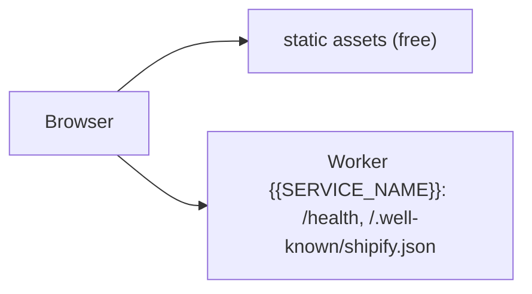

<!-- Extra rows and the default architecture for this stack's plan PRs (ship plan submit). -->
<!-- #if STAGING -->
| PR previews | on request (the label `preview`): `https://pr-<n>-{{SERVICE_NAME_STAGING}}.{{CF_WORKERS_SUBDOMAIN}}.workers.dev` (versions of the staging Worker) |
| Cost | 2 of 100 free Cloudflare Workers; no GitHub minutes for a PR without a preview, and a few per change after its merge (staging runs the browser tests) |
<!-- #endif -->
<!-- #if !STAGING -->
| PR previews | on request (the label `preview`): `https://pr-<n>-{{SERVICE_NAME}}.{{CF_WORKERS_SUBDOMAIN}}.workers.dev` (versions of the production Worker, no live traffic) |
| Cost | 1 of 100 free Cloudflare Workers; no GitHub minutes for a PR without a preview, and about 2 per change after its merge |
<!-- #endif -->

