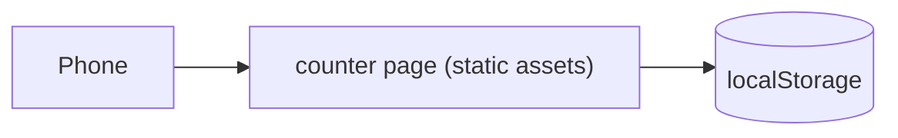

# Fixture: a small counter

## Goal

People tap a button to count things on their phone.

## Out of scope

- Accounts and sync.

## Stories

- **US1 (P1): Count taps**. As a user, I want to tap to count, so that I keep a tally.
  - AC1.1 WHEN I tap "Add one" THE APP SHALL show the count increased by one.
- **US2 (P2): Keep the count**. As a user, I want my count kept, so that reloads don't lose it.
  - AC2.1 WHEN I reload the page THE APP SHALL show the same count.

## Open questions

None.

## UI

- **Main screen:** the count and one "Add one" button.
- **States:** empty shows 0; no loading or error states.
- **Mobile:** works at 360px. **Offline:** not needed. **Installable:** no.

## Design

### Architecture

### Data

`localStorage` key `count`.

### API

None beyond `/health`.

### Failure modes

- When storage is blocked, the count works for the session and shows a note.

### Limits

- No Worker requests beyond `/health`.

## Tasks

- [ ] T1 [US1] counter UI and logic — files: `src/web/App.tsx`, `src/web/lib/count.ts` — verifies: AC1.1
- [ ] T2 [US2] persist to storage — files: `src/web/lib/count.ts` — verifies: AC2.1

## Verification

- `pnpm verify` passes.
